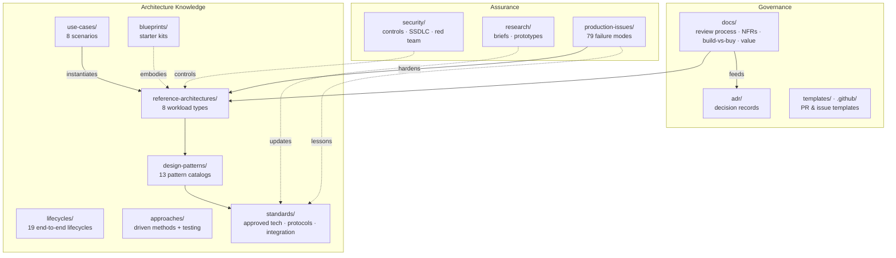

# Enterprise AI Reference Architecture

[](LICENSE)
[](docs/README.md)
[](standards/README.md)
[](CONTRIBUTING.md)

A complete, vendor-neutral **architecture knowledge base for enterprise AI/ML**: reference architectures, technology standards, design patterns, blueprints, security controls, and the governance processes that keep them true — from prototype to production.

> **The premise:** central architecture does not scale by reviewing everything. It scales by publishing standards, checklists, and blueprints that engineering teams apply independently — while central architects focus on high-risk and novel designs.

---

## Table of Contents

- [What's inside](#whats-inside)
- [Who this is for](#who-this-is-for)- [Quick start](#quick-start)
- [Repository map](#repository-map)
- [The standards lifecycle](#the-standards-lifecycle)
- [Core workflows](#core-workflows)
- [Documentation catalog](#documentation-catalog)
- [Contributing](#contributing)
- [License](#license)

## What's inside

| Collection | Purpose |
|---|---|
| [`reference-architectures/`](reference-architectures/) | Canonical reference architectures per workload type (8: training, inference, RAG, agentic, fine-tuning, data agent, copilots, intelligent automation) |
| [`lifecycles/`](lifecycles/) | 19 nested end-to-end lifecycles — SDLC, ML project, MLOps, GenAI/LLMOps, RAG, agent, data, prompt, evaluation, product, model risk, operations, technology, API, experimentation, FinOps, documentation, vendor, enablement |
| [`design-patterns/`](design-patterns/) | 13 pattern catalogs — general architecture, data, ML engineering, MLOps/deployment, GenAI/prompting, RAG, agents, reliability, security, AI UX, distributed scaling, cost/FinOps, domain & business |
| [`approaches/`](approaches/) | Driven-development approaches (TDD, BDD, DDD, data, evaluation, security, contract, outcome, evidence), delivery & practice approaches, and testing strategy |
| [`use-cases/`](use-cases/) | 8 end-to-end scenarios with problem statements, pain points, workflows, tech stacks, trade-offs, metrics, and failure modes |
| [`production-issues/`](production-issues/) | 79 real production failure modes across 6 categories with fixes, prevention, and future work |
| [`standards/`](standards/) | Approved technologies, model providers, agent protocols, integration patterns, AI-assisted development |
| [`blueprints/`](blueprints/) | Starter kits for independent, compliant adoption |
| [`security/`](security/) | AI security controls (AI-1…AI-12), secure SDLC, red-team loop |
| [`research/`](research/) | Horizon-scanning briefs and time-boxed validation prototypes |
| [`adr/`](adr/) | Numbered, immutable Architecture Decision Records |
| [`docs/`](docs/) | Governance: review process, NFRs, PoC→production, lifecycle, value, modernization |

## Who this is for

- **Architects & tech leads** — designing or reviewing AI/ML systems who need canonical patterns and a defensible review process
- **Engineering teams** — starting a new AI initiative who want a compliant head start without waiting on central review
- **Governance & security partners** — aligning AI controls, SSDLC, and red-teaming with architecture practice

## Quick start

1. **Pick your workload** — find your scenario in [`reference-architectures/`](reference-architectures/) (training, inference, RAG, agentic, fine-tuning, data agent, copilots, intelligent automation)
2. **Conform or deviate** — full conformance = self-certify with the [design review checklist](docs/design-review-checklist.md); deviations = [ADR](adr/README.md) + [review](docs/architecture-review-process.md)
3. **Choose approved tech** — anything not on [`standards/approved-technologies.md`](standards/approved-technologies.md) requires [evaluation](docs/technology-evaluation-criteria.md)
4. **Ship safely** — gates from [prototype → production](docs/poc-to-production.md) with [security controls](security/ai-security-controls.md) at every phase

## Repository map



```
.
├── reference-architectures/   # Canonical designs per workload type (RA)
├── lifecycles/                # 19 lifecycles: SDLC, ML, MLOps, LLMOps, RAG, agent, data, prompt, eval...
├── design-patterns/           # 13 pattern catalogs: software, data, ML, MLOps, GenAI, agents...
├── approaches/                # Driven methods (TDD/BDD/DDD/eval) + delivery practices + testing
├── use-cases/                 # End-to-end scenarios: problem, pain, workflow, stack, trade-offs
├── production-issues/         # 79 production failure modes with fixes and future work
├── standards/                 # Approved technologies & binding standards
├── blueprints/                # Starter kits for independent adoption
├── security/                  # AI controls, secure SDLC, red-team loop
├── research/                  # Briefs + time-boxed validation prototypes
├── adr/                       # Architecture Decision Records (numbered)
├── docs/                      # Processes: review, NFRs, value, lifecycle
├── templates/                 # Review request & reusable templates
└── .github/                   # PR/issue templates, CODEOWNERS
```

## The standards lifecycle

```
Horizon scan (research) → Time-boxed prototype → Research brief
    → Evaluation score → Cross-cutting review (EA · Cloud · Data · Security)
    → Publish standard → Blueprints & checklists → Independent adoption
```

Every standard carries a status — `Proposed → Approved → Deprecated → Removed` — and nothing is deleted; deprecations keep a 12-month trail.

## Core workflows

| I want to… | Do this |
|---|---|
| Understand how work progresses end to end | Start with [lifecycles/](lifecycles/) — 19 nested lifecycles with phase/artifact matrices |
| Find a solution to a business problem | Browse [use-cases/](use-cases/) — problem statements, workflows, trade-offs |
| Debug or harden a system | Check [production-issues/](production-issues/) before designing, and add to it after incidents |
| Choose a design pattern | Browse the catalogs in [design-patterns/](design-patterns/) |
| Pick a development approach | See [driven development approaches](approaches/driven-development-approaches.md) and the [testing strategy](approaches/testing-strategy.md) |
| Start a new AI initiative | Match a [reference architecture](reference-architectures/); self-certify or request [review](docs/architecture-review-process.md) |
| Use a technology that isn't approved | Run an [evaluation](docs/technology-evaluation-criteria.md); add an ADR |
| Make a build-vs-buy call | Follow the [framework](docs/build-vs-buy-framework.md); record the outcome as an ADR |
| Take a prototype to production | Pass the five gates in [poc-to-production.md](docs/poc-to-production.md) |
| Evaluate a new/emerging technology | [Research process](research/README.md) → brief → standards update |
| Design a system of record integration | [Solution design lifecycle](docs/solution-design-lifecycle.md) + [legacy modernization](docs/legacy-modernization.md) |
| Quantify an initiative's value | [Business cases & value](docs/business-case-and-value.md) |

## Documentation catalog

| Document | Purpose |
|---|---|
| [docs/README.md](docs/README.md) | Index of all governance processes |
| [docs/architecture-review-process.md](docs/architecture-review-process.md) | Who reviews what — T0 self-cert → T3 governance |
| [docs/design-review-checklist.md](docs/design-review-checklist.md) | The review checklist (usable for self-certification) |
| [docs/non-functional-requirements.md](docs/non-functional-requirements.md) | NFR set with numbers, not adjectives |
| [docs/poc-to-production.md](docs/poc-to-production.md) | Five gated transitions to sustained operation |
| [docs/solution-design-lifecycle.md](docs/solution-design-lifecycle.md) | Discovery → design → diligence → deployment → expansion |
| [docs/technology-evaluation-criteria.md](docs/technology-evaluation-criteria.md) | Weighted scoring rubric (security = pass/fail gate) |
| [docs/build-vs-buy-framework.md](docs/build-vs-buy-framework.md) | Evidence-based build-vs-buy decisions |
| [docs/business-case-and-value.md](docs/business-case-and-value.md) | Opportunity discovery, ROI, KPIs, kill criteria |
| [docs/legacy-modernization.md](docs/legacy-modernization.md) | Incremental AI on existing systems |
| [security/README.md](security/README.md) | Controls, SSDLC, red-team integration |
| [standards/README.md](standards/README.md) | Approved technologies & binding standards |
| [research/README.md](research/README.md) | Horizon scanning & validation prototypes |
| [lifecycles/README.md](lifecycles/README.md) | All end-to-end lifecycles and how they nest |
| [design-patterns/README.md](design-patterns/README.md) | Pattern catalog index across all categories |
| [approaches/README.md](approaches/README.md) | Driven-development approaches and testing strategy |
| [use-cases/README.md](use-cases/README.md) | End-to-end scenarios with workflows and trade-offs |
| [production-issues/README.md](production-issues/README.md) | Production failure library with fixes and future work |
| [adr/README.md](adr/README.md) | Architecture Decision Records |

## Contributing

Read [CONTRIBUTING.md](CONTRIBUTING.md) — it defines change types, required reviewers, naming conventions, and the deprecation rule. Standards and reference architecture changes require cross-cutting review before adoption. Please also read our [Code of Conduct](CODE_OF_CONDUCT.md).

## License

MIT — see [LICENSE](LICENSE).
