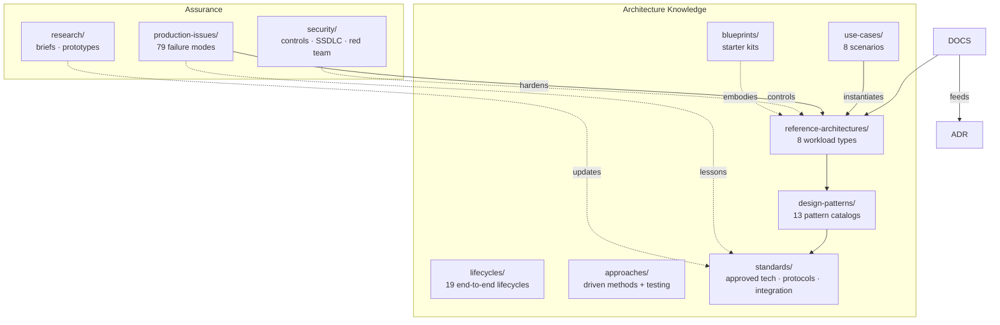

# Enterprise AI Reference Architecture


[](LICENSE)
[](docs/README.md)
[](standards/README.md)
[](CONTRIBUTING.md)
[](https://github.com/MrKyaw/Enterprise-AI-Reference-Architecture/stargazers)
[](https://github.com/MrKyaw/Enterprise-AI-Reference-Architecture/dependabot)

---

## 📋 About this repository

This repository is a **complete, vendor-neutral architecture knowledge base for enterprise AI/ML**. It exists to solve the scaling problem: instead of central architecture reviewing every AI initiative, we publish standards, checklists, and blueprints that engineering teams apply independently — while central architects focus on high-risk and novel designs.

### Purpose
Provide canonical reference architectures, technology standards, design patterns, and governance processes for AI/ML workloads (training, inference, RAG, agentic, fine-tuning, and more).

### Scope
Covers the full software development lifecycle — from discovery and design through deployment, operation, and retirement — with nested lifecycles for ML projects, MLOps, GenAI systems, RAG, agents, data pipelines, and more.

### Key deliverables (version 2.0)
- **19 end-to-end lifecycles** with phase/artifact/exit-gate matrices
- **13 pattern catalogs** across software, data, ML, MLOps, GenAI, RAG, agents, reliability, security, domain & business, AI UX, distributed scaling, cost/FinOps
- **8 end-to-end use cases** with problem statements, pain points, workflows, tech stacks, trade-offs, metrics, and failure modes
- **79 real production failure modes** across 6 categories with fixes, prevention, and future work
- **5 driven-development approaches** + testing strategy (TDD, BDD, DDD, data-, evaluation-, security-, contract-, outcome-driven)
- **8 reference architectures** for core AI workload types
- **12 AI security controls** with secure SDLC and red-team integration loop
- **Architecture Decision Records** (ADRs) for immutable governance

### Governance model
- Status-driven (`Proposed → Approved → Deprecated → Removed`)
- Cross-cutting review required for standards changes
- Deprecation retention of 12 months
- Enablement through blueprints and starter kits

### Related resources
- [Documentation catalog](docs/README.md) — all governance processes
- [Production issues library](production-issues/README.md) — failure modes with fixes
- [Research briefs](research/README.md) — horizon scanning and validation prototypes
- [Architecture Decision Records](adr/README.md) — immutable governance

### Recommended GitHub Topics
To make this repository discoverable, add these via **Settings → Manage repository → Topics**:
```
ai-governance
ai-architecture
reference-architectures
llm
mlops
rag
agents
ai-security
code-of-conduct
mit-license
architecture-patterns
enterprise-ai
data-engineering
devops
```

---

## 📦 Repository structure



```
.
├── reference-architectures/   # Canonical designs per workload type (8 RA)
├── lifecycles/                # 19 nested lifecycles: SDLC, ML, MLOps, LLMOps...
├── design-patterns/           # 13 pattern catalogs: software, data, ML, MLOps...
├── approaches/                # Driven methods + delivery + testing strategy
├── use-cases/                 # 8 end-to-end scenarios with full detail
├── production-issues/         # 79+ production failure modes
├── standards/                 # Approved technologies & binding standards
├── blueprints/                # Starter kits for independent adoption
├── security/                  # AI controls, secure SDLC, red-team loop
├── research/                  # Briefs + time-boxed validation prototypes
├── adr/                       # Architecture Decision Records (numbered)
├── docs/                      # Processes: review, NFRs, value, lifecycle
├── templates/                 # Review request & reusable templates
└── .github/                   # PR/issue templates, CODEOWNERS, repo metadata
```

---

## 🚀 Quick start

1. **Pick your workload** — find your scenario in [`reference-architectures/`](reference-architectures/) (8: training, inference, RAG, agentic, fine-tuning, data agent, copilots, intelligent automation)
2. **Conform or deviate** — full conformance = self-certify with the [design review checklist](docs/design-review-checklist.md); deviations = [ADR](adr/README.md) + [review](docs/architecture-review-process.md)
3. **Choose approved tech** — anything not on [`standards/approved-technologies.md`](standards/approved-technologies.md) requires [evaluation](docs/technology-evaluation-criteria.md)
4. **Ship safely** — gates from [prototype → production](docs/poc-to-production.md) with [security controls](security/ai-security-controls.md) at every phase

---

## 🏗️ Core content catalogs

| Collection | Items | Purpose |
|---|---|---|
| [lifecycles/](lifecycles/README.md) | 19 end-to-end lifecycles | Phase/artifact/exit-gate matrices, nesting diagram |
| [design-patterns/](design-patterns/README.md) | 13 pattern catalogs | Catalogs with intent/applicability/pitfalls + expanded treatments |
| [approaches/](approaches/README.md) | 5 driven + 3 delivery + testing strategy | TDD/BDD/DDD/data/evaluation/security/contract/outcome/evidence |
| [use-cases/](use-cases/README.md) | 8 scenarios | Problem statements, pain points, workflows, tech stacks, trade-offs, metrics, failure modes |
| [production-issues/](production-issues/README.md) | 79+ failure modes | Symptom → root cause → impact → fix → prevention → future work |
| [standards/](standards/README.md) | Approved tech + protocols | Technologies, model providers, agent protocols, integration patterns |
| [blueprints/](blueprints/README.md) | Starter kits | Scaffolded projects with IaC, guardrails, PR checklists |

---

## 🛠️ Core workflows

| I want to… | Do this |
|---|---|
| Understand how work progresses end to end | Start with [lifecycles/](lifecycles/) — 19 nested lifecycles with phase/artifact matrices |
| Find a solution to a business problem | Browse [use-cases/](use-cases/) — problem statements, workflows, trade-offs |
| Debug or harden a system | Check [production-issues/](production-issues/) before designing, and add to it after incidents |
| Select a design pattern | Browse the catalogs in [design-patterns/](design-patterns/) |
| Pick a development approach | See [driven development approaches](approaches/driven-development-approaches.md) and the [testing strategy](approaches/testing-strategy.md) |
| Start a new AI initiative | Match a [reference architecture](reference-architectures/); self-certify or request [review](docs/architecture-review-process.md) |
| Use a technology that isn't approved | Run an [evaluation](docs/technology-evaluation-criteria.md); add an ADR |
| Make a build-vs-buy call | Follow the [framework](docs/build-vs-buy-framework.md); record the outcome as an ADR |
| Take a prototype to production | Pass the five gates in [poc-to-production.md](docs/poc-to-production.md) |
| Evaluate a new/emerging technology | [Research process](research/README.md) → brief → standards update |
| Design a system of record integration | [Solution design lifecycle](docs/solution-design-lifecycle.md) + [legacy modernization](docs/legacy-modernization.md) |
| Quantify an initiative's value | [Business cases & value](docs/business-case-and-value.md) |

---

## 📊 Lifecycle overview (19 total)

| # | Lifecycle | Focus |
|---|---|---|
| 1 | Software development lifecycle | SDLC with AI extensions |
| 2 | ML project lifecycle | CRISP-ML(Q) style with quality gates |
| 3 | MLOps lifecycle | CI/CD/CT pipelines, registry, monitoring |
| 4 | GenAI/LLMOps lifecycle | Prompt-to-production with guardrails |
| 5 | RAG lifecycle | Corpus → ingest → embed → retrieve → generate |
| 6 | Agent lifecycle (AgentOps) | Capability → tool → memory → safety → operate |
| 6 | Data lifecycle | Acquire → store → transform → serve → archive → delete |
| 7 | Prompt lifecycle | Author → version → evaluate → deploy → retire |
| 8 | Evaluation lifecycle | Define success → curate datasets → harness → gate → monitor |
| 9 | Product lifecycle | Ideation → discovery → business case → delivery → value → sunset |
| 10 | Model risk lifecycle | Risk tiered governance, assessment, approval |
| 11 | Operations & incident lifecycle | Detect → triage → mitigate → resolve → postmortem |
| 12 | Technology lifecycle | Horizon scan → trial → adopt → hold → deprecate → remove |
| 12 | API lifecycle | Design → publish → version → observe → deprecate |
| 12 | Experimentation lifecycle | Hypothesis → design → run → analyze → decide |
| 12 | FinOps cost lifecycle | Forecast → attribute → optimize → govern |
| 12 | Documentation-knowledge lifecycle | Author → review → publish → maintain → retire |
| 12 | Vendor-third-party lifecycle | Assess → contract → integrate → manage → exit |
| 12 | Enablement-adoption lifecycle | Assess → build → enable → sustain → refresh |

---

## 📚 Core content deep dive

### Lifecycles (19 detailed documents)
Each lifecycle includes: phase-by-phase activities, required artifacts, exit gates, AI-specific considerations, anti-patterns, and a phase/artifact completeness matrix.

### Design patterns (13 catalogs)
Each catalog includes: pattern intent, when to use it, watch-outs, and anti-patterns. Expanded treatments include llm-gateway, human-in-the-loop-approval, evaluation-in-ci, architecture-as-code, and semantic-layer-grounding.

### Driven development approaches
- **Test-driven development (TDD)** — red/green/refactor; AI adaptation: test deterministic code, evaluate non-deterministic
- **Behavior-driven development (BDD)** — Given/When/Then scenarios; AI adaptation: business properties over exact strings
- **Acceptance-Test-Driven Development (ATDD)** — collaborative acceptance criteria; AI adaptation: refusal behavior, citation presence, escalation
- **Domain-Driven Design (DDD)** — bounded contexts, ubiquitous language; AI adaptation: AI in a bounded context with an owning team
- **Data-Driven Development** — metrics and baselines before change; AI adaptation: applies to model choice, prompt changes, retrieval settings
- **Evaluation-Driven Development (EDD)** — the AI analogue of TDD; no AI behavior change ships without evaluation gate
- **Prompt-Driven Development** — iterate primarily through prompt/context design
- **Retrieval-Driven Development** — for knowledge tasks, drive improvement through retrieval quality first
- **Security-Driven Development / DevSecOps** — security embedded in every phase
- **API-First / Contract-First / Spec-First Development** — define interface before implementing
- **Documentation-Driven Development** — write docs as part of the change
- **Outcome-Driven / Value-Driven Development** — optimize for business outcome, not deliverable
- **Evidence-Driven Architecture** — major decisions justified by prototype results

### Use cases (8 detailed scenarios)
Each use case includes: problem statement, pain points, users & stakeholders, workflow (Mermaid), tech stack (layers), trade-offs table, success metrics, failure modes & mitigations, related artifacts, and future work.

### Production issues (79+ cataloged)
Each issue includes: symptom, root cause, impact, fix, prevention (structural control/pattern), and future work (honest open problems). Categories: quality & hallucination, retrieval & data, cost & latency, security & injection, agents & tools, platform operations & lifecycle.

### Standards (binding + evolving)
- Approved technologies, model providers, agent protocols
- Integration patterns, AI-assisted development guidelines
- Model provider standards, security controls

### Blueprints (starter kits)
Scaffolded project templates with:
- Working skeleton code with approved stack wired up
- Infrastructure-as-code baseline deployment
- Guardrails pre-wired (gateway client, logging with PII redaction, eval-in-CI setup)
- Pre-filled design review checklist
- README quickstart (clone to first deployment < 1 hour)

---

## 📊 Metrics & outcomes framework

Every AI initiative should measure against this framework:

| Outcome area | Metric | Baseline | Target | Source |
|---|---|---|---|---|
| Quality | Faithfulness, citation correctness | — | ≥ 0.85 human-verified | Evaluation lifecycle |
| Speed | Time-to-answer | — | ≤ 3s | Use cases |
| Cost | Cost per outcome | — | Within envelope | FinOps lifecycle |
| Adoption | Weekly active usage | — | ↑ | Use cases |
| Trust | User trust score | — | ↑ | Surveys/feedback |
| Security | Guardrail blocks | — | → 0 incidents | Security controls |
| Drift | Quality decay over time | — | Detected < 30 days | MLOps lifecycle |

---

## 📬 Contributing

Read [CONTRIBUTING.md](CONTRIBUTING.md) — it defines change types, required reviewers, naming conventions, and the deprecation rule. Standards and reference architecture changes require cross-cutting review before adoption. Please also read our [Code of Conduct](CODE_OF_CONDUCT.md).

---

## 📄 License

MIT — see [LICENSE](LICENSE).

---

## 📈 Version history

| Version | Date | Changes |
|---|---|---|
| 0.1.0 | 2026-10-17 | Initial structure: 5 reference architectures |
| 0.2.0 | 2026-10-17 | Added lifecycles, standards, governance |
| 0.3.0 | 2026-10-17 | Expanded patterns, approaches, testing |
| 0.4.0 | 2026-10-19 | +79 production issues, 8 use cases, full audit |

---
*This repository is maintained by the Enterprise AI Architecture team. For questions, open a discussion or contact the architecture team.*

---


## 📚 Domain coverage (22 / 22)

This repository now covers all 22 critical AI/ML architecture domains:

| Domain | Status | Reference |
|---|---|---|
| Software | ✅ Covered | SDLC + software design patterns |
| Algorithms | ✅ Covered | ML engineering patterns |
| Integration | ✅ Covered | Integration patterns + API lifecycle |
| Statistics | ✅ Covered | Embedded in ML/project lifecycles |
| Machine Learning | ✅ Covered | ML project lifecycle + MLOps |
| DevOps | ✅ Covered | MLOps CI/CD pipelines + blueprints |
| Data Engineering | ✅ Covered | Data lifecycle (ingest → serve → archive) |
| Data Science | ✅ Covered | ML project lifecycle + domain model adaptation |
| ML Operations | ✅ Covered | Dedicated MLOps lifecycle |
| LLM | ✅ Covered | Inference reference architecture |
| GenAI | ✅ Covered | GenAI/LLMOps lifecycle |
| LLMOps | ✅ Covered | Dedicated lifecycle |
| Agentic AI/Multi-Agents | ✅ Covered | Agent lifecycle + agentic process automation |
| Observability | ✅ Covered | Stage-decomposed tracing + multiple lifecycles |
| Evals | ✅ Covered | Evaluation lifecycle + evaluation-in-CI pattern |
| Edge AI | ✅ Covered | Edge AI lifecycle + quantization patterns |
| Quantum Computing | ✅ Covered | Quantum computing lifecycle + quantum patterns |
| Cyber Security | ✅ Covered | AI security controls + secure SDLC |
| LLM Inference | ✅ Covered | Inference RA + inference-starter-kit |
| Agent Factory | ✅ Covered | Agent factory lifecycle + standardized scaffolds |
| Physical AI | ✅ Covered | Physical AI lifecycle + sim-to-real transfer |
| Embodied AI | ✅ Covered | Embodied AI lifecycle + sensorimotor learning |

*Last updated: 2026-10-19**Generated from `main` branch. Last updated: 2026-10-19.*

---


---

---

## 📚 Architect Career Competency Framework & Resources

A single, link-rich hub for architects at every level — the full competency framework **plus** every resource needed to close each gap.

👉 **[View the Complete Resource Hub →](resources/README.md)**

**Framework**
- 🎯 **12 architect roles** with essential knowledge & hands-on skills
- 🧠 **6 core knowledge domains** — system design, software engineering, cloud/ops, data/integration, security, business/leadership
- 💻 **11 hands-on capabilities** with expected evidence and a practice lab for each
- 🤖 **12 AI specialization domains** — classical ML, deep learning, foundation models, self-supervised, multimodal, RAG, agentic AI, evaluation, security, MLOps/LLMOps, economics, governance
- 📋 **7 architecture artifacts** with templates and tooling (ADR, C4, sequence, threat model, NFR, benchmark, roadmap)
- 📈 **6 seniority levels** from Senior Engineer to Chief/Distinguished Architect

**Resources (all in one place)**
- 📚 **40+ books**, 25+ YouTube channels, 15+ course platforms
- 🎓 **Certifications** mapped per role (AWS, Azure, GCP, CKA, CISSP, TOGAF, Databricks…)
- 📄 **Official docs & standards** (CNCF, OWASP, NIST AI RMF, ISO 42001, TOGAF, C4, arc42)
- 📑 **14 foundational papers** (Transformers, LoRA/QLoRA, RAG, ReAct, DPO, CLIP, JEPA, MCP)
- 🎙️ **Newsletters, podcasts, communities**
- 🧰 **60+ tools** by domain (IaC, observability, vector DBs, model serving, evals, AI gateways)
- 🧪 **14 hands-on labs**, plus **12 role-based learning paths** and a **90-day plan**

---

⭐ Star this repo if you find it useful!

[Report Bug](.github/ISSUE_TEMPLATE/bug_report.yml) · 
[Request Feature](.github/ISSUE_TEMPLATE/feature_request.yml) · 
[Ask Question](.github/ISSUE_TEMPLATE/question.yml)

*Generated from `main` branch. Last updated: 2026-10-19*