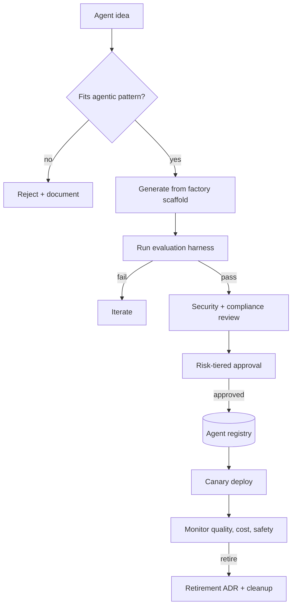

# Agent Factory Starter Kit

**Status:** Scaffolded · **Reference architecture:** [Agentic (factory profile)](../../reference-architectures/agentic/README.md) · **Owner:** platform engineering · **Last reviewed:** 2026-10-21

> **Implementation boundary:** architecture diagrams and pipeline steps describe intended behavior. The shipped pipeline is a stub; callers are not authenticated, request `tenant_id` is caller-supplied, and regex screening/redaction is illustrative. Implement identity, authorization, workload logic, evaluation, and operational controls before exposing the service. Use synthetic or explicitly authorized data. A copied `.env` file is not loaded automatically.

## What it is

A factory template for producing governed agents at speed: standardized scaffold, evaluation harness, certification gate, registry entry, and retirement record.

## When to use it

Use when more than a handful of agents will be built and ad-hoc construction has become an audit and security problem.

## Architecture



## What's in the box

| Path | Purpose |
|---|---|
| `src/main.py` | FastAPI service: health, input screening, run endpoint |
| `src/pipeline.py` | The pipeline stub — replace this with the real implementation |
| `src/guardrails.py` | Local input screening and PII redaction (defense in depth) |
| `tests/test_smoke.py` | Smoke tests wired for CI |
| `infra/` | Terraform: artifact bucket, KMS key, log group |
| `Dockerfile` | Non-root container image |
| `.github/PULL_REQUEST_TEMPLATE.md` | Pre-filled production checklist |
| `.env.example` | Configuration contract — never commit real values |

## Quickstart

```bash
cd blueprints/agent-factory-starter-kit
cp .env.example .env
python -m venv .venv && source .venv/bin/activate
pip install -r requirements.txt
PYTHONPATH=src uvicorn main:app --reload --port 8080
```

```bash
curl -s localhost:8080/health
curl -s -X POST localhost:8080/v1/run \
  -H 'content-type: application/json' \
  -d '{"input": "smoke test", "tenant_id": "demo"}'
```

Run the tests:

```bash
PYTHONPATH=src pytest -q
```

Provision the supporting infrastructure:

```bash
cd infra
terraform init
terraform plan
```

> The service returns a `scaffold` status until you replace `run_pipeline()`.

## Pipeline steps to implement

1. Screen the idea against approved agentic patterns.
2. Generate the agent from the factory scaffold.
3. Run the shared evaluation and adversarial sets.
4. Complete security, compliance, and risk-tiered approval.
5. Register, canary deploy, monitor, and schedule retirement review.

## Tech stack (layers, not products)

| Layer | Choice | Notes |
|---|---|---|
| Scaffold | Generated skeleton with defaults | Naming, guardrails, eval, and checklist baked in |
| Registry | Immutable agent artifact + config | Version, owner, risk tier, rollback target |
| Certification | Evaluation + security + risk gate | No unregistered agent in production |
| Retirement | Scheduled review and ADR | Prevents orphan agents and credential sprawl |
| Delivery | FastAPI + uvicorn | One service shape across every kit; swap the pipeline, keep the contract |
| Observability | OpenTelemetry + structured JSON logs | Correlation ID per request; stage-decomposed traces |
| IaC | Terraform | Artifact bucket, KMS key, and log group with encryption and lifecycle rules |
| Tests | pytest + FastAPI TestClient | Smoke tests run in CI before any deployment |

## Security and guardrails

- Central credential and tool registry; no per-agent keys.
- Mandatory registry entry enforced in CI.
- Automatic expiry of unowned or unmonitored agents.
- Factory scaffold updated in the same PR as any standard change.

Authoritative controls live in [AI security controls](../../security/ai-security-controls.md) and the [secure SDLC](../../security/secure-sdlc.md). The local screen in `src/guardrails.py` is a heuristic only — it is not a security control.

## Evaluation

- Certification pass rate and time to certify.
- Fleet quality sampling and security findings.
- Agent age distribution and retirement compliance.

Wire the harness into CI using [evaluation in CI](../../design-patterns/evaluation-in-ci.md). A behavior change without an evaluation gate does not ship.

## Operations

- **SLO:** Every production agent registered, owned, and monitored.
- **Cost:** Cost per agent built and per agent operated.
- **Traces:** one correlation ID per request, stage spans around every external call.
- **Runbook:** add alert → diagnosis → mitigation before the first production deploy.

## Production checklist

- [ ] Pipeline stub replaced and covered by tests
- [ ] All model calls go through the AI gateway (no provider keys in code)
- [ ] Input screening, PII redaction, and tenant scoping verified
- [ ] Evaluation harness runs in CI with explicit thresholds
- [ ] Dashboards and alerts created; correlation IDs visible end to end
- [ ] Terraform applied to a non-production account; state is remote and locked
- [ ] Rollback and kill switch tested
- [ ] Owner, on-call rotation, and cost budget recorded in the workload registry
- [ ] Design review checklist completed or deviations recorded as an ADR

## Extension points

- Self-service agent generation with policy checks.
- Cross-agent evaluation benchmarks.
- Automated deprecation when a base model retires.

## Related

- [Reference architecture: Agentic (factory profile)](../../reference-architectures/agentic/README.md)
- Lifecycles: [Agent factory lifecycle](../../lifecycles/agent-factory-lifecycle.md) · [Agent lifecycle](../../lifecycles/agent-lifecycle.md) · [Model risk lifecycle](../../lifecycles/model-risk-lifecycle.md)
- [Blueprints catalog](../README.md)
- [Production issues](../../production-issues/README.md)
- [Design patterns](../../design-patterns/README.md)

---

*Scaffold version 1.0.0 · Generated from the blueprint factory · Update this kit in the same PR as any standard it depends on.*
