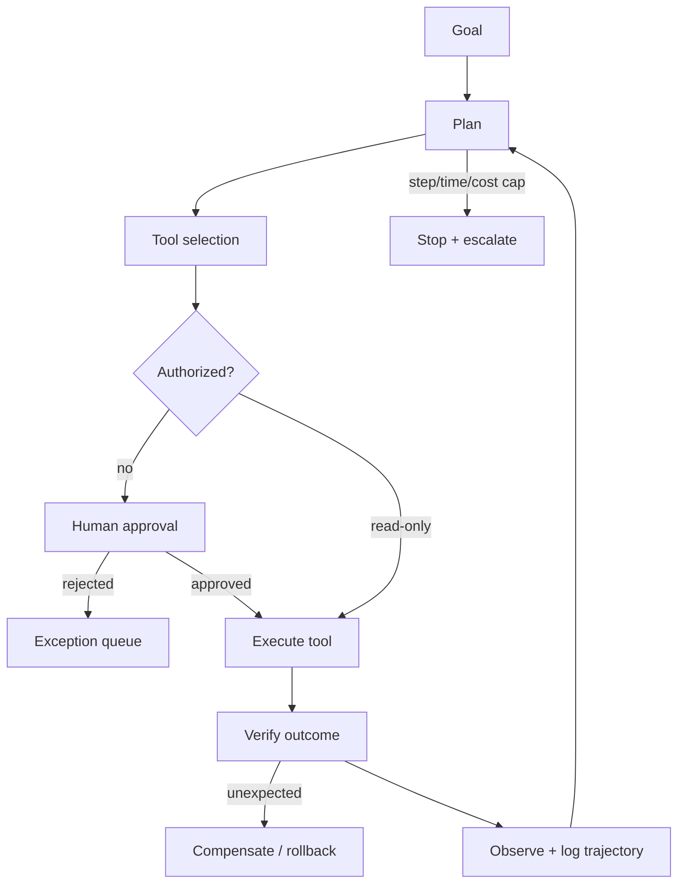

# Agent Starter Kit

**Status:** Scaffolded · **Reference architecture:** [Agentic](../../reference-architectures/agentic/README.md) · **Owner:** platform engineering · **Last reviewed:** 2026-10-21

> **Implementation boundary:** architecture diagrams and pipeline steps describe intended behavior. The shipped pipeline is a stub; callers are not authenticated, request `tenant_id` is caller-supplied, and regex screening/redaction is illustrative. Implement identity, authorization, workload logic, evaluation, and operational controls before exposing the service. Use synthetic or explicitly authorized data. A copied `.env` file is not loaded automatically.

## What it is

A bounded tool-using agent: planning, typed tool registry, authorization boundary, human approval for side effects, outcome verification, and immutable trajectory logging.

## When to use it

Use when a task needs multi-step reasoning plus actions across systems, and the blast radius can be bounded and audited.

## Architecture



## What's in the box

| Path | Purpose |
|---|---|
| `src/main.py` | FastAPI service: health, input screening, run endpoint |
| `src/pipeline.py` | The pipeline stub — replace this with the real implementation |
| `src/guardrails.py` | Local input screening and PII redaction (defense in depth) |
| `tests/test_smoke.py` | Smoke tests wired for CI |
| `infra/` | Terraform: artifact bucket, KMS key, log group |
| `Dockerfile` | Non-root container image |
| `.github/PULL_REQUEST_TEMPLATE.md` | Pre-filled production checklist |
| `.env.example` | Configuration contract — never commit real values |

## Quickstart

```bash
cd blueprints/agent-starter-kit
cp .env.example .env
python -m venv .venv && source .venv/bin/activate
pip install -r requirements.txt
PYTHONPATH=src uvicorn main:app --reload --port 8080
```

```bash
curl -s localhost:8080/health
curl -s -X POST localhost:8080/v1/run \
  -H 'content-type: application/json' \
  -d '{"input": "smoke test", "tenant_id": "demo"}'
```

Run the tests:

```bash
PYTHONPATH=src pytest -q
```

Provision the supporting infrastructure:

```bash
cd infra
terraform init
terraform plan
```

> The service returns a `scaffold` status until you replace `run_pipeline()`.

## Pipeline steps to implement

1. Turn the goal into a plan with explicit success criteria.
2. Select tools from the registry; validate arguments against the tool schema.
3. Check the authorization boundary; route side effects to human approval.
4. Execute, then verify the outcome by querying the target system.
5. Compensate on partial failure; log every step with a correlation ID.

## Tech stack (layers, not products)

| Layer | Choice | Notes |
|---|---|---|
| Runtime | Durable loop with step, time, and cost ceilings | Kill switch and bounded retries |
| Tools | Typed registry with per-tool permissions | No superuser credentials; least privilege |
| Approval | External workflow, expiry defaults to deny | Approval enforced outside the model |
| Audit | Immutable trajectory log with correlation IDs | Required for diagnosis and audit |
| Delivery | FastAPI + uvicorn | One service shape across every kit; swap the pipeline, keep the contract |
| Observability | OpenTelemetry + structured JSON logs | Correlation ID per request; stage-decomposed traces |
| IaC | Terraform | Artifact bucket, KMS key, and log group with encryption and lifecycle rules |
| Tests | pytest + FastAPI TestClient | Smoke tests run in CI before any deployment |

## Security and guardrails

- Side-effect classification for every tool; irreversible actions always gated.
- Credentials scoped per process and short-lived; never in prompts.
- Tool responses are evidence, not truth: verify before reporting success.
- Kill switch and hard ceilings on steps, wall-clock time, and spend.

Authoritative controls live in [AI security controls](../../security/ai-security-controls.md) and the [secure SDLC](../../security/secure-sdlc.md). The local screen in `src/guardrails.py` is a heuristic only — it is not a security control.

## Evaluation

- Task success on a golden trajectory set, not just final-answer accuracy.
- Authorization tests that attempt to bypass the approval gate.
- Cost and step-count distribution per task; watch for loops.

Wire the harness into CI using [evaluation in CI](../../design-patterns/evaluation-in-ci.md). A behavior change without an evaluation gate does not ship.

## Operations

- **SLO:** Every action traceable end to end; zero ungated write actions.
- **Cost:** Cap tokens and tool calls per task; alert on step-count outliers.
- **Traces:** one correlation ID per request, stage spans around every external call.
- **Runbook:** add alert → diagnosis → mitigation before the first production deploy.

## Production checklist

- [ ] Pipeline stub replaced and covered by tests
- [ ] All model calls go through the AI gateway (no provider keys in code)
- [ ] Input screening, PII redaction, and tenant scoping verified
- [ ] Evaluation harness runs in CI with explicit thresholds
- [ ] Dashboards and alerts created; correlation IDs visible end to end
- [ ] Terraform applied to a non-production account; state is remote and locked
- [ ] Rollback and kill switch tested
- [ ] Owner, on-call rotation, and cost budget recorded in the workload registry
- [ ] Design review checklist completed or deviations recorded as an ADR

## Extension points

- Sandboxed dry-run mode for high-risk tools.
- Trajectory replay for debugging and regression testing.
- Automatic compensation declarations in tool contracts.

## Related

- [Reference architecture: Agentic](../../reference-architectures/agentic/README.md)
- Lifecycles: [Agent lifecycle](../../lifecycles/agent-lifecycle.md) · [Operations & incident lifecycle](../../lifecycles/operations-incident-lifecycle.md) · [Model risk lifecycle](../../lifecycles/model-risk-lifecycle.md)
- [Blueprints catalog](../README.md)
- [Production issues](../../production-issues/README.md)
- [Design patterns](../../design-patterns/README.md)

---

*Scaffold version 1.0.0 · Generated from the blueprint factory · Update this kit in the same PR as any standard it depends on.*
