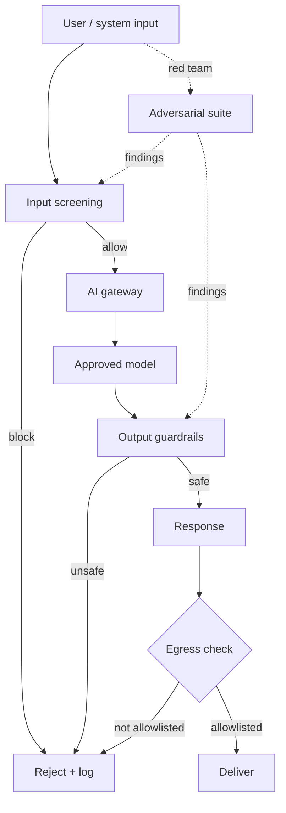

# AI Security Starter Kit

**Status:** Scaffolded · **Reference architecture:** [Cross-cutting](../../reference-architectures/README.md) · **Owner:** platform engineering · **Last reviewed:** 2026-10-21

> **Implementation boundary:** architecture diagrams and pipeline steps describe intended behavior. The shipped pipeline is a stub; callers are not authenticated, request `tenant_id` is caller-supplied, and regex screening/redaction is illustrative. Implement identity, authorization, workload logic, evaluation, and operational controls before exposing the service. Use synthetic or explicitly authorized data. A copied `.env` file is not loaded automatically.

## What it is

A security baseline for AI services: gateway-mediated model access, input and output guardrails, tool permissions, egress allowlists, redaction, and a red-team harness.

## When to use it

Use for every GenAI or agentic workload; mandatory before any external content or tool access.

## Architecture



## What's in the box

| Path | Purpose |
|---|---|
| `src/main.py` | FastAPI service: health, input screening, run endpoint |
| `src/pipeline.py` | The pipeline stub — replace this with the real implementation |
| `src/guardrails.py` | Local input screening and PII redaction (defense in depth) |
| `tests/test_smoke.py` | Smoke tests wired for CI |
| `infra/` | Terraform: artifact bucket, KMS key, log group |
| `Dockerfile` | Non-root container image |
| `.github/PULL_REQUEST_TEMPLATE.md` | Pre-filled production checklist |
| `.env.example` | Configuration contract — never commit real values |

## Quickstart

```bash
cd blueprints/ai-security-starter-kit
cp .env.example .env
python -m venv .venv && source .venv/bin/activate
pip install -r requirements.txt
PYTHONPATH=src uvicorn main:app --reload --port 8080
```

```bash
curl -s localhost:8080/health
curl -s -X POST localhost:8080/v1/run \
  -H 'content-type: application/json' \
  -d '{"input": "smoke test", "tenant_id": "demo"}'
```

Run the tests:

```bash
PYTHONPATH=src pytest -q
```

Provision the supporting infrastructure:

```bash
cd infra
terraform init
terraform plan
```

> The service returns a `scaffold` status until you replace `run_pipeline()`.

## Pipeline steps to implement

1. Route all model calls through the gateway with workload identity.
2. Screen inputs for injection and disallowed content.
3. Enforce tool permissions and egress allowlists outside the model.
4. Screen outputs for data leakage and unsafe content; fail closed.
5. Run the adversarial suite and feed findings back into controls.

## Tech stack (layers, not products)

| Layer | Choice | Notes |
|---|---|---|
| Access | AI gateway with workload identity | No provider keys in application code |
| Guardrails | Input and output screening, fail closed | Model instructions are not security controls |
| Tools | Per-tool permissions and egress allowlist | No auto-fetch of model-provided URLs |
| Red team | Adversarial suite in CI | Findings feed controls, not just a report |
| Delivery | FastAPI + uvicorn | One service shape across every kit; swap the pipeline, keep the contract |
| Observability | OpenTelemetry + structured JSON logs | Correlation ID per request; stage-decomposed traces |
| IaC | Terraform | Artifact bucket, KMS key, and log group with encryption and lifecycle rules |
| Tests | pytest + FastAPI TestClient | Smoke tests run in CI before any deployment |

## Security and guardrails

- Fail closed when a guardrail dependency is unavailable.
- Treat retrieved content as untrusted data, never instructions.
- Tenant scoping on every store, cache, and query.
- No secrets or raw PII in prompts, logs, or traces.

Authoritative controls live in [AI security controls](../../security/ai-security-controls.md) and the [secure SDLC](../../security/secure-sdlc.md). The local screen in `src/guardrails.py` is a heuristic only — it is not a security control.

## Evaluation

- Prompt-injection and data-exfiltration success rate (target zero).
- Guardrail false-positive rate and latency impact.
- Permission-denial tests for tools and tenants.

Wire the harness into CI using [evaluation in CI](../../design-patterns/evaluation-in-ci.md). A behavior change without an evaluation gate does not ship.

## Operations

- **SLO:** Zero successful injection or exfiltration in the adversarial suite.
- **Cost:** Guardrail processing cost per request; budget it explicitly.
- **Traces:** one correlation ID per request, stage spans around every external call.
- **Runbook:** add alert → diagnosis → mitigation before the first production deploy.

## Production checklist

- [ ] Pipeline stub replaced and covered by tests
- [ ] All model calls go through the AI gateway (no provider keys in code)
- [ ] Input screening, PII redaction, and tenant scoping verified
- [ ] Evaluation harness runs in CI with explicit thresholds
- [ ] Dashboards and alerts created; correlation IDs visible end to end
- [ ] Terraform applied to a non-production account; state is remote and locked
- [ ] Rollback and kill switch tested
- [ ] Owner, on-call rotation, and cost budget recorded in the workload registry
- [ ] Design review checklist completed or deviations recorded as an ADR

## Extension points

- Automated red-team generation.
- Policy-as-code checks in CI.
- Cross-tenant isolation chaos tests.

## Related

- [Reference architecture: Cross-cutting](../../reference-architectures/README.md)
- Lifecycles: [Operations & incident lifecycle](../../lifecycles/operations-incident-lifecycle.md) · [Model risk lifecycle](../../lifecycles/model-risk-lifecycle.md) · [Vendor & third-party lifecycle](../../lifecycles/vendor-third-party-lifecycle.md)
- [Blueprints catalog](../README.md)
- [Production issues](../../production-issues/README.md)
- [Design patterns](../../design-patterns/README.md)

---

*Scaffold version 1.0.0 · Generated from the blueprint factory · Update this kit in the same PR as any standard it depends on.*
