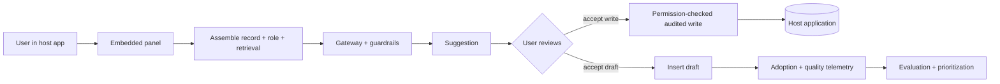

# Copilot Starter Kit

**Status:** Scaffolded · **Reference architecture:** [Copilots](../../reference-architectures/copilots/README.md) · **Owner:** platform engineering · **Last reviewed:** 2026-10-21

## What it is

An embedded assistant that works inside an existing application: record-aware context assembly, user-inherited permissions, draft-first output, audited writes, and adoption telemetry.

## When to use it

Use when users work inside a business application and leaving it to use AI costs time and creates copy-paste errors.

## Architecture



## What's in the box

| Path | Purpose |
|---|---|
| `src/main.py` | FastAPI service: health, input screening, run endpoint |
| `src/pipeline.py` | The pipeline stub — replace this with the real implementation |
| `src/guardrails.py` | Local input screening and PII redaction (defense in depth) |
| `tests/test_smoke.py` | Smoke tests wired for CI |
| `infra/` | Terraform: artifact bucket, KMS key, log group |
| `Dockerfile` | Non-root container image |
| `.github/PULL_REQUEST_TEMPLATE.md` | Pre-filled production checklist |
| `.env.example` | Configuration contract — never commit real values |

## Quickstart

```bash
cd blueprints/copilot-starter-kit
cp .env.example .env
python -m venv .venv && source .venv/bin/activate
pip install -r requirements.txt
PYTHONPATH=src uvicorn main:app --reload --port 8080
```

```bash
curl -s localhost:8080/health
curl -s -X POST localhost:8080/v1/run \
  -H 'content-type: application/json' \
  -d '{"input": "smoke test", "tenant_id": "demo"}'
```

Run the tests:

```bash
PYTHONPATH=src pytest -q
```

Provision the supporting infrastructure:

```bash
cd infra
terraform init
terraform plan
```

> The service returns a `scaffold` status until you replace `run_pipeline()`.

## Pipeline steps to implement

1. Read the current record and user role through host APIs.
2. Assemble minimal context; apply user-inherited permissions.
3. Generate a suggestion through the gateway with guardrails.
4. Let the user accept as draft or commit an explicit, audited write.
5. Emit adoption and quality events keyed to feature version.

## Tech stack (layers, not products)

| Layer | Choice | Notes |
|---|---|---|
| Surface | Native host-app extension points | Configuration first; avoid forking the host UI |
| Context | Record + governed retrieval + user permissions | Minimize: send only what the task needs |
| Writes | Separate read/write scopes, explicit commit | Draft-first; every write audited |
| Telemetry | Acceptance, edit-before-accept, task time | Feature-versioned for cohort analysis |
| Delivery | FastAPI + uvicorn | One service shape across every kit; swap the pipeline, keep the contract |
| Observability | OpenTelemetry + structured JSON logs | Correlation ID per request; stage-decomposed traces |
| IaC | Terraform | Artifact bucket, KMS key, and log group with encryption and lifecycle rules |
| Tests | pytest + FastAPI TestClient | Smoke tests run in CI before any deployment |

## Security and guardrails

- Never use a superuser copilot identity; inherit the user's permissions.
- No write without explicit user action; high-impact writes need approval.
- Context minimization and PII redaction before model calls.
- Contract tests against host-app versions to catch upgrade breakage.

Authoritative controls live in [AI security controls](../../security/ai-security-controls.md) and the [secure SDLC](../../security/secure-sdlc.md). The local screen in `src/guardrails.py` is a heuristic only — it is not a security control.

## Evaluation

- Suggestion acceptance and edit-before-accept rate per cohort.
- Task completion time against a measured baseline.
- Permission-denial tests for cross-record and cross-user access.

Wire the harness into CI using [evaluation in CI](../../design-patterns/evaluation-in-ci.md). A behavior change without an evaluation gate does not ship.

## Operations

- **SLO:** Suggestion latency inside the host app's interaction budget; zero cross-record leaks.
- **Cost:** Track cost per active user and per accepted suggestion; cap context size.
- **Traces:** one correlation ID per request, stage spans around every external call.
- **Runbook:** add alert → diagnosis → mitigation before the first production deploy.

## Production checklist

- [ ] Pipeline stub replaced and covered by tests
- [ ] All model calls go through the AI gateway (no provider keys in code)
- [ ] Input screening, PII redaction, and tenant scoping verified
- [ ] Evaluation harness runs in CI with explicit thresholds
- [ ] Dashboards and alerts created; correlation IDs visible end to end
- [ ] Terraform applied to a non-production account; state is remote and locked
- [ ] Rollback and kill switch tested
- [ ] Owner, on-call rotation, and cost budget recorded in the workload registry
- [ ] Design review checklist completed or deviations recorded as an ADR

## Extension points

- Cross-application context with explicit consent.
- Adaptive suggestion placement from acceptance patterns.
- Shared evaluation sets across similar copilots.

## Related

- [Reference architecture: Copilots](../../reference-architectures/copilots/README.md)
- Lifecycles: [Product lifecycle](../../lifecycles/product-lifecycle.md) · [Enablement & adoption lifecycle](../../lifecycles/enablement-adoption-lifecycle.md) · [Experimentation lifecycle](../../lifecycles/experimentation-lifecycle.md)
- [Blueprints catalog](../README.md)
- [Production issues](../../production-issues/README.md)
- [Design patterns](../../design-patterns/README.md)

---

*Scaffold version 1.0.0 · Generated from the blueprint factory · Update this kit in the same PR as any standard it depends on.*
