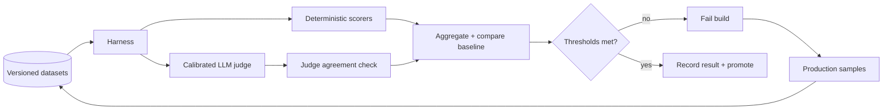

# Evaluation Starter Kit

**Status:** Scaffolded · **Reference architecture:** [Cross-cutting](../../reference-architectures/README.md) · **Owner:** platform engineering · **Last reviewed:** 2026-10-21

> **Implementation boundary:** architecture diagrams and pipeline steps describe intended behavior. The shipped pipeline is a stub; callers are not authenticated, request `tenant_id` is caller-supplied, and regex screening/redaction is illustrative. Implement identity, authorization, workload logic, evaluation, and operational controls before exposing the service. Use synthetic or explicitly authorized data. A copied `.env` file is not loaded automatically.

## What it is

An evaluation harness you can drop into any AI service: versioned datasets, deterministic scoring where possible, calibrated judges where necessary, and a CI gate with explicit thresholds.

## When to use it

Use before shipping any behavior change (model, prompt, retrieval, config) and as the gate in CI.

## Architecture



## What's in the box

| Path | Purpose |
|---|---|
| `src/main.py` | FastAPI service: health, input screening, run endpoint |
| `src/pipeline.py` | The pipeline stub — replace this with the real implementation |
| `src/guardrails.py` | Local input screening and PII redaction (defense in depth) |
| `tests/test_smoke.py` | Smoke tests wired for CI |
| `infra/` | Terraform: artifact bucket, KMS key, log group |
| `Dockerfile` | Non-root container image |
| `.github/PULL_REQUEST_TEMPLATE.md` | Pre-filled production checklist |
| `.env.example` | Configuration contract — never commit real values |

## Quickstart

```bash
cd blueprints/evaluation-starter-kit
cp .env.example .env
python -m venv .venv && source .venv/bin/activate
pip install -r requirements.txt
PYTHONPATH=src uvicorn main:app --reload --port 8080
```

```bash
curl -s localhost:8080/health
curl -s -X POST localhost:8080/v1/run \
  -H 'content-type: application/json' \
  -d '{"input": "smoke test", "tenant_id": "demo"}'
```

Run the tests:

```bash
PYTHONPATH=src pytest -q
```

Provision the supporting infrastructure:

```bash
cd infra
terraform init
terraform plan
```

> The service returns a `scaffold` status until you replace `run_pipeline()`.

## Pipeline steps to implement

1. Define success criteria and the slices that matter.
2. Curate golden, adversarial, and production-sample datasets.
3. Implement deterministic scorers; add a judge only where needed.
4. Calibrate the judge against human labels and pin its version.
5. Gate CI on explicit thresholds and report per-slice results.

## Tech stack (layers, not products)

| Layer | Choice | Notes |
|---|---|---|
| Datasets | Versioned golden, adversarial, and production samples | Never mutate a dataset in place |
| Scorers | Deterministic first, judge second | Pin judge model and prompt versions |
| CI | Explicit thresholds, fail closed | No silent skip on missing datasets |
| Reporting | Per-slice results, not just an average | Failures must be inspectable |
| Delivery | FastAPI + uvicorn | One service shape across every kit; swap the pipeline, keep the contract |
| Observability | OpenTelemetry + structured JSON logs | Correlation ID per request; stage-decomposed traces |
| IaC | Terraform | Artifact bucket, KMS key, and log group with encryption and lifecycle rules |
| Tests | pytest + FastAPI TestClient | Smoke tests run in CI before any deployment |

## Security and guardrails

- Judge outputs are advisory; human sampling validates them.
- Evaluation datasets contain no unredacted sensitive data.
- Missing datasets fail the build rather than skipping.
- Results are versioned and comparable over time.

Authoritative controls live in [AI security controls](../../security/ai-security-controls.md) and the [secure SDLC](../../security/secure-sdlc.md). The local screen in `src/guardrails.py` is a heuristic only — it is not a security control.

## Evaluation

- Scorer reliability and judge-human agreement.
- Coverage across slices: language, length, tenant, difficulty.
- Regression detection on a known-bad change.

Wire the harness into CI using [evaluation in CI](../../design-patterns/evaluation-in-ci.md). A behavior change without an evaluation gate does not ship.

## Operations

- **SLO:** Every behavior change gated; evaluation runs in CI within the build budget.
- **Cost:** Cost per evaluation run; cache deterministic scorers.
- **Traces:** one correlation ID per request, stage spans around every external call.
- **Runbook:** add alert → diagnosis → mitigation before the first production deploy.

## Production checklist

- [ ] Pipeline stub replaced and covered by tests
- [ ] All model calls go through the AI gateway (no provider keys in code)
- [ ] Input screening, PII redaction, and tenant scoping verified
- [ ] Evaluation harness runs in CI with explicit thresholds
- [ ] Dashboards and alerts created; correlation IDs visible end to end
- [ ] Terraform applied to a non-production account; state is remote and locked
- [ ] Rollback and kill switch tested
- [ ] Owner, on-call rotation, and cost budget recorded in the workload registry
- [ ] Design review checklist completed or deviations recorded as an ADR

## Extension points

- Online evaluation on sampled production traffic.
- Automatic dataset growth from user feedback.
- Cross-workload benchmark packs.

## Related

- [Reference architecture: Cross-cutting](../../reference-architectures/README.md)
- Lifecycles: [Evaluation lifecycle](../../lifecycles/evaluation-lifecycle.md) · [GenAI/LLMOps lifecycle](../../lifecycles/genai-llmops-lifecycle.md) · [Prompt lifecycle](../../lifecycles/prompt-lifecycle.md)
- [Blueprints catalog](../README.md)
- [Production issues](../../production-issues/README.md)
- [Design patterns](../../design-patterns/README.md)

---

*Scaffold version 1.0.0 · Generated from the blueprint factory · Update this kit in the same PR as any standard it depends on.*
