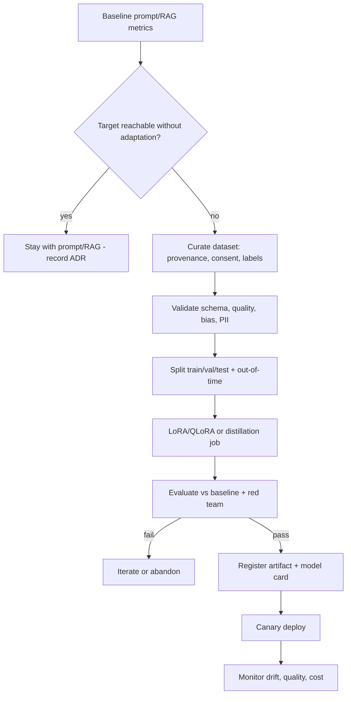

# Fine-tuning Starter Kit

**Status:** Scaffolded · **Reference architecture:** [Fine-tuning](../../reference-architectures/fine-tuning/README.md) · **Owner:** platform engineering · **Last reviewed:** 2026-10-21

> **Implementation boundary:** architecture diagrams and pipeline steps describe intended behavior. The shipped pipeline is a stub; callers are not authenticated, request `tenant_id` is caller-supplied, and regex screening/redaction is illustrative. Implement identity, authorization, workload logic, evaluation, and operational controls before exposing the service. Use synthetic or explicitly authorized data. A copied `.env` file is not loaded automatically.

## What it is

A disciplined adaptation pipeline: baseline first, curated and lawful datasets, parameter-efficient tuning, evaluation against the baseline, and registration with lineage and a model card.

## When to use it

Use when prompting and retrieval have plateaued on a narrow, high-volume task and adaptation has a measured cost or quality case.

## Architecture



## What's in the box

| Path | Purpose |
|---|---|
| `src/main.py` | FastAPI service: health, input screening, run endpoint |
| `src/pipeline.py` | The pipeline stub — replace this with the real implementation |
| `src/guardrails.py` | Local input screening and PII redaction (defense in depth) |
| `tests/test_smoke.py` | Smoke tests wired for CI |
| `infra/` | Terraform: artifact bucket, KMS key, log group |
| `Dockerfile` | Non-root container image |
| `.github/PULL_REQUEST_TEMPLATE.md` | Pre-filled production checklist |
| `.env.example` | Configuration contract — never commit real values |

## Quickstart

```bash
cd blueprints/fine-tuning-starter-kit
cp .env.example .env
python -m venv .venv && source .venv/bin/activate
pip install -r requirements.txt
PYTHONPATH=src uvicorn main:app --reload --port 8080
```

```bash
curl -s localhost:8080/health
curl -s -X POST localhost:8080/v1/run \
  -H 'content-type: application/json' \
  -d '{"input": "smoke test", "tenant_id": "demo"}'
```

Run the tests:

```bash
PYTHONPATH=src pytest -q
```

Provision the supporting infrastructure:

```bash
cd infra
terraform init
terraform plan
```

> The service returns a `scaffold` status until you replace `run_pipeline()`.

## Pipeline steps to implement

1. Record the prompting/RAG baseline on the target task.
2. Curate a dataset with provenance, consent, and a labeling guide.
3. Validate quality, bias, PII, and leakage before training.
4. Train with a parameter-efficient method; keep the base model pinned.
5. Evaluate against baseline and register only if the gate passes.

## Tech stack (layers, not products)

| Layer | Choice | Notes |
|---|---|---|
| Baseline | Prompt and RAG metrics recorded first | No adaptation without evidence of a plateau |
| Training | Parameter-efficient tuning; distillation for cost | Start cheap; measure every step |
| Registry | Immutable artifact + lineage + model card | Rollback target for every version |
| Serving | Inference RA with canary | Compare against the incumbent |
| Delivery | FastAPI + uvicorn | One service shape across every kit; swap the pipeline, keep the contract |
| Observability | OpenTelemetry + structured JSON logs | Correlation ID per request; stage-decomposed traces |
| IaC | Terraform | Artifact bucket, KMS key, and log group with encryption and lifecycle rules |
| Tests | pytest + FastAPI TestClient | Smoke tests run in CI before any deployment |

## Security and guardrails

- Lawful basis and consent checked before training begins.
- PII scanning and redaction in the dataset pipeline.
- Preserve-evaluation on general capabilities to catch forgetting.
- Model risk tier determines approval and independent validation.

Authoritative controls live in [AI security controls](../../security/ai-security-controls.md) and the [secure SDLC](../../security/secure-sdlc.md). The local screen in `src/guardrails.py` is a heuristic only — it is not a security control.

## Evaluation

- Held-out and out-of-time sets, plus subgroup analysis.
- Side-by-side baseline comparison on quality, cost, and latency.
- Red-team set for the specific task failure modes.

Wire the harness into CI using [evaluation in CI](../../design-patterns/evaluation-in-ci.md). A behavior change without an evaluation gate does not ship.

## Operations

- **SLO:** Quality at or above the agreed threshold with no safety regression.
- **Cost:** Measure total cost of ownership, including retraining and migration toil.
- **Traces:** one correlation ID per request, stage spans around every external call.
- **Runbook:** add alert → diagnosis → mitigation before the first production deploy.

## Production checklist

- [ ] Pipeline stub replaced and covered by tests
- [ ] All model calls go through the AI gateway (no provider keys in code)
- [ ] Input screening, PII redaction, and tenant scoping verified
- [ ] Evaluation harness runs in CI with explicit thresholds
- [ ] Dashboards and alerts created; correlation IDs visible end to end
- [ ] Terraform applied to a non-production account; state is remote and locked
- [ ] Rollback and kill switch tested
- [ ] Owner, on-call rotation, and cost budget recorded in the workload registry
- [ ] Design review checklist completed or deviations recorded as an ADR

## Extension points

- Distillation tuned to a quality-per-dollar target.
- Adapter registry when several adaptations share a base model.
- Automated base-model deprecation migration tests.

## Related

- [Reference architecture: Fine-tuning](../../reference-architectures/fine-tuning/README.md)
- Lifecycles: [ML project lifecycle](../../lifecycles/ml-project-lifecycle.md) · [Model risk lifecycle](../../lifecycles/model-risk-lifecycle.md) · [MLOps lifecycle](../../lifecycles/mlops-lifecycle.md)
- [Blueprints catalog](../README.md)
- [Production issues](../../production-issues/README.md)
- [Design patterns](../../design-patterns/README.md)

---

*Scaffold version 1.0.0 · Generated from the blueprint factory · Update this kit in the same PR as any standard it depends on.*
