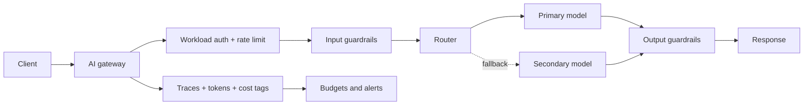

# Inference Starter Kit

**Status:** Scaffolded · **Reference architecture:** [Inference](../../reference-architectures/inference/README.md) · **Owner:** platform engineering · **Last reviewed:** 2026-10-21

## What it is

A gateway-mediated model serving service: one egress path for model traffic, input and output guardrails, routing with provider fallback, per-request cost attribution, and a quality sampling hook.

## When to use it

Use as the default starting point for any workload that calls a model provider, and as the shared pattern every other AI kit builds on.

## Architecture



## What's in the box

| Path | Purpose |
|---|---|
| `src/main.py` | FastAPI service: health, input screening, run endpoint |
| `src/pipeline.py` | The pipeline stub — replace this with the real implementation |
| `src/guardrails.py` | Local input screening and PII redaction (defense in depth) |
| `tests/test_smoke.py` | Smoke tests wired for CI |
| `infra/` | Terraform: artifact bucket, KMS key, log group |
| `Dockerfile` | Non-root container image |
| `.github/PULL_REQUEST_TEMPLATE.md` | Pre-filled production checklist |
| `.env.example` | Configuration contract — never commit real values |

## Quickstart

```bash
cd blueprints/inference-starter-kit
cp .env.example .env
python -m venv .venv && source .venv/bin/activate
pip install -r requirements.txt
PYTHONPATH=src uvicorn main:app --reload --port 8080
```

```bash
curl -s localhost:8080/health
curl -s -X POST localhost:8080/v1/run \
  -H 'content-type: application/json' \
  -d '{"input": "smoke test", "tenant_id": "demo"}'
```

Run the tests:

```bash
PYTHONPATH=src pytest -q
```

Provision the supporting infrastructure:

```bash
cd infra
terraform init
terraform plan
```

> The service returns a `scaffold` status until you replace `run_pipeline()`.

## Pipeline steps to implement

1. Authenticate the workload and apply rate limits at the gateway.
2. Screen input and redact PII before assembly.
3. Route to the pinned primary model with a declared fallback.
4. Screen output and enforce response policy.
5. Emit tokens, cost, latency, and a correlation ID for every call.

## Tech stack (layers, not products)

| Layer | Choice | Notes |
|---|---|---|
| Access | AI gateway with workload identity | No provider keys in application code |
| Routing | Primary plus fallback, pinned model versions | Consistent behavior and graceful degradation |
| Safety | Input and output guardrails, fail closed | Model instructions are not controls |
| Cost | Per-request tagging and budget alarms | Attribution before optimization |
| Delivery | FastAPI + uvicorn | One service shape across every kit; swap the pipeline, keep the contract |
| Observability | OpenTelemetry + structured JSON logs | Correlation ID per request; stage-decomposed traces |
| IaC | Terraform | Artifact bucket, KMS key, and log group with encryption and lifecycle rules |
| Tests | pytest + FastAPI TestClient | Smoke tests run in CI before any deployment |

## Security and guardrails

- All model traffic through the gateway; no provider SDK keys in the app.
- Fail closed when guardrails are unavailable.
- Pinned model versions with an explicit fallback policy.
- No raw prompts or PII in logs by default.

Authoritative controls live in [AI security controls](../../security/ai-security-controls.md) and the [secure SDLC](../../security/secure-sdlc.md). The local screen in `src/guardrails.py` is a heuristic only — it is not a security control.

## Evaluation

- Golden prompts covering normal, edge, and refusal cases.
- Regression check when a model version or prompt changes.
- Guardrail false-positive and latency impact.

Wire the harness into CI using [evaluation in CI](../../design-patterns/evaluation-in-ci.md). A behavior change without an evaluation gate does not ship.

## Operations

- **SLO:** p95 latency within the workload budget; error rate under 0.5%.
- **Cost:** Cost per request tagged at the gateway; budget alarms before production traffic.
- **Traces:** one correlation ID per request, stage spans around every external call.
- **Runbook:** add alert → diagnosis → mitigation before the first production deploy.

## Production checklist

- [ ] Pipeline stub replaced and covered by tests
- [ ] All model calls go through the AI gateway (no provider keys in code)
- [ ] Input screening, PII redaction, and tenant scoping verified
- [ ] Evaluation harness runs in CI with explicit thresholds
- [ ] Dashboards and alerts created; correlation IDs visible end to end
- [ ] Terraform applied to a non-production account; state is remote and locked
- [ ] Rollback and kill switch tested
- [ ] Owner, on-call rotation, and cost budget recorded in the workload registry
- [ ] Design review checklist completed or deviations recorded as an ADR

## Extension points

- Semantic caching with tenant isolation.
- Model cascade for cost reduction behind an evaluation gate.
- Multi-provider routing by workload SLO.

## Related

- [Reference architecture: Inference](../../reference-architectures/inference/README.md)
- Lifecycles: [GenAI/LLMOps lifecycle](../../lifecycles/genai-llmops-lifecycle.md) · [Operations & incident lifecycle](../../lifecycles/operations-incident-lifecycle.md) · [FinOps cost lifecycle](../../lifecycles/finops-cost-lifecycle.md)
- [Blueprints catalog](../README.md)
- [Production issues](../../production-issues/README.md)
- [Design patterns](../../design-patterns/README.md)

---

*Scaffold version 1.0.0 · Generated from the blueprint factory · Update this kit in the same PR as any standard it depends on.*
