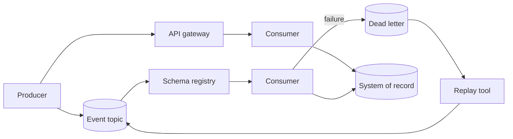

# Integration Starter Kit

**Status:** Scaffolded · **Reference architecture:** [Cross-cutting](../../reference-architectures/README.md) · **Owner:** platform engineering · **Last reviewed:** 2026-10-21

## What it is

An event-driven integration scaffold: versioned API and event contracts, schema registry, idempotent consumers, dead-letter queues, and replay.

## When to use it

Use when AI services must integrate with systems of record or exchange events reliably.

## Architecture



## What's in the box

| Path | Purpose |
|---|---|
| `src/main.py` | FastAPI service: health, input screening, run endpoint |
| `src/pipeline.py` | The pipeline stub — replace this with the real implementation |
| `src/guardrails.py` | Local input screening and PII redaction (defense in depth) |
| `tests/test_smoke.py` | Smoke tests wired for CI |
| `infra/` | Terraform: artifact bucket, KMS key, log group |
| `Dockerfile` | Non-root container image |
| `.github/PULL_REQUEST_TEMPLATE.md` | Pre-filled production checklist |
| `.env.example` | Configuration contract — never commit real values |

## Quickstart

```bash
cd blueprints/integration-starter-kit
cp .env.example .env
python -m venv .venv && source .venv/bin/activate
pip install -r requirements.txt
PYTHONPATH=src uvicorn main:app --reload --port 8080
```

```bash
curl -s localhost:8080/health
curl -s -X POST localhost:8080/v1/run \
  -H 'content-type: application/json' \
  -d '{"input": "smoke test", "tenant_id": "demo"}'
```

Run the tests:

```bash
PYTHONPATH=src pytest -q
```

Provision the supporting infrastructure:

```bash
cd infra
terraform init
terraform plan
```

> The service returns a `scaffold` status until you replace `run_pipeline()`.

## Pipeline steps to implement

1. Define API and event contracts before implementation.
2. Register schemas and enforce compatibility in CI.
3. Implement idempotent producers and consumers with keys.
4. Add dead-letter handling and a tested replay path.
5. Propagate trace context across every hop.

## Tech stack (layers, not products)

| Layer | Choice | Notes |
|---|---|---|
| Contracts | OpenAPI + AsyncAPI, versioned | Breaking changes require a new version |
| Events | Schema registry with compatibility rules | No unregistered event types |
| Consumers | Idempotent, with DLQ and replay | At-least-once delivery is the default |
| Observability | Trace context propagated across hops | End-to-end correlation |
| Delivery | FastAPI + uvicorn | One service shape across every kit; swap the pipeline, keep the contract |
| Observability | OpenTelemetry + structured JSON logs | Correlation ID per request; stage-decomposed traces |
| IaC | Terraform | Artifact bucket, KMS key, and log group with encryption and lifecycle rules |
| Tests | pytest + FastAPI TestClient | Smoke tests run in CI before any deployment |

## Security and guardrails

- No unregistered schema reaches production.
- Consumers tolerate duplicates and out-of-order delivery.
- Replay requires authorization and is audited.
- Secrets and PII excluded from event payloads by default.

Authoritative controls live in [AI security controls](../../security/ai-security-controls.md) and the [secure SDLC](../../security/secure-sdlc.md). The local screen in `src/guardrails.py` is a heuristic only — it is not a security control.

## Evaluation

- Contract tests in CI for every consumer.
- Duplicate and out-of-order delivery tests.
- Replay correctness and DLQ age.

Wire the harness into CI using [evaluation in CI](../../design-patterns/evaluation-in-ci.md). A behavior change without an evaluation gate does not ship.

## Operations

- **SLO:** No message loss; DLQ age bounded; contract changes gated.
- **Cost:** Event volume and retention cost tracked per topic.
- **Traces:** one correlation ID per request, stage spans around every external call.
- **Runbook:** add alert → diagnosis → mitigation before the first production deploy.

## Production checklist

- [ ] Pipeline stub replaced and covered by tests
- [ ] All model calls go through the AI gateway (no provider keys in code)
- [ ] Input screening, PII redaction, and tenant scoping verified
- [ ] Evaluation harness runs in CI with explicit thresholds
- [ ] Dashboards and alerts created; correlation IDs visible end to end
- [ ] Terraform applied to a non-production account; state is remote and locked
- [ ] Rollback and kill switch tested
- [ ] Owner, on-call rotation, and cost budget recorded in the workload registry
- [ ] Design review checklist completed or deviations recorded as an ADR

## Extension points

- Event catalog with ownership and lineage.
- Automated compatibility gates.
- Cross-region replication.

## Related

- [Reference architecture: Cross-cutting](../../reference-architectures/README.md)
- Lifecycles: [API lifecycle](../../lifecycles/api-lifecycle.md) · [Data lifecycle](../../lifecycles/data-lifecycle.md) · [Operations & incident lifecycle](../../lifecycles/operations-incident-lifecycle.md)
- [Blueprints catalog](../README.md)
- [Production issues](../../production-issues/README.md)
- [Design patterns](../../design-patterns/README.md)

---

*Scaffold version 1.0.0 · Generated from the blueprint factory · Update this kit in the same PR as any standard it depends on.*
