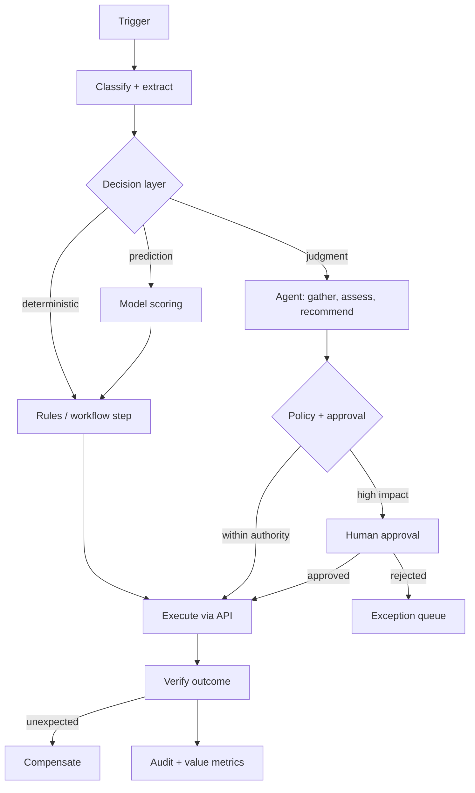

# Intelligent Automation Starter Kit

**Status:** Scaffolded · **Reference architecture:** [Intelligent automation](../../reference-architectures/intelligent-automation/README.md) · **Owner:** platform engineering · **Last reviewed:** 2026-10-21

> **Implementation boundary:** architecture diagrams and pipeline steps describe intended behavior. The shipped pipeline is a stub; callers are not authenticated, request `tenant_id` is caller-supplied, and regex screening/redaction is illustrative. Implement identity, authorization, workload logic, evaluation, and operational controls before exposing the service. Use synthetic or explicitly authorized data. A copied `.env` file is not loaded automatically.

## What it is

A process automation scaffold that puts deterministic workflow first, adds ML or agent judgment only where rules cannot reach, and reserves humans for exceptions and approvals.

## When to use it

Use for high-volume operational processes with unstructured inputs and a meaningful exception rate.

## Architecture



## What's in the box

| Path | Purpose |
|---|---|
| `src/main.py` | FastAPI service: health, input screening, run endpoint |
| `src/pipeline.py` | The pipeline stub — replace this with the real implementation |
| `src/guardrails.py` | Local input screening and PII redaction (defense in depth) |
| `tests/test_smoke.py` | Smoke tests wired for CI |
| `infra/` | Terraform: artifact bucket, KMS key, log group |
| `Dockerfile` | Non-root container image |
| `.github/PULL_REQUEST_TEMPLATE.md` | Pre-filled production checklist |
| `.env.example` | Configuration contract — never commit real values |

## Quickstart

```bash
cd blueprints/intelligent-automation-starter-kit
cp .env.example .env
python -m venv .venv && source .venv/bin/activate
pip install -r requirements.txt
PYTHONPATH=src uvicorn main:app --reload --port 8080
```

```bash
curl -s localhost:8080/health
curl -s -X POST localhost:8080/v1/run \
  -H 'content-type: application/json' \
  -d '{"input": "smoke test", "tenant_id": "demo"}'
```

Run the tests:

```bash
PYTHONPATH=src pytest -q
```

Provision the supporting infrastructure:

```bash
cd infra
terraform init
terraform plan
```

> The service returns a `scaffold` status until you replace `run_pipeline()`.

## Pipeline steps to implement

1. Ingest and classify the work item; deduplicate by business key.
2. Route the routine path to deterministic rules.
3. Call ML scoring or an agent only for the judgment slice.
4. Apply the policy and approval gate before any side effect.
5. Verify the outcome and compensate on partial failure.

## Tech stack (layers, not products)

| Layer | Choice | Notes |
|---|---|---|
| Orchestration | Durable workflow engine | Retries, compensation, exception routing |
| Decision | Rules, then ML, then agent | Cheapest reliable mechanism first |
| Integrations | APIs first; UI automation only as a last resort | Detect UI breakage explicitly |
| Audit | Immutable per-instance step log | Required for disputes and compliance |
| Delivery | FastAPI + uvicorn | One service shape across every kit; swap the pipeline, keep the contract |
| Observability | OpenTelemetry + structured JSON logs | Correlation ID per request; stage-decomposed traces |
| IaC | Terraform | Artifact bucket, KMS key, and log group with encryption and lifecycle rules |
| Tests | pytest + FastAPI TestClient | Smoke tests run in CI before any deployment |

## Security and guardrails

- Least-privilege, short-lived credentials per process.
- Irreversible actions always require approval.
- Bounded retries, then route to a human queue with context.
- Every automated decision auditable per instance and step.

Authoritative controls live in [AI security controls](../../security/ai-security-controls.md) and the [secure SDLC](../../security/secure-sdlc.md). The local screen in `src/guardrails.py` is a heuristic only — it is not a security control.

## Evaluation

- Straight-through processing rate and accuracy on an audited sample.
- Exception rate composition, not just the total.
- Compensation and rework rate.

Wire the harness into CI using [evaluation in CI](../../design-patterns/evaluation-in-ci.md). A behavior change without an evaluation gate does not ship.

## Operations

- **SLO:** No silent automation breakage; every exception has an owner.
- **Cost:** Cost per transaction versus the manual baseline, including review effort.
- **Traces:** one correlation ID per request, stage spans around every external call.
- **Runbook:** add alert → diagnosis → mitigation before the first production deploy.

## Production checklist

- [ ] Pipeline stub replaced and covered by tests
- [ ] All model calls go through the AI gateway (no provider keys in code)
- [ ] Input screening, PII redaction, and tenant scoping verified
- [ ] Evaluation harness runs in CI with explicit thresholds
- [ ] Dashboards and alerts created; correlation IDs visible end to end
- [ ] Terraform applied to a non-production account; state is remote and locked
- [ ] Rollback and kill switch tested
- [ ] Owner, on-call rotation, and cost budget recorded in the workload registry
- [ ] Design review checklist completed or deviations recorded as an ADR

## Extension points

- Process discovery from event logs.
- Self-healing integrations that detect interface changes.
- Explicit, reversible autonomy increases per step.

## Related

- [Reference architecture: Intelligent automation](../../reference-architectures/intelligent-automation/README.md)
- Lifecycles: [Agent lifecycle](../../lifecycles/agent-lifecycle.md) · [Operations & incident lifecycle](../../lifecycles/operations-incident-lifecycle.md)
- [Blueprints catalog](../README.md)
- [Production issues](../../production-issues/README.md)
- [Design patterns](../../design-patterns/README.md)

---

*Scaffold version 1.0.0 · Generated from the blueprint factory · Update this kit in the same PR as any standard it depends on.*
