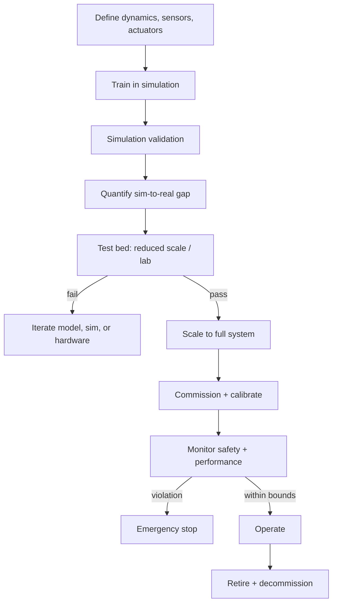

# Physical AI Starter Kit

**Status:** Scaffolded · **Reference architecture:** [Intelligent automation (physical profile)](../../reference-architectures/intelligent-automation/README.md) · **Owner:** platform engineering · **Last reviewed:** 2026-10-21

> **Implementation boundary:** architecture diagrams and pipeline steps describe intended behavior. The shipped pipeline is a stub; callers are not authenticated, request `tenant_id` is caller-supplied, and regex screening/redaction is illustrative. Implement identity, authorization, workload logic, evaluation, and operational controls before exposing the service. Use synthetic or explicitly authorized data. A copied `.env` file is not loaded automatically.

## What it is

A simulation-to-real scaffold for physical systems: model training with randomized dynamics, quantified sim-to-real gap, test-bed validation, a hard safety envelope, and commissioning.

## When to use it

Use when an AI controller will act on physical hardware and mistakes have physical consequences.

## Architecture



## What's in the box

| Path | Purpose |
|---|---|
| `src/main.py` | FastAPI service: health, input screening, run endpoint |
| `src/pipeline.py` | The pipeline stub — replace this with the real implementation |
| `src/guardrails.py` | Local input screening and PII redaction (defense in depth) |
| `tests/test_smoke.py` | Smoke tests wired for CI |
| `infra/` | Terraform: artifact bucket, KMS key, log group |
| `Dockerfile` | Non-root container image |
| `.github/PULL_REQUEST_TEMPLATE.md` | Pre-filled production checklist |
| `.env.example` | Configuration contract — never commit real values |

## Quickstart

```bash
cd blueprints/physical-ai-starter-kit
cp .env.example .env
python -m venv .venv && source .venv/bin/activate
pip install -r requirements.txt
PYTHONPATH=src uvicorn main:app --reload --port 8080
```

```bash
curl -s localhost:8080/health
curl -s -X POST localhost:8080/v1/run \
  -H 'content-type: application/json' \
  -d '{"input": "smoke test", "tenant_id": "demo"}'
```

Run the tests:

```bash
PYTHONPATH=src pytest -q
```

Provision the supporting infrastructure:

```bash
cd infra
terraform init
terraform plan
```

> The service returns a `scaffold` status until you replace `run_pipeline()`.

## Pipeline steps to implement

1. Define the system dynamics, limits, and safety envelope.
2. Train in simulation with randomized dynamics and sensor noise.
3. Quantify sim-to-real transfer on a reduced-scale test bed.
4. Validate safety and quality before scaling to the full system.
5. Commission, calibrate, and monitor with an independent stop path.

## Tech stack (layers, not products)

| Layer | Choice | Notes |
|---|---|---|
| Simulation | Physics engine with sensor noise and actuator delay | Match real dynamics within the acceptance envelope |
| Transfer | Domain randomization + real-world fine-tuning | Measure the gap; do not assume it |
| Safety | Hard limits enforced outside the policy | Independent emergency stop path |
| Telemetry | Correlated observation-action trajectories | Drives drift analysis and retraining |
| Delivery | FastAPI + uvicorn | One service shape across every kit; swap the pipeline, keep the contract |
| Observability | OpenTelemetry + structured JSON logs | Correlation ID per request; stage-decomposed traces |
| IaC | Terraform | Artifact bucket, KMS key, and log group with encryption and lifecycle rules |
| Tests | pytest + FastAPI TestClient | Smoke tests run in CI before any deployment |

## Security and guardrails

- Hard safety limits enforced in a separate control path.
- Emergency stop tested before every deployment.
- No autonomous operation outside the validated envelope.
- Decommissioning and cleanup planned before deployment.

Authoritative controls live in [AI security controls](../../security/ai-security-controls.md) and the [secure SDLC](../../security/secure-sdlc.md). The local screen in `src/guardrails.py` is a heuristic only — it is not a security control.

## Evaluation

- Sim-to-real quality gap on held-out real-world trials.
- Safety-violation count during validation (target zero).
- Commissioning time and calibration repeatability.

Wire the harness into CI using [evaluation in CI](../../design-patterns/evaluation-in-ci.md). A behavior change without an evaluation gate does not ship.

## Operations

- **SLO:** Zero safety-envelope violations; bounded sim-to-real gap.
- **Cost:** Cost per real-world trial and per commissioned unit.
- **Traces:** one correlation ID per request, stage spans around every external call.
- **Runbook:** add alert → diagnosis → mitigation before the first production deploy.

## Production checklist

- [ ] Pipeline stub replaced and covered by tests
- [ ] All model calls go through the AI gateway (no provider keys in code)
- [ ] Input screening, PII redaction, and tenant scoping verified
- [ ] Evaluation harness runs in CI with explicit thresholds
- [ ] Dashboards and alerts created; correlation IDs visible end to end
- [ ] Terraform applied to a non-production account; state is remote and locked
- [ ] Rollback and kill switch tested
- [ ] Owner, on-call rotation, and cost budget recorded in the workload registry
- [ ] Design review checklist completed or deviations recorded as an ADR

## Extension points

- Learned dynamics models to close the gap.
- Digital twin for continuous validation.
- Fleet-level safety analytics.

## Related

- [Reference architecture: Intelligent automation (physical profile)](../../reference-architectures/intelligent-automation/README.md)
- Lifecycles: [Physical AI lifecycle](../../lifecycles/physical-ai-lifecycle.md) · [Agent lifecycle](../../lifecycles/agent-lifecycle.md) · [Operations & incident lifecycle](../../lifecycles/operations-incident-lifecycle.md)
- [Blueprints catalog](../README.md)
- [Production issues](../../production-issues/README.md)
- [Design patterns](../../design-patterns/README.md)

---

*Scaffold version 1.0.0 · Generated from the blueprint factory · Update this kit in the same PR as any standard it depends on.*
