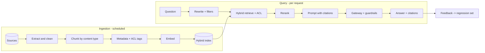

# RAG Starter Kit

**Status:** Scaffolded · **Reference architecture:** [RAG](../../reference-architectures/rag/README.md) · **Owner:** platform engineering · **Last reviewed:** 2026-10-21

## What it is

A production-shaped retrieval-augmented generation service: ingestion with provenance, hybrid retrieval with ACL filtering, reranking, grounded generation with citations, and an evaluation gate.

## When to use it

Use when users need answers from documents and the answer must be traceable to a source the user is allowed to see.

## Architecture



## What's in the box

| Path | Purpose |
|---|---|
| `src/main.py` | FastAPI service: health, input screening, run endpoint |
| `src/pipeline.py` | The pipeline stub — replace this with the real implementation |
| `src/guardrails.py` | Local input screening and PII redaction (defense in depth) |
| `tests/test_smoke.py` | Smoke tests wired for CI |
| `infra/` | Terraform: artifact bucket, KMS key, log group |
| `Dockerfile` | Non-root container image |
| `.github/PULL_REQUEST_TEMPLATE.md` | Pre-filled production checklist |
| `.env.example` | Configuration contract — never commit real values |

## Quickstart

```bash
cd blueprints/rag-starter-kit
cp .env.example .env
python -m venv .venv && source .venv/bin/activate
pip install -r requirements.txt
PYTHONPATH=src uvicorn main:app --reload --port 8080
```

```bash
curl -s localhost:8080/health
curl -s -X POST localhost:8080/v1/run \
  -H 'content-type: application/json' \
  -d '{"input": "smoke test", "tenant_id": "demo"}'
```

Run the tests:

```bash
PYTHONPATH=src pytest -q
```

Provision the supporting infrastructure:

```bash
cd infra
terraform init
terraform plan
```

> The service returns a `scaffold` status until you replace `run_pipeline()`.

## Pipeline steps to implement

1. Extract and normalize each source type; attach source, date, and ACL tags.
2. Chunk per content type, preserving tables and headings.
3. Embed with a pinned, versioned model and write to the hybrid index.
4. Retrieve with ACL pre-filters, rerank top-k, and assemble a cited prompt.
5. Refuse or qualify when evidence is insufficient; log the assembled context.

## Tech stack (layers, not products)

| Layer | Choice | Notes |
|---|---|---|
| Ingestion | Scheduled + incremental, idempotent | Per-type extractors for prose, tables, slides; deletion propagation |
| Index | Hybrid (vector + keyword) with metadata filters | Dense-only misses identifiers; sparse-only misses paraphrases |
| Retrieval | ACL pre-filter + reranker | Never post-filter: post-filtering leaks existence and count |
| Evaluation | Golden Q to docs to answer set in CI | Faithfulness, citation correctness, recall@k |
| Delivery | FastAPI + uvicorn | One service shape across every kit; swap the pipeline, keep the contract |
| Observability | OpenTelemetry + structured JSON logs | Correlation ID per request; stage-decomposed traces |
| IaC | Terraform | Artifact bucket, KMS key, and log group with encryption and lifecycle rules |
| Tests | pytest + FastAPI TestClient | Smoke tests run in CI before any deployment |

## Security and guardrails

- All model traffic through the AI gateway; no provider keys in this service.
- ACL filtering happens before retrieval results reach the prompt.
- Treat retrieved text as untrusted data, never as instructions.
- Redact PII before logging; log the prompt hash, not raw sensitive content.

Authoritative controls live in [AI security controls](../../security/ai-security-controls.md) and the [secure SDLC](../../security/secure-sdlc.md). The local screen in `src/guardrails.py` is a heuristic only — it is not a security control.

## Evaluation

- Golden set: question to expected documents to expected answer.
- Hard gates on faithfulness and citation correctness; track recall@k separately.
- Adversarial set for negation, stale sources, and permission-denial cases.

Wire the harness into CI using [evaluation in CI](../../design-patterns/evaluation-in-ci.md). A behavior change without an evaluation gate does not ship.

## Operations

- **SLO:** p95 answer latency within the product budget; retrieval errors surfaced, never silently empty.
- **Cost:** Track cost per answered question; cap top-k and reranker time; cache embeddings, not answers with ACL risk.
- **Traces:** one correlation ID per request, stage spans around every external call.
- **Runbook:** add alert → diagnosis → mitigation before the first production deploy.

## Production checklist

- [ ] Pipeline stub replaced and covered by tests
- [ ] All model calls go through the AI gateway (no provider keys in code)
- [ ] Input screening, PII redaction, and tenant scoping verified
- [ ] Evaluation harness runs in CI with explicit thresholds
- [ ] Dashboards and alerts created; correlation IDs visible end to end
- [ ] Terraform applied to a non-production account; state is remote and locked
- [ ] Rollback and kill switch tested
- [ ] Owner, on-call rotation, and cost budget recorded in the workload registry
- [ ] Design review checklist completed or deviations recorded as an ADR

## Extension points

- Graph retrieval for relationship-heavy questions (only with measured gain).
- Cross-encoder reranker upgrade behind an evaluation gate.
- Stale-source detection driven by source change events.

## Related

- [Reference architecture: RAG](../../reference-architectures/rag/README.md)
- Lifecycles: [RAG lifecycle](../../lifecycles/rag-lifecycle.md) · [Evaluation lifecycle](../../lifecycles/evaluation-lifecycle.md) · [GenAI/LLMOps lifecycle](../../lifecycles/genai-llmops-lifecycle.md)
- [Blueprints catalog](../README.md)
- [Production issues](../../production-issues/README.md)
- [Design patterns](../../design-patterns/README.md)

---

*Scaffold version 1.0.0 · Generated from the blueprint factory · Update this kit in the same PR as any standard it depends on.*
