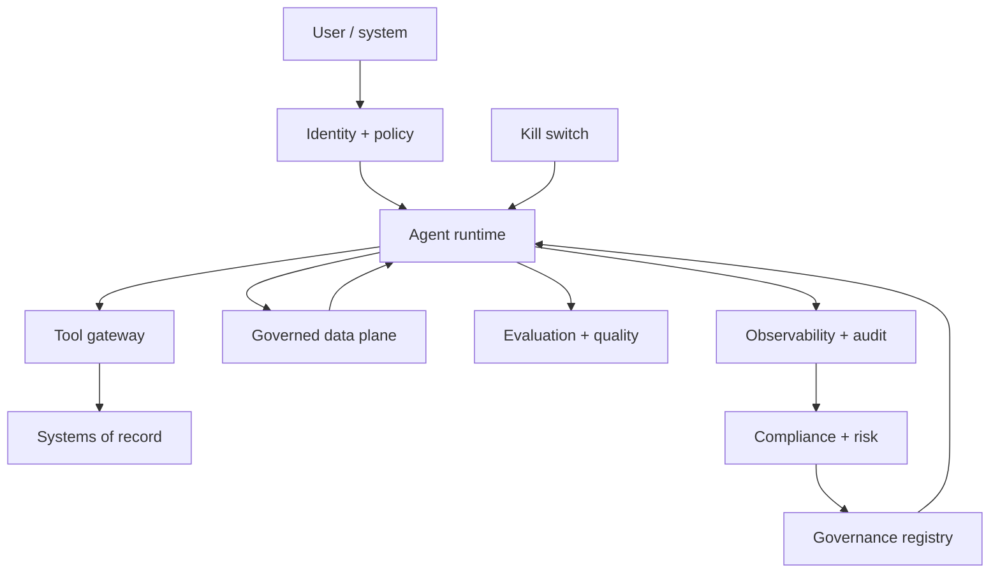

# Secure Agentic Enterprise Starter Kit

**Status:** Scaffolded · **Reference architecture:** [Secure Agentic Enterprise](../../reference-architectures/enterprise-first/secure-agentic-enterprise.md) · **Owner:** platform engineering · **Last reviewed:** 2026-10-21

## What it is

An integrated scaffold for a secure agentic platform: gateway-mediated model access, bounded agent runtime, typed and sandboxed tool gateway, governed data plane, human approval for side effects, evaluation gates, observability, and a kill switch.

## When to use it

Use when multiple agents, tools, and business systems must operate together under security, compliance, quality, and production constraints.

## Architecture



## What's in the box

| Path | Purpose |
|---|---|
| `src/main.py` | FastAPI service: health, input screening, run endpoint |
| `src/pipeline.py` | The pipeline stub — replace this with the real implementation |
| `src/guardrails.py` | Local input screening and PII redaction (defense in depth) |
| `tests/test_smoke.py` | Smoke tests wired for CI |
| `infra/` | Terraform: artifact bucket, KMS key, log group |
| `Dockerfile` | Non-root container image |
| `.github/PULL_REQUEST_TEMPLATE.md` | Pre-filled production checklist |
| `.env.example` | Configuration contract — never commit real values |

## Quickstart

```bash
cd blueprints/secure-agentic-enterprise-starter-kit
cp .env.example .env
python -m venv .venv && source .venv/bin/activate
pip install -r requirements.txt
PYTHONPATH=src uvicorn main:app --reload --port 8080
```

```bash
curl -s localhost:8080/health
curl -s -X POST localhost:8080/v1/run \
  -H 'content-type: application/json' \
  -d '{"input": "smoke test", "tenant_id": "demo"}'
```

Run the tests:

```bash
PYTHONPATH=src pytest -q
```

Provision the supporting infrastructure:

```bash
cd infra
terraform init
terraform plan
```

> The service returns a `scaffold` status until you replace `run_pipeline()`.

## Pipeline steps to implement

1. Authenticate the workload and caller; determine the authorization boundary.
2. Screen input and redact PII before context assembly.
3. Plan and select tools from the registry; validate arguments against schemas.
4. Enforce tool permissions, egress rules, and sandboxing before execution.
5. Execute, verify the outcome, and compensate on partial failure.
6. Log every step, tool call, approval, and output with a run ID.
7. Run evaluation gates and quality sampling before and after release.

## Tech stack (layers, not products)

| Layer | Choice | Notes |
|---|---|---|
| Access | AI gateway with workload identity | No provider keys in application code |
| Runtime | Bounded agent loop with step, time, and cost ceilings | Kill switch and human approval for side effects |
| Tools | Typed registry with per-tool permissions and sandbox | No superuser credentials |
| Data | Governed retrieval with ACL pre-filtering | Provenance for every context item |
| Safety | Fail-closed guardrails, egress allowlist, audit | Model instructions are not controls |
| Quality | Evaluation gates and production sampling | No capability change without evidence |
| Delivery | FastAPI + uvicorn | One service shape across every kit; swap the pipeline, keep the contract |
| Observability | OpenTelemetry + structured JSON logs | Correlation ID per request; stage-decomposed traces |
| IaC | Terraform | Artifact bucket, KMS key, and log group with encryption and lifecycle rules |
| Tests | pytest + FastAPI TestClient | Smoke tests run in CI before any deployment |

## Security and guardrails

- All model traffic through the gateway; no provider SDK keys in the app.
- Fail closed when guardrails or policy services are unavailable.
- Least-privilege, short-lived credentials per tool and process.
- Human approval for side effects; approvals expire to deny.
- Bounded autonomy with a tested kill switch.

Authoritative controls live in [AI security controls](../../security/ai-security-controls.md) and the [secure SDLC](../../security/secure-sdlc.md). The local screen in `src/guardrails.py` is a heuristic only — it is not a security control.

## Evaluation

- Task success and authorization-bypass tests.
- Prompt-injection and data-exfiltration success rate (target zero).
- Cost, step count, and latency distributions per task.

Wire the harness into CI using [evaluation in CI](../../design-patterns/evaluation-in-ci.md). A behavior change without an evaluation gate does not ship.

## Operations

- **SLO:** Zero ungated write actions; quality and cost visible alongside latency.
- **Cost:** Cost per successful task tagged at the gateway and tool layer.
- **Traces:** one correlation ID per request, stage spans around every external call.
- **Runbook:** add alert → diagnosis → mitigation before the first production deploy.

## Production checklist

- [ ] Pipeline stub replaced and covered by tests
- [ ] All model calls go through the AI gateway (no provider keys in code)
- [ ] Input screening, PII redaction, and tenant scoping verified
- [ ] Evaluation harness runs in CI with explicit thresholds
- [ ] Dashboards and alerts created; correlation IDs visible end to end
- [ ] Terraform applied to a non-production account; state is remote and locked
- [ ] Rollback and kill switch tested
- [ ] Owner, on-call rotation, and cost budget recorded in the workload registry
- [ ] Design review checklist completed or deviations recorded as an ADR

## Extension points

- Multi-agent orchestration with shared evaluation benchmarks.
- Automated certification through the agent factory.
- Policy-as-code checks in CI.

## Related

- [Reference architecture: Secure Agentic Enterprise](../../reference-architectures/enterprise-first/secure-agentic-enterprise.md)
- Lifecycles: [Agent lifecycle](../../lifecycles/agent-lifecycle.md) · [Agent factory lifecycle](../../lifecycles/agent-factory-lifecycle.md) · [Model risk lifecycle](../../lifecycles/model-risk-lifecycle.md) · [Operations & incident lifecycle](../../lifecycles/operations-incident-lifecycle.md) · [Evaluation lifecycle](../../lifecycles/evaluation-lifecycle.md)
- [Blueprints catalog](../README.md)
- [Production issues](../../production-issues/README.md)
- [Design patterns](../../design-patterns/README.md)

---

*Scaffold version 1.0.0 · Generated from the blueprint factory · Update this kit in the same PR as any standard it depends on.*
