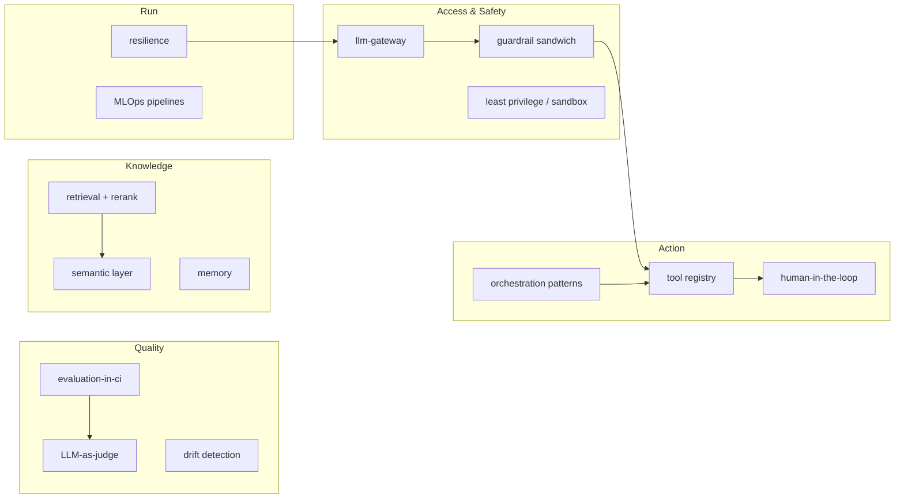

# Design Patterns

Reusable solutions for problems that recur across AI/ML systems. Patterns are **recommended**; reference architectures decide which are **required**. Each category file is a catalog — a table of patterns with intent, applicability, and pitfalls — plus expanded treatments where the nuance matters.

## Pattern catalog

| Category | File | Patterns |
|---|---|---|
| General software & architecture | [general-architecture.md](general-architecture.md) | Layered, hexagonal, modular monolith, microservices, event-driven, CQRS, event sourcing, saga, outbox, BFF, sidecar, strangler fig, API gateway, cache-aside, pub/sub, serverless |
| Data architecture | [data-architecture.md](data-architecture.md) | Lakehouse/medallion, data mesh, data product, CDC, SCD, lambda/kappa, data vault, feature store, semantic layer, batch vs streaming |
| ML engineering | [ml-engineering.md](ml-engineering.md) | Train/serve consistency, feature store, champion/challenger, shadow, A/B, batch/online/streaming inference, prediction & embedding caches, distillation, ensembles, drift detection, active learning |
| MLOps & deployment | [mlops-deployment.md](mlops-deployment.md) | CI/CD/CT pipelines, model registry, experiment tracking, reproducibility manifest, artifact lineage, environment parity, policy-as-code, canary/blue-green, automatic rollback, retraining triggers |
| GenAI & prompting | [genai-prompting.md](genai-prompting.md) | Prompt template, few-shot, chain-of-thought, structured output, context engineering, model cascade/router, semantic caching, guardrail sandwich, LLM-as-judge |
| RAG | [rag-patterns.md](rag-patterns.md) | Chunking strategies, hybrid search, reranking, query rewriting, multi-query/fusion, HyDE, parent-document & sentence-window, self-RAG, corrective RAG, graph RAG, agentic RAG, citation grounding |
| Agents | [agent-patterns.md](agent-patterns.md) | Tool use, ReAct, plan-and-execute, reflection, memory taxonomy, supervisor, hierarchical, blackboard, swarm, handoff, termination, HITL, sandbox, registry |
| Reliability & resilience | [reliability-resilience.md](reliability-resilience.md) | Circuit breaker, bulkhead, retry+backoff, timeout, fallback, load leveling, graceful degradation, idempotency, health checks, read-repair |
| Security | [security-patterns.md](security-patterns.md) | Defense in depth, zero trust, least privilege, secret vaulting, prompt-injection defense, output filtering, egress allowlist, sandbox isolation, immutable audit |
| Domain & business | [domain-and-business.md](domain-and-business.md) | Bounded context, ubiquitous language, context mapping, anticorruption layer, event storming, domain storytelling, capability mapping, value-stream mapping, Wardley mapping |

## Expanded patterns (full treatment)

These have dedicated documents because they carry architectural weight:

| Pattern | Document |
|---|---|
| Centralized model access | [llm-gateway.md](llm-gateway.md) |
| Human control of side effects | [human-in-the-loop-approval.md](human-in-the-loop-approval.md) |
| Quality gates in CI | [evaluation-in-ci.md](evaluation-in-ci.md) |
| Executable architecture | [architecture-as-code.md](architecture-as-code.md) |
| Governed business meaning | [semantic-layer-grounding.md](semantic-layer-grounding.md) |

## Cross-cutting pattern map

## Using patterns

1. Prefer an established pattern over a novel solution — patterns carry known failure modes
2. Apply the *smallest* set that solves the problem; pattern stacking adds complexity
3. Record deliberate departures as [ADRs](../adr/README.md)
4. If you need a pattern that isn't here, propose it (2 reviewers, proven in at least one system) — see [CONTRIBUTING.md](../CONTRIBUTING.md)

## Selecting patterns

| You need… | Start with |
|---|---|
| Controlled model access | [llm-gateway](llm-gateway.md) + [guardrail sandwich](genai-prompting.md#guardrail-sandwich) |
| Better answer quality | [rag-patterns](rag-patterns.md) before more prompt engineering |
| Reliable data meaning | [semantic-layer-grounding](semantic-layer-grounding.md) |
| Safe automation | [agent-patterns](agent-patterns.md) + [HITL](human-in-the-loop-approval.md) |
| Cost/latency control | [genai-prompting](genai-prompting.md) cascades/caches + [reliability](reliability-resilience.md) |
| Deployment confidence | [mlops-deployment](mlops-deployment.md) + [evaluation-in-ci](evaluation-in-ci.md) |
| Modernize legacy safely | [domain-and-business](domain-and-business.md) + [general-architecture](general-architecture.md) strangler fig |
