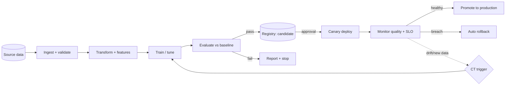

# MLOps & Deployment Patterns

**Status:** Proposed · **Last reviewed:** 2026-10-17

Patterns for automating the path from code and data to production models and AI configurations. Implements the [MLOps lifecycle](../lifecycles/mlops-lifecycle.md) and [GenAI/LLMOps lifecycle](../lifecycles/genai-llmops-lifecycle.md).

## Pipeline patterns

| Pattern | Intent | Watch out |
|---|---|---|
| **CI/CD for models** | Automated test → build → deploy with gates | Model tests differ from code tests — evaluate, don't just lint |
| **Continuous training (CT)** | Retrain on schedule, drift, or new data | Auto-promotion needs guardrails and rollback |
| **Pipeline-as-code** | Training/serving pipelines declared, versioned, reviewable | Over-abstraction hides real logic |
| **Metadata-driven pipelines** | Parameterize ingestion/transform/train from metadata | Metadata becomes a second codebase to govern |
| **Template pipelines** | Reusable stage templates (ingest → transform → feature → train → eval → register) | Templates must evolve with standards |
| **Orchestrated DAGs** | Explicit dependencies, retries, backfills | Hidden dependencies bypass orchestration |
| **Reproducibility manifest** | Every run records code commit, data version, deps, seeds, config | A manifest nobody reads is not reproducibility |
| **Environment parity** | Dev/staging/prod share dependency and runtime definitions | "Works in notebook" gaps |

## Registry & lineage patterns

| Pattern | Intent | Watch out |
|---|---|---|
| **Model registry as source of truth** | Immutable versions with metrics, owner, approval state | A file share with a naming convention is not a registry |
| **Promotion as state transition** | Staging → production is a recorded event | Manual promotion with no audit trail fails risk review |
| **Artifact lineage graph** | Data → code → run → model → deployment traceability | Must be automatic, not maintained by hand |
| **Experiment tracking** | Log parameters, metrics, artifacts per run | Comparison views needed or tracking is just hoarding |
| **Golden/promoted artifact immutability** | Production artifact can't change in place | Rebuilding from a tag must reproduce it |

## Deployment patterns

| Pattern | Intent | Use when | Watch out |
|---|---|---|---|
| **Canary** | Incremental traffic shift to new version | Traffic and quality signals exist | Needs statistical thinking, not gut feel |
| **Blue-green** | Parallel environments, instant switch | Rollback speed is critical | Double infrastructure cost; data migrations |
| **Shadow** | Mirror traffic to new version, compare | Zero user risk required | Logging/comparison infrastructure |
| **Feature flags for models** | Decouple deploy from release; target by segment | Rolling out AI features (especially copilots/agents) | Flag debt; combinatorial testing |
| **Progressive rollout by autonomy level** | Agents/copilots start read-only, expand authority | Any side-effecting AI | Requires explicit autonomy state management |
| **Automatic rollback** | Revert on SLO/quality breach | Mature monitoring + quality signals | Rollback of data/index changes is harder than code |

## Configuration & governance patterns

| Pattern | Intent | Watch out |
|---|---|---|
| **Config-as-code for prompts & guardrails** | Prompts, thresholds, tools versioned with the app | UI-edited production prompts destroy auditability |
| **Policy-as-code** | Encode enforceable controls as automated checks | Keep policy checks fast enough for CI |
| **Promotion gates** | Eval thresholds + security checks block promotion | Gates that everyone can override are decoration |
| **Change detection for provider/model versions** | Alert when an upstream model changes | Requires pinned versions and scheduled evaluation |
| **Drift-triggered CT** | Alert → retrain → evaluate → promote (approval or bounded auto) | Alert fatigue causes ignored triggers |

## Observability patterns

| Pattern | Intent | Watch out |
|---|---|---|
| **Stage-decomposed latency** | Per-stage timing (gateway, retrieval, model, tools) | Aggregate latency hides the real bottleneck |
| **Cost attribution per workload** | Tag every call with project/tenant identity | Untagged spend is unmanageable |
| **Full-path trace with correlation ID** | Request → retrieval → prompt → model → tools → output | Sampling must still catch rare failures |
| **Sampled quality scoring** | Automated judges on a traffic sample | Judge version pinning and calibration |
| **Canary metric comparison** | Side-by-side incumbent vs candidate | Metric pollution from mixed traffic |

## Reference pipeline

## Anti-patterns

- Pipelines that can't be re-run to produce the same artifact
- Retraining that skips evaluation because "it's the same code"
- Rollback plans that only cover code, not prompts, indexes, or data
- Monitoring that watches the platform but not the model
- One giant pipeline per model instead of reusable templates
