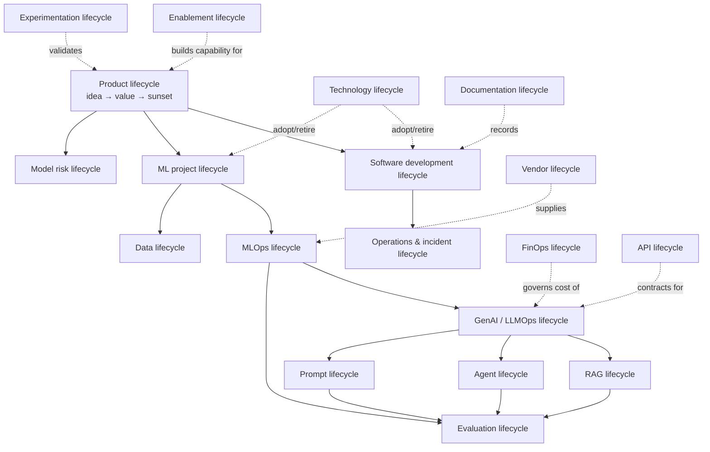

# Lifecycles

End-to-end lifecycles that govern how AI/ML work is conceived, built, deployed, operated, and retired. They **nest** rather than compete: a software lifecycle contains a data lifecycle, an ML lifecycle contains MLOps, a GenAI system contains a RAG and prompt lifecycle, and everything sits inside a product lifecycle.

## Index

| Lifecycle | Covers | Owner |
|---|---|---|
| [software-development-lifecycle.md](software-development-lifecycle.md) | Requirements → design → build → test → release → operate | Engineering |
| [ml-project-lifecycle.md](ml-project-lifecycle.md) | Problem framing → data → modeling → evaluation → deployment | Data science / ML |
| [mlops-lifecycle.md](mlops-lifecycle.md) | CI/CD/CT automation, registry, monitoring, retraining | ML platform |
| [genai-llmops-lifecycle.md](genai-llmops-lifecycle.md) | Prompt → model → eval → deploy → observe for LLM apps | AI engineering |
| [rag-lifecycle.md](rag-lifecycle.md) | Corpus → ingest → embed → retrieve → generate → evaluate | AI engineering |
| [agent-lifecycle.md](agent-lifecycle.md) | Design → tools → memory → safety → operate → retire (AgentOps) | AI engineering |
| [data-lifecycle.md](data-lifecycle.md) | Acquire → store → transform → serve → archive → delete | Data |
| [prompt-lifecycle.md](prompt-lifecycle.md) | Author → version → evaluate → deploy → observe → retire | AI engineering |
| [evaluation-lifecycle.md](evaluation-lifecycle.md) | Dataset curation → metrics → harness → gates → drift review | AI quality |
| [product-lifecycle.md](product-lifecycle.md) | Idea → discovery → business case → delivery → value → sunset | Product |
| [model-risk-lifecycle.md](model-risk-lifecycle.md) | Intake → assess → approve → monitor → revalidate → retire | Governance / risk |
| [operations-incident-lifecycle.md](operations-incident-lifecycle.md) | Monitor → detect → triage → mitigate → resolve → postmortem | Operations |
| [technology-lifecycle.md](technology-lifecycle.md) | Horizon scan → trial → adopt → hold → deprecate → remove | Architecture |
| [api-lifecycle.md](api-lifecycle.md) | Design → publish → version → observe → deprecate | Platform / API |
| [experimentation-lifecycle.md](experimentation-lifecycle.md) | Hypothesis → design → run → analyze → decide; progressive feature release | Product / data |
| [finops-cost-lifecycle.md](finops-cost-lifecycle.md) | Forecast → attribute → optimize → govern | Finance / platform |
| [documentation-knowledge-lifecycle.md](documentation-knowledge-lifecycle.md) | Author → review → publish → maintain → retire | Architecture |
| [vendor-third-party-lifecycle.md](vendor-third-party-lifecycle.md) | Assess → contract → integrate → manage → exit | Procurement / architecture |
| [enablement-adoption-lifecycle.md](enablement-adoption-lifecycle.md) | Assess skills → build capability → enable → sustain | Leadership / enablement |

## How they relate

## Universal lifecycle rules

Every lifecycle in this directory obeys the same five rules:

1. **Every phase has an artifact** — a lifecycle without artifacts is a vibe
2. **Every phase has an exit gate** — see [design review](../docs/architecture-review-process.md) and [PoC-to-production](../docs/poc-to-production.md)
3. **Changes are versioned** — code, data, prompts, models, definitions, and documents alike
4. **Evaluation is continuous** — quality is measured at every phase, not once before launch ([evaluation lifecycle](evaluation-lifecycle.md))
5. **Retirement is designed in** — every lifecycle ends with data deletion, credential revocation, and decommission criteria

## Phase/artifact matrix (completeness check)

| Lifecycle | Entry artifact | Mid artifact | Exit artifact |
|---|---|---|---|
| Software | Requirement | Design + tests | Release + runbook |
| ML project | Framed problem + baseline | Trained model + eval report | Registered artifact + monitoring |
| MLOps | Pipeline definition | Auto retrain + CT pipeline | SLO dashboard |
| GenAI/LLMOps | Prompt spec + eval set | Deployed prompt/model config | Drift report |
| RAG | Corpus + ACL model | Index + retrieval eval | Grounding metrics |
| Agent | Capability + side-effect map | Tool registry + traces | Autonomy authorization record |
| Data | Source registration | Curated dataset + lineage | Retention/deletion record |
| Prompt | Prompt template | Versioned prompt + eval score | Deprecation note |
| Evaluation | Golden set | Harness + thresholds | Trend history |
| Product | Opportunity + KPI | Business case | Value report / sunset decision |
| Model risk | Intake request | Assessment | Revalidation schedule |
| Operations | SLO + alerting | Runbook | Postmortem + action items |
| Technology | Horizon-scan trigger | Prototype + brief | Standard status change |
| API | Consumer need | Contract + tests | Deprecation/retirement record |
| Experimentation | Hypothesis | Running experiment | Decision record |
| FinOps | Cost model | Attribution dashboard | Optimization report |
| Documentation | Documentation gap | Draft + review | Current, indexed doc |
| Vendor | Capability gap | Security review + prototype | Contract + exit plan |
| Enablement | Capability heat map | Training/blueprint adoption | Sustained adoption metrics |

## Governance tie-in

Lifecycle phase gates map to the [secure SDLC](../security/secure-sdlc.md) checkpoints and the [design review checklist](../docs/design-review-checklist.md). If a lifecycle phase has no security checkpoint, treat that as a gap to report via [SECURITY.md](../SECURITY.md).
