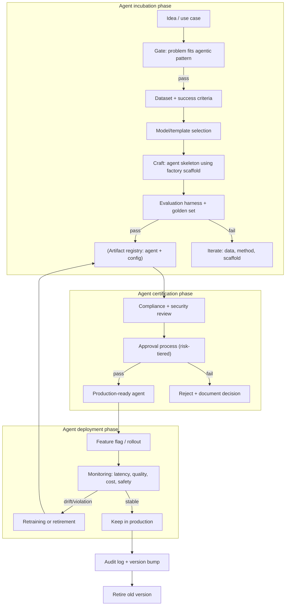

# Agent Factory Lifecycle

**Status:** Draft · **Primary RA:** [Agentic](../reference-architectures/agentic/README.md) · **Lifecycle position:** Design → mass-produce → monitor → retire individual agents

## Problem statement

Moving from hand-crafted, one-off agents to a scalable, governed factory that can produce, version, and retire autonomous agents at speed. Teams need to move beyond "craft" mode where every agent is built ad-hoc with inconsistent patterns, making it impossible to audit, scale, or enforce standards across the organization.

**Outcome wanted:** a repeatable, auditable process for incubating, testing, and mass‑producing agents that inherit organization‑wide governance, while allowing teams to specialize agents for their use cases.

## Pain points

| Pain | Consequence |
|---|---|
| Every agent built ad‑hoc | Inconsistent patterns; no shared governance; hard to audit |
| Agent proliferation without oversight | Shadow agents; ungoverned credentials; security blind spots |
| Re‑inventing orchestration per agent | Each team builds its own loop, tool registry, approval flow |
| No standard evaluation for agents | Quality claims unverifiable; metrics incomparable |
| Hard to retire obsolete agents | Stale agents linger; security risk; confusion over which agent to use |
| Agent version drift | No immutable artifact lineage; hard to roll back |
| Credential sprawl | Each agent has its own keys/policies; hard to rotate |

## Users & stakeholders

| Role | Interest |
|---|---|
| Platform team | Standardized agent lifecycle; resource governance |
| Security/compliance | One source of truth for credentials; auditability |
| Product teams | Fast‑track agent incubation; self‑service |
| Operations | Predictable retirement and rollback; fleet management |
| Risk/governance | Model risk, decision lineage, authority boundaries |

## Workflow

**Human decision points:** gate approval; risk-tiered authorization; retirement triggers; canary rollout acceptance.

## Tech stack (layers, not products)

| Layer | Capability | Notes |
|---|---|---|
| Scaffold / template | Factory‑generated agent skeleton | Enforces naming, checklist, default guardrails |
| Agent runtime | Durable orchestration engine | Retries, compensation, exception routing |
| Tool registry | Curated, permission‑scoped tool definitions | No per‑agent superuser credentials |
| Evaluation harness | Golden sets + adversarial sets + judge calibration | Same rigor as [evaluation lifecycle](../lifecycles/evaluation-lifecycle.md) |
| Registry | Immutable artifact + lineage + model card | Every agent version registered; rollback possible |
| Governance policy | Authorization boundary + approval gate | Declared at creation; enforced at runtime |
| Observability | Traces per agent decision + outcome | Stage‑decomposed; correlated with user/request ID |

## Trade-offs

| Decision | Option A | Option B | Guidance |
|---|---|---|---|
| Centralized vs. decentralized factory | Central team owns factory; teams consume | Teams build their own agents | Central factory ensures standards; allow limited self‑service via templates |
| Autonomy level | Fully autonomous (no human loop) | Human‑in‑the‑loop for all writes | Tier by impact; autonomous only for low‑risk, read‑only tasks |
| Evaluation depth | Minimal (quick check) | Comprehensive (golden + adversarial + judge) | Comprehensive for high‑risk agents; minimal for prototyping |
| Tool access | Broad (many integrations) | Narrow (vetted set only) | Start narrow; expand as trust and evaluation evidence grow |
| Rollout speed | Full fleet at once | Canary per agent type | Canary reduces risk; full fleet only for low‑impact agents |
| Retirement cadence | Reactive (when problem goes away) | Proactive (quarterly review) | Proactive; schedule retirement reviews alongside launch reviews |

## Success metrics

| Metric | Target | Measurement |
|---|---|---|
| Agent throughput (new agents / month) | ↑ (baseline per team) | Factory production rate |
| Agent certification pass rate | ≥ 80% on first submission | Factory quality gate |
| Agent retirement half‑life | ≤ 6 months | Fleet age distribution |
| Credential rotation compliance | 100% within SLA | Security audit |
| Evaluation coverage | 100% of agents have golden set | Registry audit |
| Agent security findings | → 0 critical findings per quarter | Security review |

## Failure modes & mitigations

| Failure | Mitigation |
|---|---|
| Agent proliferates without registration | Factory scaffold mandates registry step; CI gate blocks unregistered agents |
| Credential leakage | Vault‑scoped credentials; short‑lived tokens; centralized rotation |
| Evaluation drift (agent quality decays) | Periodic re‑evaluation against golden set; automated triggers |
| Retirement unknown (orphan agents) | Mandatory retirement ADR when agent is decommissioned; audit log |
| Factory scaffold rot vs standards | Update scaffold in same PR as standard change; version the scaffold |
| Agent takes unintended action | Authorization boundary + approval gate; sandbox at runtime; side-effect classification |

## Related artifacts

[Agent lifecycle](../lifecycles/agent-lifecycle.md) · [Agent patterns](../design-patterns/agent-patterns.md) · [Human-in-the-loop approval](../design-patterns/human-in-the-loop-approval.md) · [Artifact registry](../standards/README.md)

## Agent factory checklist

- [ ] Idea mapped to approved agentic pattern
- [ ] Success criteria and golden set defined
- [ ] Agent scaffold generated from factory template
- [ ] Evaluation harness configured and passing
- [ ] Compliance + security review passed
- [ ] Risk‑tiered approval obtained
- [ ] Agent registered in artifact registry
- [ ] Feature‑flagged rollout plan documented
- [ ] Monitoring + alerting configured
- [ ] Retirement criteria documented

--- 

*Agent factory lifecycle version 0.1 — Last updated: 2026-10-19*