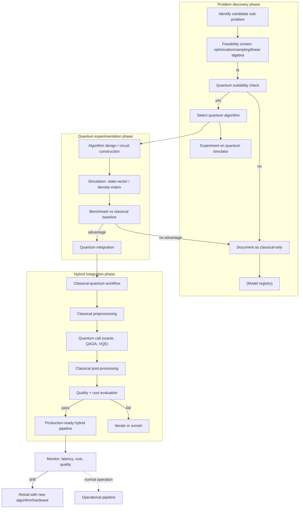

# Quantum Computing Lifecycle

**Status:** Exploratory · **Primary RA:** [Inference](../reference-architectures/inference/README.md) (quantum‑accelerated subset) · **Lifecycle position:** Algorithm discovery → experimentation → hybrid deployment

## Problem statement

Investigating whether quantum computing can provide a computational advantage for specific AI/ML workloads (optimization, sampling, linear algebra). Most AI today runs on classical hardware; quantum advantage is narrow and early-stage, but the technology is advancing rapidly enough that architecture teams need a structured way to evaluate, prototype, and integrate quantum-accelerated components.

**Outcome wanted:** a repeatable process for identifying quantum‑suitable sub‑problems, building hybrid classical‑quantum workflows, and evaluating whether quantum provides measurable benefit over classical baselines.

## Pain points

| Pain | Consequence |
|---|---|
| Unclear problem fit | Wasting resources on algorithms that see no quantum advantage |
| Hybrid workflow complexity | Orchestrating classical‑quantum communication adds latency and overhead |
| Limited hardware access | Prototype on simulators only; results may not translate to real devices |
| Skill gap | Few teams have quantum + ML expertise together |
| Evaluation ambiguity | No standard benchmarks for "quantum speedup" on ML tasks |
| Integration with existing pipelines | Quantum calls cannot be dropped into current ML pipelines without redesign |
| Cost unpredictability | Quantum pricing (time on hardware) is opaque; small changes can spike cost |

## Users & stakeholders

| Role | Interest |
|---|---|
| Research scientists | Exploring new algorithms; theoretical advantage |
| ML engineers | Integrating quantum steps into existing pipelines |
| Architecture team | Governance, cost tracking, risk classification |
| Security/compliance | Quantum‑resistant concerns; data sensitivity in superposition |
| Product leadership | Decision framework: build vs. buy vs. wait |

## Workflow

**Human decision points:** problem selection for quantum suitability; simulator vs. real hardware; integration boundaries; cost‑benefit go/no-go.

## Tech stack (layers, not products)

| Layer | Capability | Notes |
|---|---|---|
| Algorithm selection | QAOA, VQE, quantum annealing, phase estimation | Match algorithm to optimization/sampling/linear algebra need |
| Simulator | Open-source (Qiskit Aer, Cirq Simulator, Braket simulators) | Use for early iteration; results not production‑validated |
| Hardware access | Cloud quantum (AWS Braket, Azure Quantum, Google QCS) | Pay‑per‑use; queue times; device availability varies |
| Classical orchestrator | Workflow engine (Airflow, Prefect) | Coordinates pre‑ and post‑processing steps |
| Quantum SDK | Qiskit, Cirq, Ocean, Braket SDK | Choose based on hardware provider |
| Integration pattern | Call‑and‑return with data serialization | Quantum output is classical data after measurement |
| Evaluation | Statistical significance + confidence intervals | Single run not enough; multiple shots required |

## Trade-offs

| Decision | Option A | Option B | Guidance |
|---|---|---|---|
| Problem scope | Small sub‑problem within larger ML pipeline | End‑to‑end model replacement | Start with a bounded sub‑problem; never replace entire model without strong evidence |
| Simulation vs. real hardware | Simulator only (fast, no cost) | Real quantum hardware (slower, cost) | Simulate first; move to real hardware only if simulator shows consistent advantage |
| Integration depth | Tight (quantum step inline) | Loose (separate job, exchange data) | Loose is safer; tight only when latency budget permits quantum call |
| Cost model | Predictable (cloud credits) | Unpredictable (hardware wait time + runtime) | Budget caps on quantum experiments; treat as research spend until advantage proven |
| Algorithm maturity | Well‑known (VQE for chemistry) | Emerging (new heuristics) | Prefer vetted algorithms; new ones only in dedicated research spikes |

## Success metrics

| Metric | Target | Measurement |
|---|---|---|
| Quantum advantage detected | Yes (statistically significant) | Benchmark against best classical baseline |
| Circuit depth / width | Within device limits | Qubit count, gate depth |
| Simulation-to-real consistency | Results translate (same algorithm works) | Run on both; compare outcomes |
| Classical baseline parity | Classical still competitive | Cost/quality comparison |
| End‑to‑end latency | Within acceptable bound for use case | Include classical‑quantum communication |
| Cost per computation | Within research budget | Track hardware time + development cost |

## Failure modes & mitigations

| Failure | Mitigation |
|---|---|
| No quantum advantage found | Document as classical-only; revisit when hardware matures |
| Simulation results don't transfer to real hardware | Run on real hardware as early as possible; note simulator limitations |
| Integration overhead exceeds quantum speedup | Measure total latency (classical + quantum); only integrate if net win |
| Hardware availability kills schedule | Build fallback classical path; treat quantum as optional enrichment |
| Cost spirals without oversight | Hard budget caps; weekly review of quantum spend; cap shots per experiment |

## Related artifacts

["Inference reference architecture (quantum-accelerated subset)"](../reference-architectures/inference/README.md) · [Quantum‑ready design patterns](../design-patterns/general-architecture.md) · [Classical‑quantum integration patterns](../standards/integration-patterns.md)

## Quantum computing suitability screen

| Criterion | Threshold | Pass/Fail |
|---|---|---|
| Problem type | Optimization, sampling, linear algebra | \_\_\_\_ |
| Problem size | Fits on NISQ-era device (≤ 100 qubits useful) | \_\_\_\_ |
| Advantage evidence | Simulator shows >2× speedup or better quality | \_\_\_\_ |
| Hardware availability | Target device accessible within project timeline | \_\_\_\_ |
| Integration cost | Classical‑quantum overhead < 20% of total | \_\_\_\_ |

--- 

*Quantum computing lifecycle version 0.1 — Last updated: 2026-10-19*