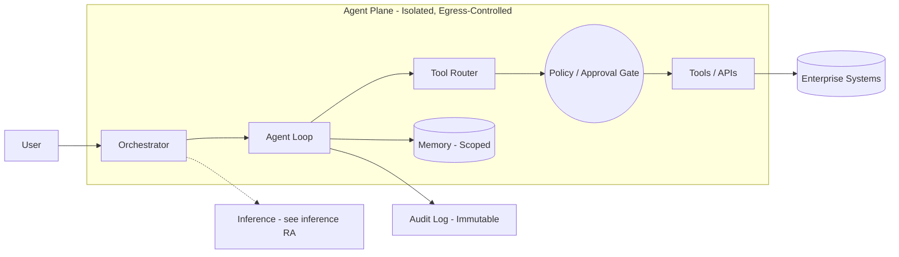

# Reference Architecture — Agentic Systems

**Status:** Proposed · **Owner:** AI Architecture · **Last reviewed:** 2026-10-17

## Scope & non-goals

**Covers:** LLM-driven agents and multi-agent orchestrations that take actions (tool calls, workflows, system changes) on behalf of the enterprise.

**Does not cover:** simple single-turn inference (see [inference/](../inference/README.md)), pure retrieval systems (see [rag/](../rag/README.md)).

> Agentic systems carry the highest blast radius of any workload type. Deviations from this architecture require **direct architecture review** — never self-certified.

## Context diagram

## Component view

1. **Orchestrator** — owns the plan/execute/observe loop; deterministic control flow where possible
2. **Tool router** — typed tool registry; every tool has declared side-effect class (read / write / irreversible)
3. **Policy & approval gate** — write and irreversible actions require human or policy-engine approval
4. **Scoped memory** — session and long-term memory isolated per user/tenant; explicit retention
5. **Audit log** — every step, tool call, and decision recorded immutably with correlation IDs
6. **Egress control** — agents run in an isolated plane with strict outbound allowlists

## Technology mapping

| Component | Approved options | Notes |
|---|---|---|
| Agent frameworks | _(see [approved-technologies.md](../../standards/approved-technologies.md))_ | Prefer minimal frameworks; the loop is simple, the governance is not |
| Tool interfaces | OpenAPI/typed function calling | Standard contract format |

## Security controls

- **Assume prompt injection.** All external content (web, email, retrieved docs) is untrusted input
- Least-privilege, short-lived credentials per tool — never a broad service account
- Side-effect classification mandatory for every tool; approval gate enforced outside the model
- Bounded autonomy: max steps, max cost, max wall-clock per run; kill switch at orchestrator
- Adversarial red-teaming required before production (see [security/red-team-integration.md](../../security/red-team-integration.md))

## Operational requirements

- Full traceability: user → run → steps → tool calls → outputs
- Anomaly alerting: unexpected tool sequences, cost spikes, permission escalations
- Graceful halt: on policy violation or model uncertainty, stop and escalate — do not guess

## Deviation process

Direct architecture review required. Open an ADR referencing this document, tag `deviation`, and follow [architecture review process](../../docs/architecture-review-process.md).
