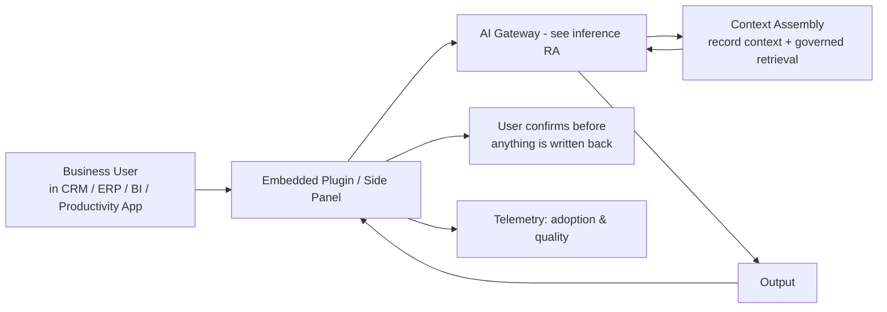

# Reference Architecture — Enterprise Copilots & Embedded AI

**Status:** Proposed · **Owner:** AI Architecture · **Last reviewed:** 2026-10-17

## Scope & non-goals

**Covers:** AI capability embedded into core business applications — copilots, summarization, classification, drafting, and assistants inside CRM, ERP, BI, IT service management, productivity suites, and internal tools.

**Does not cover:** customer-facing AI products (treat as [inference](../inference/) + [RAG](../rag/)); autonomous multi-step agents with side effects (see [agentic/](../agentic/) — embedded copilots that *act* follow the agentic RA); internal data question-answering (see [data-agent/](../data-agent/)).

## Context diagram

## Component view

1. **Embedding layer** — plugin/side-panel/integration inside the host application; thin — orchestration and policy live outside the vendor app
2. **Context assembly** — current record, user role, and relevant governed content assembled with attribution; minimization: send only what the task needs
3. **Gateway reuse** — all model traffic via the AI gateway; embedded AI gets no special provider access
4. **Write-back discipline** — AI output is *suggested* by default; commit requires explicit user action (copilots are read-mostly, write-rarely)
5. **Adoption & quality telemetry** — usage, acceptance rate, edit-before-accept rate, and user feedback tied to feature versions

## Technology mapping

| Component | Approved options | Notes |
|---|---|---|
| Host-app extension points | Native APIs of the host platform | Configuration-first where possible |
| Gateway | _(see [approved-technologies.md](../../standards/approved-technologies.md))_ | |
| Retrieval | Per [RAG RA](../rag/README.md) | |

## Security controls

- Data sent to the model respects the host app's classification — a record the user can see may still be class-restricted from *model processing*; enforce at context assembly
- No cross-user context leakage: memory/sessions scoped per user and per host-app tenant
- Prompt injection via record content (email bodies, notes, tickets) treated as untrusted input (AI-3)
- OAuth scopes of the embedding integration are read-first; write scopes are separate and audited
- Output filters on anything rendered back into the application (AI-2)

## Operational requirements

- Feature-flagged rollout per org unit; kill switch at the plugin level
- Adoption KPIs and quality KPIs reported per [business-case-and-value](../../docs/business-case-and-value.md) (this is where value shows up first — unmeasured copilots die quietly)
- Host-application upgrades are a compatibility test event (integration contracts, not hope)
- Prompt/version changes gated by evaluation on realistic in-app task sets

## Rollout playbook (summary)

1. One high-frequency, low-risk task (summarize a record)
2. Measure acceptance and time saved against baseline
3. Expand scope within the same host app
4. Only after proven value: tasks with write actions (per [HITL approval](../../design-patterns/human-in-the-loop-approval.md))

## Deviation process

Open an ADR referencing this document, tag `deviation`, and route via [architecture review process](../../docs/architecture-review-process.md).
