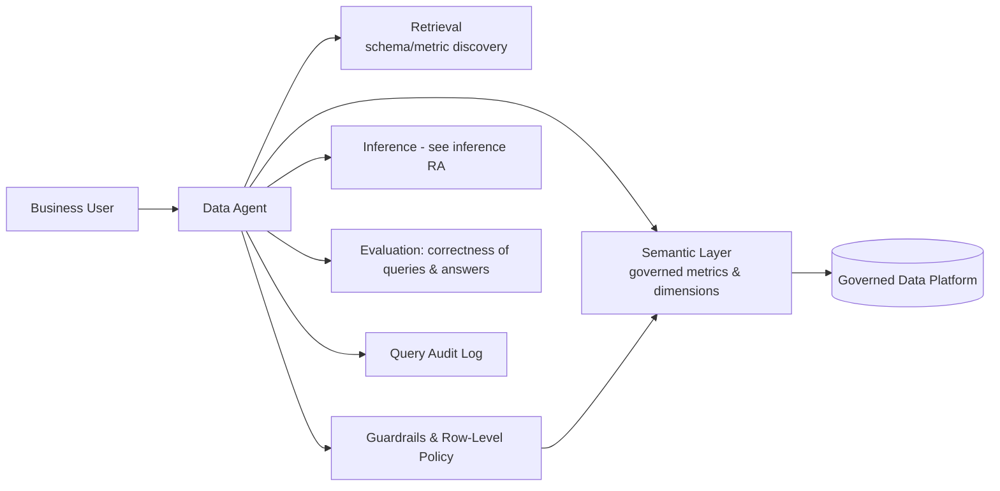

# Reference Architecture — Data Agent (Natural-Language Query over Governed Data)

**Status:** Proposed · **Owner:** AI Architecture · **Last reviewed:** 2026-10-17

## Scope & non-goals

**Covers:** the natural-language interface to governed data — agents that let business users ask questions and get answers without writing SQL — built on a semantic foundation with retrieval, tool calling, evaluation, and guardrails.

**Does not cover:** general-purpose document RAG (see [rag/](../rag/README.md)); BI dashboards on the same semantic layer (a consumer of it, not an AI workload); predictive ML on data pipelines (see [training/](../training/README.md)).

## Why this is its own workload type

A data agent that queries **raw tables** hallucinates business meaning; a data agent that queries a **semantic layer** inherits governed definitions. The distinguishing architectural decision: agents must resolve questions against governed metrics and dimensions — never against physical tables directly.

## Context diagram

## Component view

1. **Semantic foundation** — metrics, dimensions, joins, and business definitions modeled once, versioned like code, shared by BI *and* agents (see [semantic-layer-grounding pattern](../../design-patterns/semantic-layer-grounding.md))
2. **Schema/metric retrieval** — helps the agent discover what exists: relevant tables, metrics, definitions — a retrieval problem over metadata, not data
3. **Query synthesis & execution** — generates queries against the semantic layer (or SQL with guardrails); every query validated before execution
4. **Policy enforcement** — row/column-level security from the governed platform applies identically to agent queries; the agent inherits user permissions, never gains its own broad access
5. **Answer grounding** — responses cite the metric definitions and query results used; "I don't know" is a valid, evaluated outcome
6. **Evaluation** — two-layer metrics: *query correctness* (does the generated query mean what the user asked?) and *answer correctness* (does the response match the query result?)

## Technology mapping

| Component | Approved options | Notes |
|---|---|---|
| Semantic layer | _(see [approved-technologies.md](../../standards/approved-technologies.md))_ | |
| Vector/metadata retrieval | _(see approved technologies)_ | Over metadata/schema, small corpus |
| Agent framework | _(see approved technologies)_ | Tool-calling per [agent-protocols](../../standards/agent-protocols.md) |

## Security controls

- User identity flows through to query execution — no agent-level superuser credentials (controls AI-4)
- PII columns masked or excluded at the semantic/policy layer regardless of user curiosity (AI-6)
- Generated queries logged and auditable (AI-7)
- Prompt-injection resistance: retrieved metadata is untrusted content; it cannot alter policies (AI-3)

## Operational requirements

- Golden question set per business domain with expected query/answer pairs, gated in CI ([evaluation-in-ci](../../design-patterns/evaluation-in-ci.md))
- Ambiguity detection: low-confidence questions ask a clarifying question rather than guessing
- Query cost and scan volume tracked; runaway queries killed by policy
- Semantic layer changes trigger data-agent evaluation runs (definitions changed → answers may change)

## Deviation process

Open an ADR referencing this document, tag `deviation`, and route via [architecture review process](../../docs/architecture-review-process.md).
