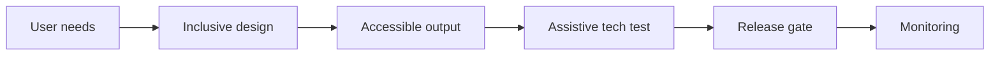

# Reference Architecture — Accessibility-First Enterprise Architecture

**Status:** Proposed · **Owner:** AI Architecture · **Last reviewed:** 2026-10-22

## Principle

Design AI interactions for the widest range of users and abilities from the start.

This architecture makes the named concern the **primary optimization target**. Other concerns are treated as constraints with explicit budgets, not as afterthoughts. When trade-offs arise, the named concern wins unless a documented exception is approved.

## When to use it

Use for any user-facing AI, including copilots, chat, and automated communications.

## Context diagram

## Component view

- WCAG-aligned interaction design
- Screen-reader and keyboard support
- Cognitive load reduction
- Multimodal output options
- Accessibility testing in CI
- User feedback from diverse users

## Decision rules

- Accessibility is a release gate, not a retrofit.
- AI outputs are perceivable, operable, understandable, and robust.
- No essential information only in color or images.
- Users can control pace, verbosity, and modality.
- Feedback includes users with disabilities.

## Security and compliance

- No security through obscurity in accessible flows.
- Assistive access is authenticated and authorized.

## Operational requirements

- Accessibility audits scheduled.
- Defects tracked with severity.
- Regression tests for accessible paths.

## Metrics

- Accessibility audit score
- Task success for assistive-tech users
- Defect count by severity
- Time to remediate accessibility issues

## Anti-patterns

- Accessibility as final polish
- AI-generated UI without keyboard support
- Essential info only in visual output
- No testing with assistive technology

## Deviation process

Open an ADR referencing this document, tag `deviation`, and route via [architecture review process](../../docs/architecture-review-process.md). Deviations must state which constraint is being relaxed and for how long.

## Related

- [ai-ux-and-interaction.md](../../design-patterns/ai-ux-and-interaction.md)
- [product-lifecycle.md](../../lifecycles/product-lifecycle.md)
- [README.md](../../blueprints/copilot-starter-kit/README.md)
- [AI security controls](../../security/ai-security-controls.md)
- [Design review checklist](../../docs/design-review-checklist.md)
