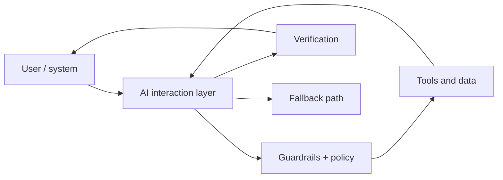

# Reference Architecture — AI-First Enterprise Architecture

**Status:** Proposed · **Owner:** AI Architecture · **Last reviewed:** 2026-10-22

## Principle

Design the system so AI is the primary interaction and computation layer, with traditional software providing guardrails, state, and determinism.

This architecture makes the named concern the **primary optimization target**. Other concerns are treated as constraints with explicit budgets, not as afterthoughts. When trade-offs arise, the named concern wins unless a documented exception is approved.

## When to use it

Use when the core user value comes from judgment, generation, retrieval, or automation that deterministic code cannot provide.

## Context diagram

## Component view

- AI interaction and orchestration layer
- Context assembly and retrieval
- Tool and data access plane
- Guardrails and policy enforcement
- Evaluation and feedback loop
- Human oversight and override

## Decision rules

- Use AI where judgment is required; use deterministic code for invariants.
- Every AI output that affects state must be verifiable.
- Feedback from real usage feeds evaluation datasets.
- Provide a non-AI fallback for critical paths.
- Human override is a feature, not an exception.

## Security and compliance

- All model traffic through the gateway.
- Untrusted content never becomes privileged instructions.
- Least-privilege tool credentials.
- Audit every tool call and output.

## Operational requirements

- Quality SLO alongside latency and availability SLOs.
- Cost attribution per AI interaction.
- Shadow or canary rollout for model and prompt changes.

## Metrics

- Task success rate
- Human override rate
- Cost per successful outcome
- User satisfaction
- Fallback usage rate

## Anti-patterns

- Adding AI as a feature without evaluation
- No fallback when the model fails
- Letting the model own irreversible actions without approval
- Ignoring cost until after launch

## Deviation process

Open an ADR referencing this document, tag `deviation`, and route via [architecture review process](../../docs/architecture-review-process.md). Deviations must state which constraint is being relaxed and for how long.

## Related

- [README.md](../agentic/README.md)
- [genai-llmops-lifecycle.md](../../lifecycles/genai-llmops-lifecycle.md)
- [ai-ux-and-interaction.md](../../design-patterns/ai-ux-and-interaction.md)
- [AI security controls](../../security/ai-security-controls.md)
- [Design review checklist](../../docs/design-review-checklist.md)
