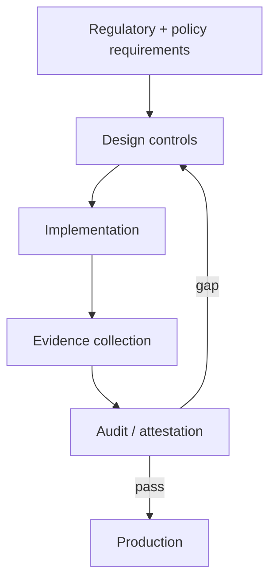

# Reference Architecture — Compliance-First Enterprise Architecture

**Status:** Proposed · **Owner:** AI Architecture · **Last reviewed:** 2026-10-22

## Principle

Treat regulatory, contractual, and policy obligations as first-class design inputs and release gates, not as a late-stage review.

This architecture makes the named concern the **primary optimization target**. Other concerns are treated as constraints with explicit budgets, not as afterthoughts. When trade-offs arise, the named concern wins unless a documented exception is approved.

## When to use it

Use for regulated data, customer-facing AI, or any workload subject to audit, retention, residency, or sector-specific rules.

## Context diagram

## Component view

- Policy and control catalog
- Data classification and handling rules
- Audit logging and evidence store
- Retention and deletion workflows
- Access control and residency controls
- Compliance dashboard and reporting

## Decision rules

- No feature ships unless its control mapping is complete.
- Data residency and retention are declared before implementation.
- Every automated decision that affects a person is explainable and contestable.
- Deletion requests propagate to indexes, caches, logs, and training data.
- Compliance evidence is generated by the system, not assembled manually.

## Security and compliance

- Zero-data-retention terms with providers where required.
- PII redaction at every boundary.
- Immutable audit logs retained per schedule.
- Access reviews on a defined cadence.

## Operational requirements

- Control coverage tracked as a first-class metric.
- Audit readiness tested through tabletop exercises.
- Change management records for model and data changes.

## Metrics

- Control coverage percentage
- Audit findings and remediation time
- Time to produce evidence
- Policy violation count
- Deletion SLA adherence

## Anti-patterns

- Compliance review after build
- Manual evidence collection
- Undefined data retention
- Assuming provider terms satisfy internal policy

## Deviation process

Open an ADR referencing this document, tag `deviation`, and route via [architecture review process](../../docs/architecture-review-process.md). Deviations must state which constraint is being relaxed and for how long.

## Related

- [ai-security-controls.md](../../security/ai-security-controls.md)
- [business-case-and-value.md](../../docs/business-case-and-value.md)
- [model-risk-lifecycle.md](../../lifecycles/model-risk-lifecycle.md)
- [AI security controls](../../security/ai-security-controls.md)
- [Design review checklist](../../docs/design-review-checklist.md)
