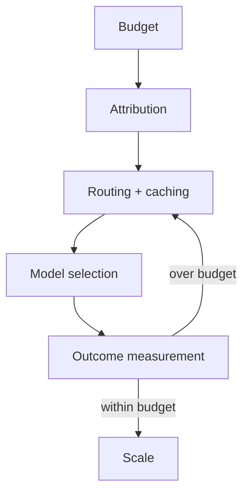

# Reference Architecture — Cost-First (FinOps-First) Enterprise Architecture

**Status:** Proposed · **Owner:** AI Architecture · **Last reviewed:** 2026-10-22

## Principle

Make unit economics a design constraint from day one; every AI capability must justify its cost per successful outcome.

This architecture makes the named concern the **primary optimization target**. Other concerns are treated as constraints with explicit budgets, not as afterthoughts. When trade-offs arise, the named concern wins unless a documented exception is approved.

## When to use it

Use for high-volume or long-running AI workloads, or when AI spend is a material budget line.

## Context diagram

## Component view

- Cost attribution by tenant, feature, and request
- Budgets and alarms before production traffic
- Model routing and cascading
- Caching and context minimization
- Capacity and batch optimization
- Unit-economics reporting

## Decision rules

- Cost per successful outcome is tracked from the first deployment.
- No unbounded spend; budgets fail closed.
- Context size is minimized and measured.
- Model choice is justified by quality-per-dollar, not accuracy alone.
- Cost regressions block release alongside quality regressions.

## Security and compliance

- Cost data does not expose sensitive tenant details.
- Budget controls cannot be bypassed by workloads.

## Operational requirements

- Cost dashboards reviewed with engineering and finance.
- Anomaly detection on spend.
- Quarterly unit-economics review.

## Metrics

- Cost per successful outcome
- Cost per request and per token
- Budget variance
- Cache hit rate
- Spend by tenant and feature

## Anti-patterns

- Optimizing accuracy without cost
- No attribution beyond total bill
- Unbounded context windows
- Scaling before unit economics are known

## Deviation process

Open an ADR referencing this document, tag `deviation`, and route via [architecture review process](../../docs/architecture-review-process.md). Deviations must state which constraint is being relaxed and for how long.

## Related

- [finops-cost-lifecycle.md](../../lifecycles/finops-cost-lifecycle.md)
- [cost-finops.md](../../design-patterns/cost-finops.md)
- [README.md](../../blueprints/observability-starter-kit/README.md)
- [AI security controls](../../security/ai-security-controls.md)
- [Design review checklist](../../docs/design-review-checklist.md)
