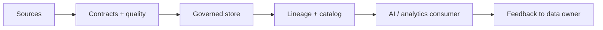

# Reference Architecture — Data-First Enterprise Architecture

**Status:** Proposed · **Owner:** AI Architecture · **Last reviewed:** 2026-10-22

## Principle

Make data quality, governance, lineage, and access policy the foundation; models and applications are consumers of governed data.

This architecture makes the named concern the **primary optimization target**. Other concerns are treated as constraints with explicit budgets, not as afterthoughts. When trade-offs arise, the named concern wins unless a documented exception is approved.

## When to use it

Use when AI outputs depend on enterprise data, especially analytics, RAG, or data agents.

## Context diagram

## Component view

- Data contracts and schema registry
- Quality checks and freshness monitoring
- Data catalog and lineage
- Classification and access policy
- Semantic layer for metrics
- Deletion and retention workflows

## Decision rules

- No model or agent on unversioned, unowned data.
- Data quality failures block downstream AI releases.
- Access policy is enforced in the data plane, not the prompt.
- Lineage covers ingestion, transformation, retrieval, and training.
- Deletion requests propagate end to end.

## Security and compliance

- Classification enforced at ingestion, retrieval, and logging.
- PII redaction before data leaves the trust boundary.
- Least-privilege access to source systems.

## Operational requirements

- Data freshness and quality SLOs.
- Lineage completeness tracked.
- Incident runbooks for data corruption.

## Metrics

- Data quality score
- Freshness and completeness
- Lineage coverage
- Policy violation count
- Time to onboard a new data source

## Anti-patterns

- Training on drifting live tables
- Undefined metric definitions
- Post-filtering retrieval results instead of pre-filtering
- No data owner for AI-critical datasets

## Deviation process

Open an ADR referencing this document, tag `deviation`, and route via [architecture review process](../../docs/architecture-review-process.md). Deviations must state which constraint is being relaxed and for how long.

## Related

- [data-lifecycle.md](../../lifecycles/data-lifecycle.md)
- [semantic-layer-grounding.md](../../design-patterns/semantic-layer-grounding.md)
- [README.md](../../blueprints/data-agent-starter-kit/README.md)
- [AI security controls](../../security/ai-security-controls.md)
- [Design review checklist](../../docs/design-review-checklist.md)
