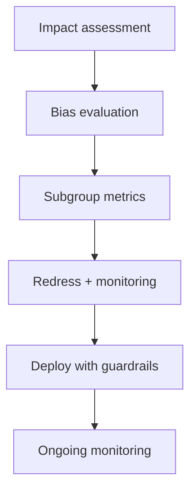

# Reference Architecture — Ethics-First Enterprise Architecture

**Status:** Proposed · **Owner:** AI Architecture · **Last reviewed:** 2026-10-22

## Principle

Assess and mitigate societal, fairness, and bias impacts before deploying AI that affects people.

This architecture makes the named concern the **primary optimization target**. Other concerns are treated as constraints with explicit budgets, not as afterthoughts. When trade-offs arise, the named concern wins unless a documented exception is approved.

## When to use it

Use for AI that influences decisions about individuals, groups, or access to services.

## Context diagram

## Component view

- AI impact assessment
- Bias and fairness evaluation
- Subgroup performance reporting
- Redress and appeal mechanisms
- Ethics review gate
- Ongoing monitoring for drift in fairness

## Decision rules

- No deployment without an impact assessment for high-risk use cases.
- Subgroup performance is reported, not only aggregate.
- Users can contest AI-influenced decisions.
- Ethics review is a release gate for high-impact systems.
- Monitoring includes fairness metrics, not only accuracy.

## Security and compliance

- Protected attributes handled per policy.
- Audit logs support contestability.

## Operational requirements

- Ethics metrics in production dashboards.
- Periodic re-assessment after major changes.
- Incident process for harm reports.

## Metrics

- Subgroup performance gaps
- Appeal and redress rates
- Bias evaluation coverage
- Harm incidents
- Time to remediate fairness issues

## Anti-patterns

- Aggregate-only quality metrics
- No appeal path
- Treating fairness as a one-time check
- Ignoring downstream effects of automation

## Deviation process

Open an ADR referencing this document, tag `deviation`, and route via [architecture review process](../../docs/architecture-review-process.md). Deviations must state which constraint is being relaxed and for how long.

## Related

- [model-risk-lifecycle.md](../../lifecycles/model-risk-lifecycle.md)
- [business-case-and-value.md](../../docs/business-case-and-value.md)
- [ai-security-controls.md](../../security/ai-security-controls.md)
- [AI security controls](../../security/ai-security-controls.md)
- [Design review checklist](../../docs/design-review-checklist.md)
