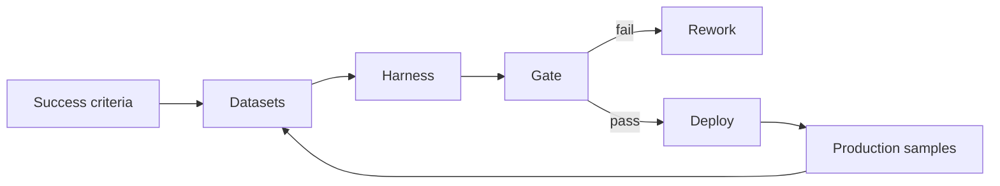

# Reference Architecture — Evaluation-First Enterprise Architecture

**Status:** Proposed · **Owner:** AI Architecture · **Last reviewed:** 2026-10-22

## Principle

Define success, datasets, and gates before building; no AI behavior change ships without measured evidence.

This architecture makes the named concern the **primary optimization target**. Other concerns are treated as constraints with explicit budgets, not as afterthoughts. When trade-offs arise, the named concern wins unless a documented exception is approved.

## When to use it

Use for any AI capability whose quality is not self-evident from unit tests.

## Context diagram

## Component view

- Success criteria and slice definitions
- Versioned golden, adversarial, and production datasets
- Deterministic scorers and calibrated judges
- CI gates with explicit thresholds
- Per-slice reporting
- Production evaluation sampling

## Decision rules

- Evaluation datasets are versioned and never mutated in place.
- Missing datasets fail the build rather than skip.
- Judge models and prompts are pinned and calibrated.
- Behavior changes require a passing eval gate.
- Production samples feed dataset growth.

## Security and compliance

- Evaluation data contains no unredacted sensitive data.
- Judge outputs are advisory; humans validate samples.

## Operational requirements

- Eval runtime budget tracked.
- Regression detection on known-bad changes.
- Dataset coverage reviewed quarterly.

## Metrics

- Scorer reliability
- Judge-human agreement
- Regression detection rate
- Slice coverage
- Evaluation runtime

## Anti-patterns

- Average-only quality reporting
- Unpinned judge models
- Skipping evals for small changes
- No adversarial dataset

## Deviation process

Open an ADR referencing this document, tag `deviation`, and route via [architecture review process](../../docs/architecture-review-process.md). Deviations must state which constraint is being relaxed and for how long.

## Related

- [evaluation-lifecycle.md](../../lifecycles/evaluation-lifecycle.md)
- [evaluation-in-ci.md](../../design-patterns/evaluation-in-ci.md)
- [README.md](../../blueprints/evaluation-starter-kit/README.md)
- [AI security controls](../../security/ai-security-controls.md)
- [Design review checklist](../../docs/design-review-checklist.md)
