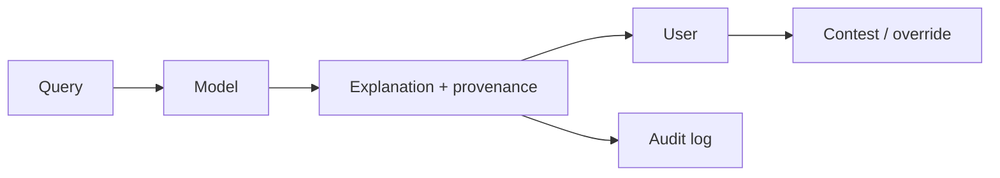

# Reference Architecture — Explainability-First Enterprise Architecture

**Status:** Proposed · **Owner:** AI Architecture · **Last reviewed:** 2026-10-22

## Principle

Make AI decisions inspectable, attributable, and contestable by default.

This architecture makes the named concern the **primary optimization target**. Other concerns are treated as constraints with explicit budgets, not as afterthoughts. When trade-offs arise, the named concern wins unless a documented exception is approved.

## When to use it

Use for decision support, regulated domains, or any AI output that users or auditors must trust.

## Context diagram

## Component view

- Citations and source provenance
- Rationales and confidence indicators
- Feature or evidence attribution
- Audit logs with run IDs
- Contestability and override paths
- Explanation quality evaluation

## Decision rules

- User-facing AI provides provenance for consequential outputs.
- Explanations are evaluated for usefulness, not just generated.
- Audit logs capture inputs, tools, outputs, and approvals.
- Contestability is available for high-impact decisions.
- Explanations do not reveal sensitive data.

## Security and compliance

- Explanations are redacted and access-controlled.
- Audit logs are immutable.

## Operational requirements

- Explanation satisfaction tracked.
- Audit completeness measured.
- Incident investigation supported by logs.

## Metrics

- Explanation satisfaction
- Audit completeness
- Contestability usage
- Time to investigate incidents
- Provenance coverage

## Anti-patterns

- Post-hoc rationalization with no provenance
- No audit trail for tool calls
- Explanations that leak sensitive data
- Assuming confidence scores are explanations

## Deviation process

Open an ADR referencing this document, tag `deviation`, and route via [architecture review process](../../docs/architecture-review-process.md). Deviations must state which constraint is being relaxed and for how long.

## Related

- [rag-patterns.md](../../design-patterns/rag-patterns.md)
- [README.md](../../blueprints/rag-starter-kit/README.md)
- [evaluation-lifecycle.md](../../lifecycles/evaluation-lifecycle.md)
- [AI security controls](../../security/ai-security-controls.md)
- [Design review checklist](../../docs/design-review-checklist.md)
