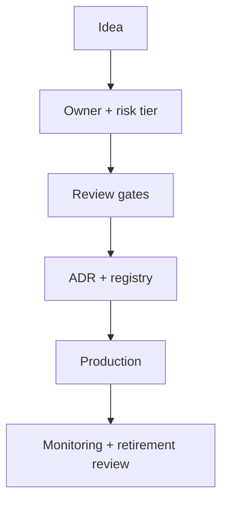

# Reference Architecture — Governance-First Enterprise Architecture

**Status:** Proposed · **Owner:** AI Architecture · **Last reviewed:** 2026-10-22

## Principle

Make ownership, risk tiering, decision rights, and approval explicit before any AI system reaches production.

This architecture makes the named concern the **primary optimization target**. Other concerns are treated as constraints with explicit budgets, not as afterthoughts. When trade-offs arise, the named concern wins unless a documented exception is approved.

## When to use it

Use in organizations with multiple AI teams, regulated domains, or shared platforms.

## Context diagram

## Component view

- AI workload registry
- Risk tiering and control mapping
- Architecture decision records
- Review and approval workflows
- Ownership and on-call assignment
- Retirement and deprecation process

## Decision rules

- No production AI without a named owner and on-call rotation.
- Risk tier determines required controls and approvals.
- Deviations are recorded as ADRs.
- Registry entries are enforced in CI.
- Retirement reviews are scheduled, not ad hoc.

## Security and compliance

- Central credential and tool registry; no per-agent keys.
- Mandatory registry entry for production agents.
- Automatic expiry of unowned systems.

## Operational requirements

- Governance metrics reviewed quarterly.
- Review cycle time tracked.
- Exception expiry tracked.

## Metrics

- Registered vs unregistered systems
- Review cycle time
- Policy violation count
- Agent age distribution
- Retirement compliance

## Anti-patterns

- Shadow AI with no owner
- Approvals by email only
- Registry as documentation only
- No retirement path for failed experiments

## Deviation process

Open an ADR referencing this document, tag `deviation`, and route via [architecture review process](../../docs/architecture-review-process.md). Deviations must state which constraint is being relaxed and for how long.

## Related

- [architecture-review-process.md](../../docs/architecture-review-process.md)
- [README.md](../../adr/README.md)
- [README.md](../../blueprints/agent-factory-starter-kit/README.md)
- [AI security controls](../../security/ai-security-controls.md)
- [Design review checklist](../../docs/design-review-checklist.md)
