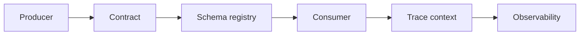

# Reference Architecture — Interoperability-First Enterprise Architecture

**Status:** Proposed · **Owner:** AI Architecture · **Last reviewed:** 2026-10-22

## Principle

Prefer open standards and portable contracts so systems can evolve without lock-in.

This architecture makes the named concern the **primary optimization target**. Other concerns are treated as constraints with explicit budgets, not as afterthoughts. When trade-offs arise, the named concern wins unless a documented exception is approved.

## When to use it

Use for enterprise platforms, integration-heavy systems, and multi-vendor environments.

## Context diagram

## Component view

- OpenAPI and AsyncAPI contracts
- Schema registry with compatibility rules
- Versioning and deprecation policy
- Trace context propagation
- Portable data formats
- Adapter layer for vendor-specific features

## Decision rules

- Breaking changes require a new version.
- No unregistered schema reaches production.
- Consumers tolerate duplicates and out-of-order delivery.
- Vendor-specific features are isolated behind adapters.
- Migration effort is estimated for every dependency.

## Security and compliance

- Contracts exclude secrets and PII by default.
- Replay requires authorization and audit.

## Operational requirements

- Contract tests in CI.
- Compatibility gates automated.
- DLQ and replay tested.

## Metrics

- Contract test pass rate
- Breaking change count
- Migration effort estimate
- DLQ age
- Schema registry coverage

## Anti-patterns

- Undocumented integration contracts
- Direct dependency on vendor internals
- No deprecation policy
- Unversioned events

## Deviation process

Open an ADR referencing this document, tag `deviation`, and route via [architecture review process](../../docs/architecture-review-process.md). Deviations must state which constraint is being relaxed and for how long.

## Related

- [api-lifecycle.md](../../lifecycles/api-lifecycle.md)
- [integration-patterns.md](../../standards/integration-patterns.md)
- [README.md](../../blueprints/integration-starter-kit/README.md)
- [AI security controls](../../security/ai-security-controls.md)
- [Design review checklist](../../docs/design-review-checklist.md)
