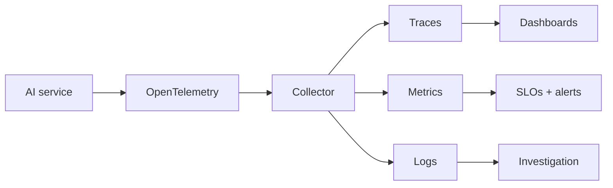

# Reference Architecture — Observability-First Enterprise Architecture

**Status:** Proposed · **Owner:** AI Architecture · **Last reviewed:** 2026-10-22

## Principle

Instrument for understanding before optimizing; every AI request must be traceable, measurable, and debuggable in production.

This architecture makes the named concern the **primary optimization target**. Other concerns are treated as constraints with explicit budgets, not as afterthoughts. When trade-offs arise, the named concern wins unless a documented exception is approved.

## When to use it

Use for any AI workload in production, especially where quality decay is invisible to uptime monitoring.

## Context diagram

## Component view

- OpenTelemetry traces, metrics, and logs
- Correlation IDs across hops
- Stage-level spans around model and tool calls
- Token, latency, and cost metrics
- Quality sampling of real traffic
- Burn-rate alerts

## Decision rules

- Every request has a correlation ID.
- No raw prompts or PII in logs by default.
- Quality is monitored alongside uptime.
- Alerts are tied to user impact, not raw thresholds.
- Observability cost is tracked as platform cost.

## Security and compliance

- Trace access follows least privilege.
- Redaction at the logging boundary.
- Retention aligned with privacy policy.

## Operational requirements

- Trace completeness tracked.
- Alert precision and MTTD measured.
- Runbooks linked from dashboards.

## Metrics

- Trace completeness
- Mean time to detect (MTTD)
- Alert precision
- Quality SLO coverage
- Observability cost per workload

## Anti-patterns

- Uptime-only monitoring for AI systems
- No correlation ID across services
- Logging raw prompts by default
- Alerting on thresholds without burn rates

## Deviation process

Open an ADR referencing this document, tag `deviation`, and route via [architecture review process](../../docs/architecture-review-process.md). Deviations must state which constraint is being relaxed and for how long.

## Related

- [operations-incident-lifecycle.md](../../lifecycles/operations-incident-lifecycle.md)
- [distributed-scaling.md](../../design-patterns/distributed-scaling.md)
- [README.md](../../blueprints/observability-starter-kit/README.md)
- [AI security controls](../../security/ai-security-controls.md)
- [Design review checklist](../../docs/design-review-checklist.md)
