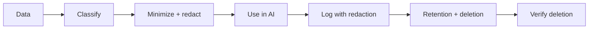

# Reference Architecture — Privacy-First Enterprise Architecture

**Status:** Proposed · **Owner:** AI Architecture · **Last reviewed:** 2026-10-22

## Principle

Minimize data collection and exposure; enforce residency, consent, and deletion as system properties, not policy documents.

This architecture makes the named concern the **primary optimization target**. Other concerns are treated as constraints with explicit budgets, not as afterthoughts. When trade-offs arise, the named concern wins unless a documented exception is approved.

## When to use it

Use whenever personal, customer, employee, or regulated data touches AI pipelines.

## Context diagram

## Component view

- Data classification and handling rules
- PII detection and redaction
- Consent and purpose tracking
- Residency and storage controls
- Retention schedules
- Deletion propagation across stores, indexes, caches, and logs

## Decision rules

- No raw PII in prompts, logs, or traces by default.
- Collect the minimum data needed for the task.
- Deletion requests propagate end to end within SLA.
- Provider contracts include zero-retention where required.
- Privacy impact assessment before new data use.

## Security and compliance

- PII redaction at every trust boundary.
- Access to raw data is least privilege and audited.
- Encryption at rest and in transit.

## Operational requirements

- Deletion SLA tracked and tested.
- Privacy incidents drilled.
- Data inventory maintained.

## Metrics

- PII leakage incidents (target zero)
- Deletion SLA adherence
- Consent coverage
- Data minimization ratio
- Access audit findings

## Anti-patterns

- Logging raw prompts for debugging
- Assuming provider retention defaults are acceptable
- Treating redaction as a post-processing step
- No deletion path for indexes and caches

## Deviation process

Open an ADR referencing this document, tag `deviation`, and route via [architecture review process](../../docs/architecture-review-process.md). Deviations must state which constraint is being relaxed and for how long.

## Related

- [ai-security-controls.md](../../security/ai-security-controls.md)
- [data-lifecycle.md](../../lifecycles/data-lifecycle.md)
- [README.md](../../blueprints/rag-starter-kit/README.md)
- [AI security controls](../../security/ai-security-controls.md)
- [Design review checklist](../../docs/design-review-checklist.md)
