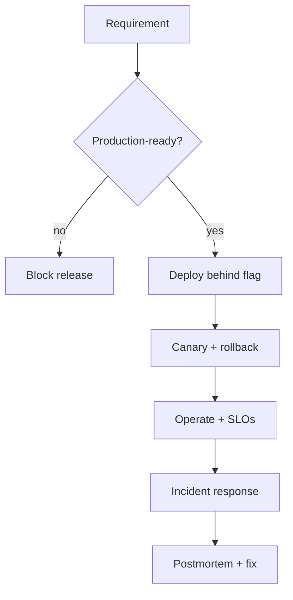

# Reference Architecture — Production-First Enterprise Architecture

**Status:** Proposed · **Owner:** AI Architecture · **Last reviewed:** 2026-10-22

## Principle

Optimize for reliable operation in production before optimizing for feature richness or demo impact.

This architecture makes the named concern the **primary optimization target**. Other concerns are treated as constraints with explicit budgets, not as afterthoughts. When trade-offs arise, the named concern wins unless a documented exception is approved.

## When to use it

Use when an AI capability will carry business-critical traffic, has an on-call owner, and must meet availability, latency, and recovery commitments.

## Context diagram

## Component view

- Runtime and deployment pipeline with rollback
- Observability: traces, metrics, logs, quality sampling
- SLOs and error budgets per tier
- Runbooks, on-call rotation, and escalation paths
- Feature flags and progressive delivery
- Capacity planning and cost guardrails

## Decision rules

- No capability ships without a runbook, alert, and rollback path.
- Prefer boring, well-understood technology for critical paths.
- Feature flags gate every user-visible change.
- Canary or shadow rollout is required for model and prompt changes.
- Manual steps in operations are defects, not procedures.

## Security and compliance

- Secrets only in the secrets manager; short-lived credentials.
- Guardrails and output filters mandatory for user-facing paths.
- PII redaction before logging.
- Kill switch tested before production traffic.

## Operational requirements

- Default SLOs for availability, latency, and cost per tier.
- Autoscaling on queue depth and latency, not CPU alone.
- Circuit breakers and graceful degradation to a non-AI path.
- Postmortems for every SLO breach.

## Metrics

- SLO attainment and error-budget burn
- Mean time to recovery (MTTR)
- Deployment frequency and rollback rate
- Incident count per quarter
- Cost per successful outcome

## Anti-patterns

- Demo-first delivery with no rollback
- Hidden manual deployment steps
- Optimizing accuracy while ignoring latency or cost
- Shipping without alerts because "it worked in staging"

## Deviation process

Open an ADR referencing this document, tag `deviation`, and route via [architecture review process](../../docs/architecture-review-process.md). Deviations must state which constraint is being relaxed and for how long.

## Related

- [operations-incident-lifecycle.md](../../lifecycles/operations-incident-lifecycle.md)
- [reliability-resilience.md](../../design-patterns/reliability-resilience.md)
- [non-functional-requirements.md](../../docs/non-functional-requirements.md)
- [AI security controls](../../security/ai-security-controls.md)
- [Design review checklist](../../docs/design-review-checklist.md)
