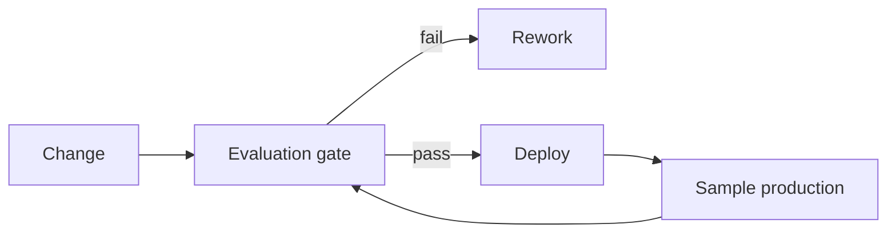

# Reference Architecture — Quality-First Enterprise Architecture

**Status:** Proposed · **Owner:** AI Architecture · **Last reviewed:** 2026-10-22

## Principle

Optimize for correctness, safety, and usefulness first; treat speed and cost as constraints, not the objective.

This architecture makes the named concern the **primary optimization target**. Other concerns are treated as constraints with explicit budgets, not as afterthoughts. When trade-offs arise, the named concern wins unless a documented exception is approved.

## When to use it

Use when output quality directly affects trust, revenue, safety, or regulatory exposure.

## Context diagram

## Component view

- Evaluation harness with versioned datasets
- Deterministic scorers and calibrated judges
- Per-slice reporting and regression detection
- Golden, adversarial, and production-sample sets
- Release gates with explicit thresholds
- Quality monitoring in production

## Decision rules

- No behavior change ships without an evaluation gate.
- Report per-slice results, not only averages.
- Judge models and prompts are pinned and calibrated.
- Missing datasets fail the build rather than skip.
- Quality regressions block release even if latency improves.

## Security and compliance

- Evaluation datasets contain no unredacted sensitive data.
- Judge outputs are advisory; humans validate samples.
- Adversarial sets include injection and exfiltration attempts.

## Operational requirements

- Quality SLO defined per workload.
- Evaluation runs in CI within the build budget.
- Production sampling feeds dataset growth.

## Metrics

- Task success and faithfulness
- Regression detection rate
- Judge-human agreement
- Per-slice failure rates
- Time to detect quality decay

## Anti-patterns

- Average-only quality reporting
- Skipping evals for "small" prompt changes
- Using an uncalibrated judge as authority
- Treating latency gains as sufficient for release

## Deviation process

Open an ADR referencing this document, tag `deviation`, and route via [architecture review process](../../docs/architecture-review-process.md). Deviations must state which constraint is being relaxed and for how long.

## Related

- [evaluation-lifecycle.md](../../lifecycles/evaluation-lifecycle.md)
- [evaluation-in-ci.md](../../design-patterns/evaluation-in-ci.md)
- [README.md](../../blueprints/evaluation-starter-kit/README.md)
- [AI security controls](../../security/ai-security-controls.md)
- [Design review checklist](../../docs/design-review-checklist.md)
