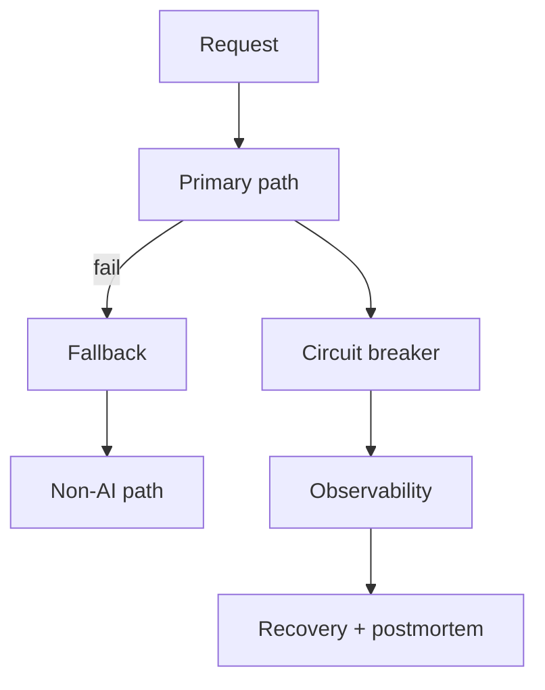

# Reference Architecture — Resilience-First Enterprise Architecture

**Status:** Proposed · **Owner:** AI Architecture · **Last reviewed:** 2026-10-22

## Principle

Design for graceful degradation and recovery; a manipulated or failed model must not take down the business process.

This architecture makes the named concern the **primary optimization target**. Other concerns are treated as constraints with explicit budgets, not as afterthoughts. When trade-offs arise, the named concern wins unless a documented exception is approved.

## When to use it

Use for customer-facing, revenue-critical, or safety-relevant AI systems.

## Context diagram

## Component view

- Fallback and non-AI paths
- Circuit breakers and retries
- Timeout and bulkhead isolation
- Chaos and failure-injection testing
- Disaster recovery and backups
- Degraded-mode UX

## Decision rules

- Every AI path has a defined non-AI fallback.
- Failures degrade gracefully, never silently.
- Timeouts are set on every external call.
- Blast radius is bounded by infrastructure, not prompt text.
- Recovery is tested, not assumed.

## Security and compliance

- Sandbox isolation limits manipulated-agent impact.
- Kill switch available and tested.
- No single provider dependency without a documented fallback.

## Operational requirements

- Chaos experiments on a schedule.
- RTO and RPO defined per tier.
- Incident drills for AI-specific failures.

## Metrics

- Availability and error rate
- Failover time
- Blast radius of incidents
- Mean time to recovery
- Chaos experiment pass rate

## Anti-patterns

- Single provider with no fallback
- No timeout on model calls
- Assuming retry will fix a bad model
- Silent fallback to stale data

## Deviation process

Open an ADR referencing this document, tag `deviation`, and route via [architecture review process](../../docs/architecture-review-process.md). Deviations must state which constraint is being relaxed and for how long.

## Related

- [reliability-resilience.md](../../design-patterns/reliability-resilience.md)
- [operations-incident-lifecycle.md](../../lifecycles/operations-incident-lifecycle.md)
- [README.md](../../blueprints/intelligent-automation-starter-kit/README.md)
- [AI security controls](../../security/ai-security-controls.md)
- [Design review checklist](../../docs/design-review-checklist.md)
