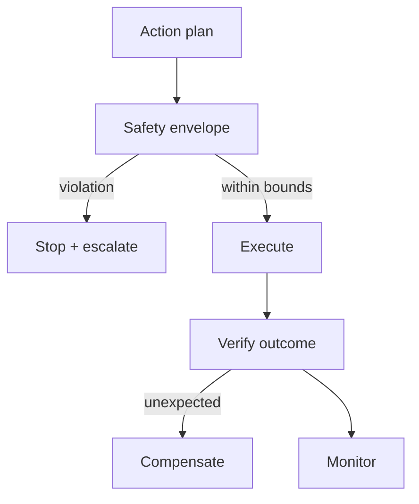

# Reference Architecture — Safety-First Enterprise Architecture

**Status:** Proposed · **Owner:** AI Architecture · **Last reviewed:** 2026-10-22

## Principle

Prevent harm first; autonomous and physical actions are bounded by validated envelopes and independent stop paths.

This architecture makes the named concern the **primary optimization target**. Other concerns are treated as constraints with explicit budgets, not as afterthoughts. When trade-offs arise, the named concern wins unless a documented exception is approved.

## When to use it

Use for agentic systems with side effects, physical AI, embodied AI, or high-impact automation.

## Context diagram

## Component view

- Hazard analysis and risk assessment
- Safety envelope enforced outside the model
- Independent emergency stop path
- Human takeover and approval gates
- Red-team and simulation testing
- Incident and near-miss reporting

## Decision rules

- Safety limits are enforced by deterministic systems, not prompts.
- No autonomous operation outside the validated envelope.
- Emergency stop is tested before every deployment.
- Near misses are reported and reviewed.
- Safety regressions block release.

## Security and compliance

- Least privilege and sandbox isolation.
- No credentials in model context.
- Audit trail for all actions.

## Operational requirements

- Safety drills scheduled.
- Near-miss metrics reviewed.
- Decommissioning planned before deployment.

## Metrics

- Safety violations (target zero)
- Near-miss count
- Emergency stop test pass rate
- Time to stop
- Incident severity

## Anti-patterns

- Safety limits in prompt text only
- No independent stop path
- Skipping simulation validation
- Treating near misses as non-events

## Deviation process

Open an ADR referencing this document, tag `deviation`, and route via [architecture review process](../../docs/architecture-review-process.md). Deviations must state which constraint is being relaxed and for how long.

## Related

- [physical-ai-lifecycle.md](../../lifecycles/physical-ai-lifecycle.md)
- [embodied-ai-lifecycle.md](../../lifecycles/embodied-ai-lifecycle.md)
- [README.md](../../blueprints/physical-ai-starter-kit/README.md)
- [AI security controls](../../security/ai-security-controls.md)
- [Design review checklist](../../docs/design-review-checklist.md)
