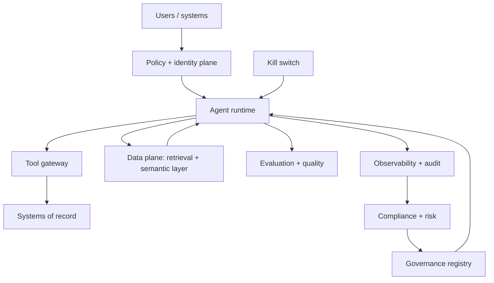

# Reference Architecture — Secure Agentic Enterprise

**Status:** Proposed · **Owner:** AI Architecture + Cybersecurity · **Last reviewed:** 2026-10-22

## Scope & non-goals

**Covers:** an enterprise-wide architecture for deploying AI agents that can reason, use tools, and take actions across business systems, with security, compliance, quality, and production operability as non-negotiable constraints.

**Does not cover:** a single agent implementation (see [agentic/](../agentic/README.md)); model training (see [training/](../training/README.md)); or a specific business process (see [intelligent-automation/](../intelligent-automation/README.md)).

## Context diagram

## Component view

1. **Identity and policy plane** — workload identity, user identity propagation, authorization boundaries, and policy-as-code.
2. **Agent runtime** — durable, bounded execution with step, time, and cost ceilings and human approval for side effects.
3. **Tool gateway** — typed tool registry, per-tool permissions, egress allowlists, and sandboxed execution.
4. **Data plane** — governed retrieval, semantic layer, ACL filtering, and provenance for every context item.
5. **Evaluation plane** — golden and adversarial datasets, CI gates, production sampling, and quality SLOs.
6. **Observability plane** — traces, metrics, logs, cost attribution, and quality sampling correlated by run ID.
7. **Governance plane** — registry, risk tiering, ADRs, review gates, and scheduled retirement.
8. **Safety controls** — kill switch, bounded autonomy, sandbox isolation, and independent emergency stop paths.

## Data flow

1. A user or system submits a goal with identity and tenant context.
2. The policy plane authenticates the caller and determines the authorization boundary.
3. The agent runtime plans and selects tools from the registry.
4. The tool gateway enforces permissions, egress rules, and sandboxing before execution.
5. The data plane supplies governed context with ACL pre-filtering and provenance.
6. Outputs pass guardrails and are verified against the target system where possible.
7. Every step, tool call, approval, and output is logged immutably and correlated by run ID.
8. Evaluation and observability planes feed quality, cost, and safety metrics back into governance.

## Technology mapping

| Component | Approved options | Notes |
|---|---|---|
| Identity | _(see [approved-technologies.md](../../standards/approved-technologies.md))_ | Workload identity and short-lived tokens |
| Agent runtime | _(see approved technologies)_ | Durable, bounded, auditable |
| Tool gateway | _(see approved technologies)_ | Typed registry, sandboxed execution |
| Data plane | _(see approved technologies)_ | Governed retrieval and semantic layer |
| Evaluation | _(see approved technologies)_ | Versioned datasets and CI gates |
| Observability | _(see approved technologies)_ | OpenTelemetry and cost attribution |

## Security controls

- AI-1 through AI-12 from [ai-security-controls.md](../../security/ai-security-controls.md) apply in full.
- All model traffic transits the AI gateway; no provider keys in applications.
- Retrieved content is untrusted data and cannot modify permissions or policy.
- Side effects pass an external approval gate; approvals expire to deny.
- Agent credentials are never exposed to model context.
- Kill switch and bounded autonomy are tested quarterly.

## Operational requirements

- SLOs for latency, availability, quality, and cost per agent tier.
- Capacity planning for peak concurrency and tool-call fan-out.
- Canary or shadow rollout for agent capability changes.
- Incident runbooks for tool failures, model degradation, and runaway agents.
- Retirement reviews on a defined cadence.

## Deviation process

Open an ADR referencing this document, tag `deviation`, and route via [architecture review process](../../docs/architecture-review-process.md). Deviations that relax security, compliance, or safety controls require explicit sign-off from Cybersecurity and AI Governance.

## Related

- [Agentic reference architecture](../agentic/README.md)
- [Agent lifecycle](../../lifecycles/agent-lifecycle.md)
- [Agent factory lifecycle](../../lifecycles/agent-factory-lifecycle.md)
- [AI security controls](../../security/ai-security-controls.md)
- [Evaluation lifecycle](../../lifecycles/evaluation-lifecycle.md)
- [Operations & incident lifecycle](../../lifecycles/operations-incident-lifecycle.md)
- [Secure agentic enterprise starter kit](../../blueprints/secure-agentic-enterprise-starter-kit/README.md)
