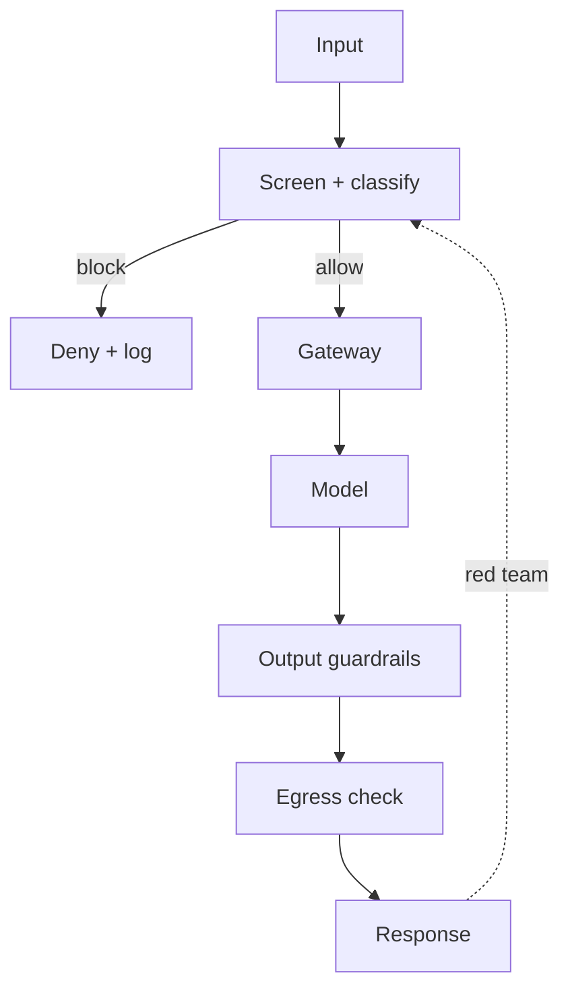

# Reference Architecture — Security-First Enterprise Architecture

**Status:** Proposed · **Owner:** AI Architecture · **Last reviewed:** 2026-10-22

## Principle

Threat model and control design precede feature design; assume the model can be manipulated and keep controls outside the model.

This architecture makes the named concern the **primary optimization target**. Other concerns are treated as constraints with explicit budgets, not as afterthoughts. When trade-offs arise, the named concern wins unless a documented exception is approved.

## When to use it

Use for any AI workload with external input, tool access, sensitive data, or side effects.

## Context diagram

## Component view

- AI gateway with workload identity
- Input and output guardrails that fail closed
- Tool permissions and egress allowlists
- Sandboxed execution environments
- Immutable audit logging
- Red-team harness in CI

## Decision rules

- Guardrails are deterministic systems, not prompt instructions.
- Treat all retrieved content as untrusted data.
- Least privilege, short-lived credentials for every component.
- No provider keys in application code.
- Fail closed when a guardrail dependency is unavailable.

## Security and compliance

- All controls from AI-1 through AI-12 apply.
- Tenant scoping on every store, cache, and query.
- No secrets or raw PII in prompts, logs, or traces.
- Adversarial testing before production and after major changes.

## Operational requirements

- Security metrics reviewed with operational metrics.
- Kill switch tested quarterly.
- Vulnerability remediation tracked to SLA.

## Metrics

- Prompt-injection success rate (target zero)
- Data-exfiltration success rate (target zero)
- Guardrail false-positive rate
- Time to remediate findings
- Red-team coverage

## Anti-patterns

- Prompt-based security controls
- Auto-fetching model-provided URLs
- Shared service accounts across agents
- Assuming the model will follow instructions under attack

## Deviation process

Open an ADR referencing this document, tag `deviation`, and route via [architecture review process](../../docs/architecture-review-process.md). Deviations must state which constraint is being relaxed and for how long.

## Related

- [ai-security-controls.md](../../security/ai-security-controls.md)
- [red-team-integration.md](../../security/red-team-integration.md)
- [README.md](../../blueprints/ai-security-starter-kit/README.md)
- [AI security controls](../../security/ai-security-controls.md)
- [Design review checklist](../../docs/design-review-checklist.md)
