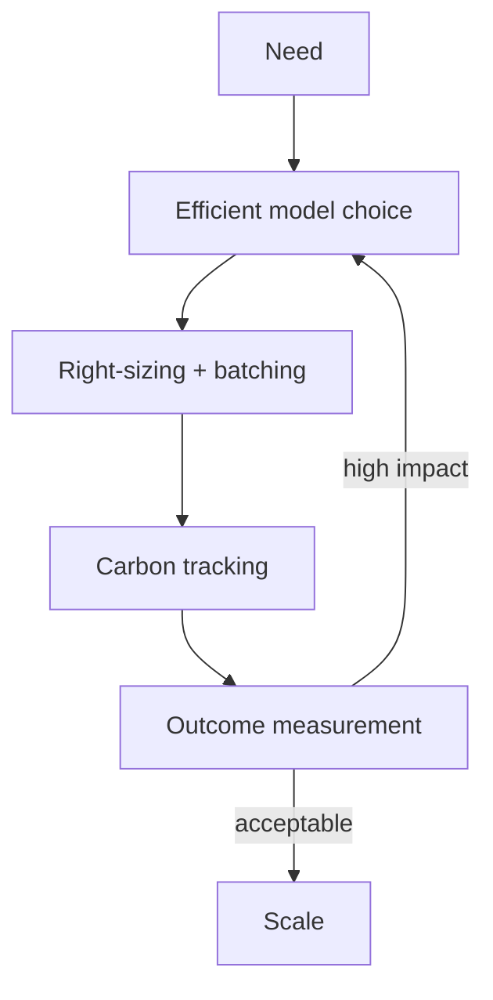

# Reference Architecture — Sustainability-First Enterprise Architecture

**Status:** Proposed · **Owner:** AI Architecture · **Last reviewed:** 2026-10-22

## Principle

Treat energy and carbon as design constraints; prefer efficient models and measure impact per outcome.

This architecture makes the named concern the **primary optimization target**. Other concerns are treated as constraints with explicit budgets, not as afterthoughts. When trade-offs arise, the named concern wins unless a documented exception is approved.

## When to use it

Use for large-scale or always-on AI systems, or where sustainability targets are contractual.

## Context diagram

## Component view

- Model efficiency and right-sizing
- Batching and caching
- Carbon and energy tracking
- Hardware utilization monitoring
- Lifecycle and retirement planning
- Sustainability reporting

## Decision rules

- Model choice includes energy per quality point.
- No always-on oversized capacity without justification.
- Carbon per successful outcome is tracked.
- Retirement and cleanup are planned before deployment.
- Efficiency regressions are reviewed with quality regressions.

## Security and compliance

- Sustainability controls do not bypass security controls.
- Resource limits prevent runaway jobs.

## Operational requirements

- Carbon metrics in dashboards.
- Capacity planning includes energy.
- Quarterly sustainability review.

## Metrics

- Energy per successful outcome
- Carbon per successful outcome
- Hardware utilization
- Model efficiency ratio
- Retirement compliance

## Anti-patterns

- Largest model by default
- No carbon tracking
- Overprovisioned always-on endpoints
- Ignoring idle resource cost

## Deviation process

Open an ADR referencing this document, tag `deviation`, and route via [architecture review process](../../docs/architecture-review-process.md). Deviations must state which constraint is being relaxed and for how long.

## Related

- [finops-cost-lifecycle.md](../../lifecycles/finops-cost-lifecycle.md)
- [cost-finops.md](../../design-patterns/cost-finops.md)
- [README.md](../../blueprints/training-starter-kit/README.md)
- [AI security controls](../../security/ai-security-controls.md)
- [Design review checklist](../../docs/design-review-checklist.md)
