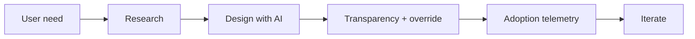

# Reference Architecture — User-First (Human-Centered) Enterprise Architecture

**Status:** Proposed · **Owner:** AI Architecture · **Last reviewed:** 2026-10-22

## Principle

Optimize for human outcomes, transparency, and control; AI is in service of the user, not the other way around.

This architecture makes the named concern the **primary optimization target**. Other concerns are treated as constraints with explicit budgets, not as afterthoughts. When trade-offs arise, the named concern wins unless a documented exception is approved.

## When to use it

Use for user-facing AI, copilots, decision support, and any system where adoption and trust determine value.

## Context diagram

## Component view

- User research and task analysis
- Interaction design and feedback loops
- Transparency and provenance in outputs
- Human override and escalation paths
- Accessibility and inclusive design
- Adoption and satisfaction telemetry

## Decision rules

- Users can inspect, correct, and override AI outputs.
- High-impact actions require explicit user confirmation.
- AI must reduce task time or error, measured against a baseline.
- Accessibility is a release gate, not a retrofit.
- Feedback is captured and routed to evaluation datasets.

## Security and compliance

- No deceptive or hidden AI behavior.
- User data used only with consent and clear purpose.
- Override paths are auditable.

## Operational requirements

- Adoption metrics reviewed with quality metrics.
- Support escalation paths documented.
- Incident communication plan for user-visible failures.

## Metrics

- Task completion time vs baseline
- User satisfaction and trust
- Override and rejection rates
- Accessibility audit score
- Adoption and retention

## Anti-patterns

- AI novelty over user need
- No way to see or correct AI output
- Measuring engagement instead of task success
- Hiding AI involvement from users

## Deviation process

Open an ADR referencing this document, tag `deviation`, and route via [architecture review process](../../docs/architecture-review-process.md). Deviations must state which constraint is being relaxed and for how long.

## Related

- [ai-ux-and-interaction.md](../../design-patterns/ai-ux-and-interaction.md)
- [product-lifecycle.md](../../lifecycles/product-lifecycle.md)
- [README.md](../../blueprints/copilot-starter-kit/README.md)
- [AI security controls](../../security/ai-security-controls.md)
- [Design review checklist](../../docs/design-review-checklist.md)
