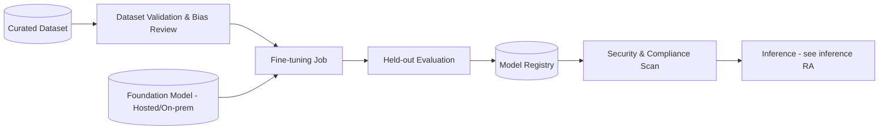

# Reference Architecture — Fine-tuning

**Status:** Proposed · **Owner:** AI Architecture · **Last reviewed:** 2026-10-17

## Scope & non-goals

**Covers:** adaptation of foundation models (LoRA/QLoRA, full fine-tuning, distillation, DPO-style preference tuning), dataset curation and labeling, evaluation, and hosting of adapted models.

**Does not cover:** large-scale pretraining (out of scope for the enterprise), prompt-only customization (treat as inference).

> Fine-tuning is a **build decision with long-term maintenance cost**. Every fine-tuning initiative must first document why prompting, RAG, or tool-use will not meet the requirement (see [build-vs-buy-framework.md](../../docs/build-vs-buy-framework.md)).

## Context diagram

## Component view

1. **Dataset curation** — documented provenance, consent/lawful basis, labeling guidelines
2. **Dataset validation** — schema, quality, bias, and PII checks before training
3. **Fine-tuning job** — time-boxed, quota-bound, reproducible configuration
4. **Evaluation** — held-out set + red-team suite; compared against the prompting/RAG baseline
5. **Registry & scan** — artifact registered with lineage; security scan before serving
6. **Serving** — per [inference reference architecture](../inference/README.md)

## Technology mapping

| Component | Approved options | Notes |
|---|---|---|
| Fine-tuning platforms | _(see [approved-technologies.md](../../standards/approved-technologies.md))_ | Prefer hosted fine-tuning for licensed models |
| Base models | _(see [model-provider-standards.md](../../standards/model-provider-standards.md))_ | Check license terms for adapted-model redistribution |

## Security controls

- Training data requires documented lawful basis and PII handling per data-platform standards
- No training on data the organization cannot retain under source-system agreements
- Base-model license reviewed before adaptation; adapted weights classified per derived-work terms
- Adapted model passes the same security scan as any artifact before promotion

## Operational requirements

- Each fine-tuning initiative records: baseline (prompt/RAG) metrics vs tuned metrics, cost, and maintenance owner
- Drift monitoring post-deployment; scheduled re-evaluation cadence
- Sunset plan mandatory: what happens when the base model is deprecated by the provider

## Deviation process

Open an ADR referencing this document, tag `deviation`, and route via [architecture review process](../../docs/architecture-review-process.md).
