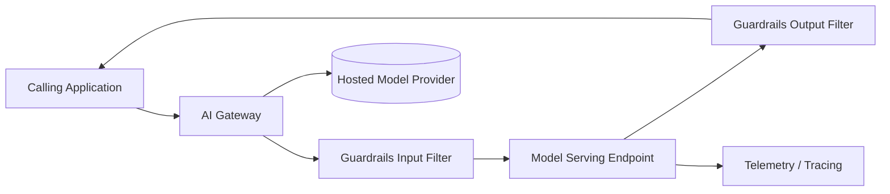

# Reference Architecture — Inference

**Status:** Proposed · **Owner:** AI Architecture · **Last reviewed:** 2026-10-17

## Scope & non-goals

**Covers:** model serving for real-time, batch, and streaming inference; gateway patterns for hosted model providers; autoscaling, observability, and cost guardrails.

**Does not cover:** RAG-specific retrieval components (see [rag/](../rag/README.md)), agent orchestration (see [agentic/](../agentic/README.md)).

## Context diagram

## Component view

1. **AI Gateway** — single entry point: authN/Z, rate limiting, routing, failover, cost attribution
2. **Guardrails** — input/output filtering (prompt injection, PII, topic policy)
3. **Serving endpoints** — self-hosted or hosted, with autoscaling and warm capacity per SLO
4. **Telemetry** — per-request tracing, token/latency/cost metrics, quality sampling
5. **Model provider integration** — via gateway only; no direct provider keys in applications

## Technology mapping

| Component | Approved options | Notes |
|---|---|---|
| Gateway | _(see [approved-technologies.md](../../standards/approved-technologies.md))_ | |
| Self-hosted serving | _(see approved technologies)_ | |
| Hosted providers | _(see [model-provider-standards.md](../../standards/model-provider-standards.md))_ | |

## Security controls

- All egress to model providers through the gateway with allowlisted endpoints and DLP inspection
- Secrets (provider keys) live only in the secrets manager; workloads use short-lived credentials
- Prompt/response logging respects data classification; PII redaction before logging
- Guardrails and output filters mandatory for user-facing endpoints

## Operational requirements

- Default SLOs: availability, p95 latency, cost-per-1k-requests; set per tier (T0–T3)
- Autoscaling on queue depth/latency, not CPU alone
- Canary or shadow rollout required for model version changes
- Circuit breakers and graceful degradation to a fallback model or non-AI path

## Deviation process

Open an ADR referencing this document, tag `deviation`, and route via [architecture review process](../../docs/architecture-review-process.md).
