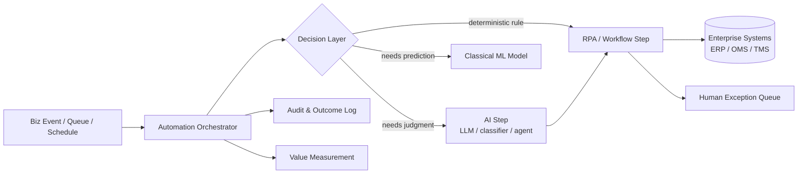

# Reference Architecture — Intelligent Automation

**Status:** Proposed · **Owner:** AI Architecture · **Last reviewed:** 2026-10-17

## Scope & non-goals

**Covers:** end-to-end automation that combines workflow automation, robotic process automation (RPA), classical ML, AI/LLM reasoning, and agents — platform-agnostic architectures across the application, data, integration, and automation layers (finance, retail, supply chain, and similar operational functions).

**Does not cover:** pure conversational systems without a process (see [inference](../inference/) + [copilots](../copilots/)); data platforms themselves (see [data-agent](../data-agent/) for their AI interface).

## Context diagram

## Component view

1. **Orchestrator** — the durable control loop: retries, compensation, timeouts, exception queues. AI steps are *steps*, not the process
2. **Decision layer routing** — each branch chooses the cheapest reliable mechanism: a rules engine for the 80% (deterministic, free, testable), AI only where judgment is genuinely needed
3. **AI steps** — invoke models/agents with typed inputs/outputs; side-effecting steps subject to [HITL approval](../../design-patterns/human-in-the-loop-approval.md)
4. **Human exception queue** — automation never fails silently; exceptions route to a person with context and a decision history
5. **Integration layer** — system access via APIs first; UI-automation RPA only where no API exists (with breakage detection, because UI automation is the fragile edge)
6. **Value measurement** — every automation logged with outcome and cycle-time delta feeding [business-case-and-value](../../docs/business-case-and-value.md)

## Technology mapping

| Layer | Approved options | Notes |
|---|---|---|
| Orchestration/workflow | _(see [approved-technologies.md](../../standards/approved-technologies.md))_ | |
| RPA platform | _(see approved technologies)_ | |
| AI step runtime | Per applicable RA ([inference](../inference/), [agentic](../agentic/)) | |

## Security controls

- Automation credentials are per-process, least privilege, vaulted, and short-lived — never a human's account running unattended
- Every action attributable: process instance → step → decision → system change (AI-7)
- AI prompts/templates versioned and change-controlled; production automation flows follow [SSDLC](../../security/secure-sdlc.md)
- Unstructured content entering the decision layer treated as untrusted (AI-3)

## Operational requirements

- Success rate, exception rate, and cycle-time-per-transaction tracked per automation
- Break-glass process to disable an automation without halting the business function it serves
- Quarterly re-evaluation: automations drift as upstream systems change (UI automation breaks loudest)
- Decommission criteria defined at build time — nobody owns automation forever by accident

## Design principles

- **Automate the process *and* simplify it first** — automating a broken process institutionalizes the waste
- **Rules before models, models before agents** — cheapest reliable mechanism wins
- **Platform-agnostic core** — automation logic portable; platform-specific glue isolated behind adapters (build-vs-buy per [framework](../../docs/build-vs-buy-framework.md))

## Deviation process

Open an ADR referencing this document, tag `deviation`, and route via [architecture review process](../../docs/architecture-review-process.md).
