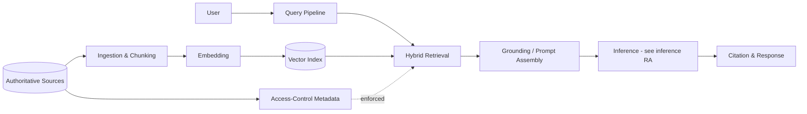

# Reference Architecture — RAG (Retrieval-Augmented Generation)

**Status:** Proposed · **Owner:** AI Architecture · **Last reviewed:** 2026-10-17

## Scope & non-goals

**Covers:** ingestion pipelines, chunking/embedding strategies, vector and hybrid retrieval, grounding, citation, and evaluation for RAG systems.

**Does not cover:** non-retrieval chat systems, fine-tuning as a grounding strategy (see [fine-tuning/](../fine-tuning/README.md)).

## Context diagram

## Component view

1. **Ingestion** — scheduled, idempotent; chunking strategy recorded per corpus
2. **Embedding** — approved embedding models; re-embedding is a versioned migration, never silent
3. **Index** — vector store with hybrid (vector + keyword) retrieval where precision matters
4. **Access control** — document-level permissions enforced **at retrieval time**, not post-hoc
5. **Grounding** — prompt assembly with citations; prompt templates versioned like code
6. **Evaluation** — golden set, retrieval relevance and faithfulness metrics in CI

## Technology mapping

| Component | Approved options | Notes |
|---|---|---|
| Vector store | _(see [approved-technologies.md](../../standards/approved-technologies.md))_ | |
| Embedding models | _(see [model-provider-standards.md](../../standards/model-provider-standards.md))_ | |
| Orchestration | _(see approved technologies)_ | |

## Security controls

- Retrieval-time authorization: a user can never retrieve chunks they are not entitled to see
- Source content scanned for prompt-injection payloads at ingestion and retrieval
- Provenance retained for every chunk (source, version, ACL set)
- Retention and deletion propagate from source systems to the index

## Operational requirements

- Golden retrieval set maintained per corpus; regressions block deployment
- Chunking/embedding changes require an evaluation report in the PR
- Index freshness SLO per corpus (e.g., source change visible within N hours)

## Deviation process

Open an ADR referencing this document, tag `deviation`, and route via [architecture review process](../../docs/architecture-review-process.md).
