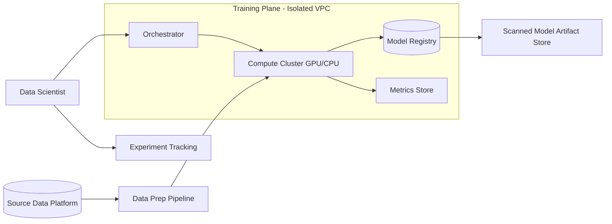

# Reference Architecture — Training

**Status:** Proposed · **Owner:** AI Architecture · **Last reviewed:** 2026-10-17

## Scope & non-goals

**Covers:** batch and distributed model training workloads, experiment management, training-data preparation pipelines, and model artifact publication.

**Does not cover:** fine-tuning (see [fine-tuning/](../fine-tuning/README.md)), real-time inference (see [inference/](../inference/README.md)), or exploratory notebook work (governed by data-platform standards).

## Context diagram

## Component view

1. **Orchestration** — scheduled/repeatable pipelines, not ad-hoc scripts on shared machines
2. **Compute** — GPU/CPU clusters with per-project isolation and quota
3. **Experiment tracking** — runs, parameters, metrics, lineage
4. **Data preparation** — versioned, reproducible transformations from the governed data platform
5. **Model registry** — immutable, versioned artifacts with provenance metadata
6. **Publication gate** — security and quality scan before promotion

## Technology mapping

| Component | Approved options | Notes |
|---|---|---|
| Orchestration | _(see [approved-technologies.md](../../standards/approved-technologies.md))_ | |
| Compute | _(see approved technologies)_ | Spot/preemptible preferred for non-time-critical runs |
| Experiment tracking | _(see approved technologies)_ | |
| Model registry | _(see approved technologies)_ | |

## Security controls

- Training plane runs in an isolated network segment; no direct internet egress
- Training data access follows data-platform classification controls
- Published artifacts pass malware/model-scan before promotion
- Full lineage (data → code → artifact) retained for audit

## Operational requirements

- Every training job is reproducible from recorded configuration and pinned dependencies
- Cost per experiment tracked and attributed to a project code
- Failed-run alerting and quota enforcement enabled by default

## Deviation process

Open an ADR referencing this document, tag `deviation`, and route via [architecture review process](../../docs/architecture-review-process.md).
