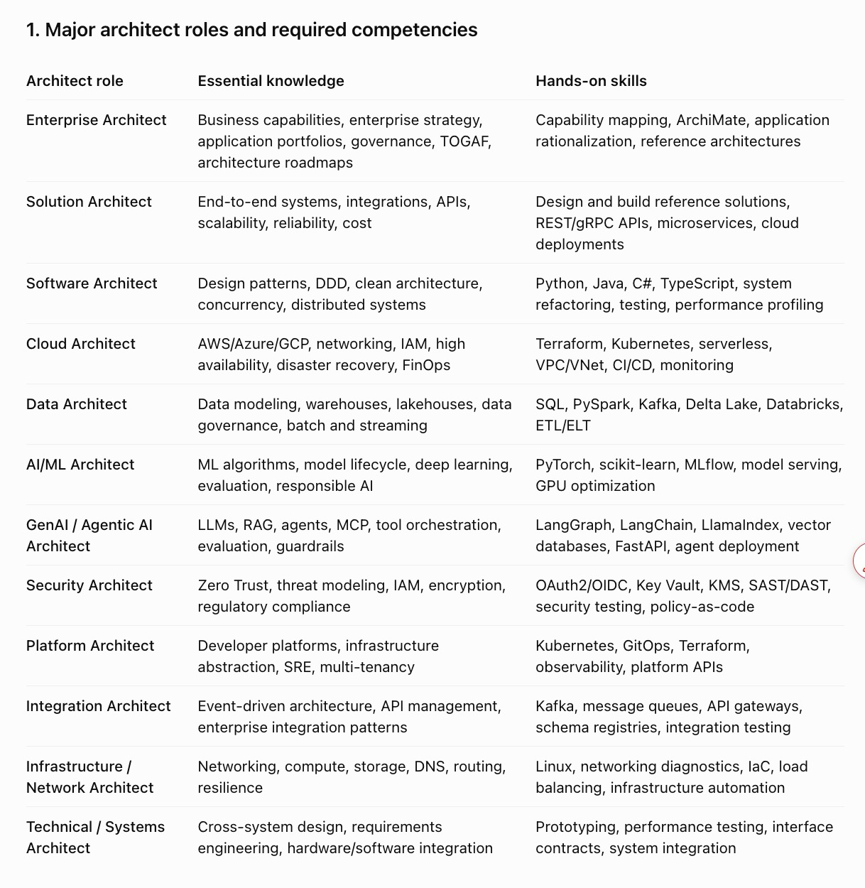
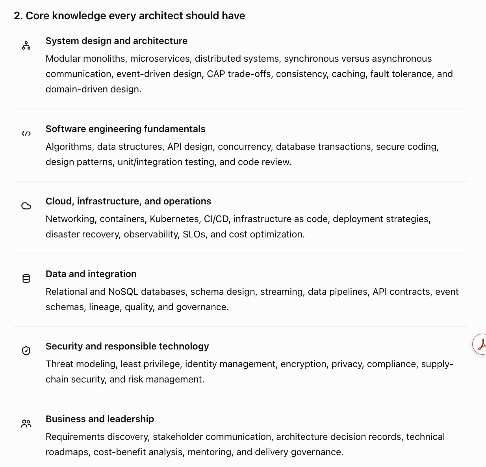

# Architect Career Competency Framework — Complete Resource Hub

**Last updated:** 2026-10-21 · **Status:** Maintained

One page containing the full architect competency framework **plus every learning resource that matters** — books, YouTube channels, courses, certifications, official documentation, papers, newsletters, podcasts, communities, hands-on labs, and tools — organised so you can go from "gap identified" to "link to learn it" in one click.

> Part of the [Enterprise AI Reference Architecture](../README.md). Pair this with the repository's [lifecycles](../lifecycles/README.md), [design patterns](../design-patterns/README.md), and [production issues](../production-issues/README.md) for applied practice.

---

## 📑 Contents

1. [How to use this hub](#1-how-to-use-this-hub)
2. [Major architect roles and required competencies](#2-major-architect-roles-and-required-competencies)
3. [Core knowledge every architect should have](#3-core-knowledge-every-architect-should-have)
4. [Hands-on proficiency](#4-hands-on-proficiency)
5. [Additional specialization for AI architects](#5-additional-specialization-for-ai-architects)
6. [Architecture artifacts every senior architect should know](#6-architecture-artifacts-every-senior-architect-should-know)
7. [Seniority expectations](#7-seniority-expectations)
8. [Master resource library](#8-master-resource-library)
9. [Role-based learning paths](#9-role-based-learning-paths)
10. [90-day plans](#10-90-day-plans)

---

## 1. How to use this hub

1. **Locate your role** in [section 2](#2-major-architect-roles-and-required-competencies) and read the essential knowledge + hands-on skills.
2. **Self-assess** each capability in [section 4](#4-hands-on-proficiency) on a 1–5 scale.
3. **Follow the link** for anything below 3 — every capability has a mapped resource in [section 8](#8-master-resource-library).
4. **Produce evidence**: an ADR, a C4 diagram, a threat model, a benchmark. Learning without an artifact does not count (see [section 6](#6-architecture-artifacts-every-senior-architect-should-know)).
5. **Re-assess quarterly** and move to the next role's scope ([section 7](#7-seniority-expectations)).

> **Principle:** an architect does not need to be the strongest programmer in every technology, but must have enough implementation experience to tell an elegant diagram from a system that actually works.

---

## 2. Major architect roles and required competencies

| Architect role | Essential knowledge | Hands-on skills |
|---|---|---|
| **Enterprise Architect** | Business capabilities, enterprise strategy, application portfolios, governance, TOGAF, architecture roadmaps | Capability mapping, ArchiMate, application rationalization, reference architectures |
| **Solution Architect** | End-to-end systems, integrations, APIs, scalability, reliability, cost | Design and build reference solutions, REST/gRPC APIs, microservices, cloud deployments |
| **Software Architect** | Design patterns, DDD, clean architecture, concurrency, distributed systems | Python, Java, C#, TypeScript, system refactoring, testing, performance profiling |
| **Cloud Architect** | AWS/Azure/GCP, networking, IAM, high availability, disaster recovery, FinOps | Terraform, Kubernetes, serverless, VPC/VNet, CI/CD, monitoring |
| **Data Architect** | Data modeling, warehouses, lakehouses, data governance, batch and streaming | SQL, PySpark, Kafka, Delta Lake, Databricks, ETL/ELT |
| **AI/ML Architect** | ML algorithms, model lifecycle, deep learning, evaluation, responsible AI | PyTorch, scikit-learn, MLflow, model serving, GPU optimization |
| **GenAI / Agentic AI Architect** | LLMs, RAG, agents, MCP, tool orchestration, evaluation, guardrails | LangGraph, LangChain, LlamaIndex, vector databases, FastAPI, agent deployment |
| **Security Architect** | Zero Trust, threat modeling, IAM, encryption, regulatory compliance | OAuth2/OIDC, Key Vault, KMS, SAST/DAST, security testing, policy-as-code |
| **Platform Architect** | Developer platforms, infrastructure abstraction, SRE, multi-tenancy | Kubernetes, GitOps, Terraform, observability, platform APIs |
| **Integration Architect** | Event-driven architecture, API management, enterprise integration patterns | Kafka, message queues, API gateways, schema registries, integration testing |
| **Infrastructure / Network Architect** | Networking, compute, storage, DNS, routing, resilience | Linux, networking diagnostics, IaC, load balancing, infrastructure automation |
| **Technical / Systems Architect** | Cross-system design, requirements engineering, hardware/software integration | Prototyping, performance testing, interface contracts, system integration |

**The difference between roles is scope and depth, not a different discipline.** An Enterprise Architect owns portfolio-level decisions; a Solution Architect owns one solution end to end; a Software Architect owns code-level structure.

### Role → primary resources

| Role | Start here | Certification | YouTube |
|---|---|---|---|
| Enterprise Architect | [TOGAF](https://www.opengroup.org/togaf) · [ArchiMate](https://www.opengroup.org/archimate) · [Enterprise Architecture as Strategy](https://hbr.org/product/enterprise-architecture-as-strategy/8588-HBK-ENG) | [TOGAF Certification](https://www.opengroup.org/certifications/togaf) | [Enterprise Architecture videos](https://www.youtube.com/results?search_query=enterprise+architecture+togaf) |
| Solution Architect | [C4 model](https://c4model.com) · [System Design Primer](https://github.com/donnemartin/system-design-primer) · [Azure Architecture Center](https://learn.microsoft.com/azure/architecture/) | [AWS SA Pro](https://aws.amazon.com/certification/certified-solutions-architect-professional/) · [Azure Solutions Architect Expert](https://learn.microsoft.com/credentials/certifications/azure-solutions-architect/) | [ByteByteGo](https://www.youtube.com/@ByteByteGo) · [Gaurav Sen](https://www.youtube.com/@gkcs) |
| Software Architect | [Refactoring.Guru patterns](https://refactoring.guru/design-patterns) · [Clean Architecture](https://www.oreilly.com/library/view/clean-architecture-a/9780134494344/) · [DDD](https://www.domainlanguage.com/ddd/) | — (portfolio + code review evidence) | [ArjanCodes](https://www.youtube.com/@ArjanCodes) · [Hussein Nasser](https://www.youtube.com/@HusseinNasser) |
| Cloud Architect | [AWS Architecture Center](https://aws.amazon.com/architecture/) · [Azure Architecture Center](https://learn.microsoft.com/azure/architecture/) · [Google Cloud Architecture Center](https://cloud.google.com/architecture) | [AWS SA Professional](https://aws.amazon.com/certification/) · [Azure Expert](https://learn.microsoft.com/credentials/certifications/) · [Google PCA](https://cloud.google.com/learn/certification/cloud-architect) | [TechWorld with Nana](https://www.youtube.com/@TechWorldwithNana) · [John Savill's Technical Training](https://www.youtube.com/@NTFAQGuy) |
| Data Architect | [dbt docs](https://docs.getdbt.com) · [Delta Lake docs](https://docs.delta.io) · [Databricks docs](https://docs.databricks.com) | [Databricks Certified Data Architect](https://www.databricks.com/learn/certification) · [Snowflake SnowPro](https://www.snowflake.com/certifications/) | [Advancing Analytics](https://www.youtube.com/@AdvancingAnalytics) · [Databricks](https://www.youtube.com/@Databricks) |
| AI/ML Architect | [PyTorch tutorials](https://pytorch.org/tutorials/) · [scikit-learn user guide](https://scikit-learn.org/stable/user_guide.html) · [Designing ML Systems](https://www.oreilly.com/library/view/designing-machine-learning/9781098107956/) | [AWS ML Specialty](https://aws.amazon.com/certification/certified-machine-learning-specialty/) · [Azure AI Engineer](https://learn.microsoft.com/credentials/certifications/azure-ai-engineer/) · [Google ML Engineer](https://cloud.google.com/learn/certification/machine-learning-engineer) | [Andrej Karpathy](https://www.youtube.com/@AndrejKarpathy) · [StatQuest](https://www.youtube.com/@statquest) · [Yannic Kilcher](https://www.youtube.com/@YannicKilcher) |
| GenAI / Agentic AI Architect | [MCP spec](https://modelcontextprotocol.io) · [LangGraph docs](https://langchain-ai.github.io/langgraph/) · [LlamaIndex docs](https://docs.llamaindex.ai) · [OpenAI Cookbook](https://cookbook.openai.com) | [AWS AI Practitioner](https://aws.amazon.com/certification/certified-ai-practitioner/) · [Azure AI Engineer](https://learn.microsoft.com/credentials/certifications/azure-ai-engineer/) | [LangChain](https://www.youtube.com/@LangChain) · [LlamaIndex](https://www.youtube.com/@LlamaIndex) · [AI Explained](https://www.youtube.com/@AIExplained) |
| Security Architect | [OWASP Top 10](https://owasp.org/www-project-top-ten/) · [OWASP ASVS](https://owasp.org/www-project-application-security-verification-standard/) · [NIST Zero Trust](https://www.nist.gov/publications/zero-trust-architecture) | [CISSP](https://www.isc2.org/certifications/cissp) · [CCSP](https://www.isc2.org/certifications/ccsp) · [AWS Security Specialty](https://aws.amazon.com/certification/certified-security-specialty/) | [John Hammond](https://www.youtube.com/@_JohnHammond) · [LiveOverflow](https://www.youtube.com/@LiveOverflow) |
| Platform Architect | [CNCF Landscape](https://landscape.cncf.io) · [Kubernetes docs](https://kubernetes.io/docs/home/) · [SRE Book](https://sre.google/books/) | [CKA](https://training.linuxfoundation.org/certification/certified-kubernetes-administrator-cka/) · [CKAD](https://training.linuxfoundation.org/certification/certified-kubernetes-application-developer-ckad/) | [CNCF](https://www.youtube.com/@CNCF) · [That DevOps Guy](https://www.youtube.com/@MarcelDempers) |
| Integration Architect | [Enterprise Integration Patterns](https://www.enterpriseintegrationpatterns.com) · [Kafka docs](https://kafka.apache.org/documentation/) · [AsyncAPI](https://www.asyncapi.com/docs) | [Confluent Certified Developer](https://developer.confluent.io/certification/) | [Confluent](https://www.youtube.com/@Confluent) |
| Infrastructure / Network Architect | [Cloudflare Learning Center](https://www.cloudflare.com/learning/) · [Linux Journey](https://linuxjourney.com) · [Terraform tutorials](https://developer.hashicorp.com/terraform/tutorials) | [CCNA](https://learningnetwork.cisco.com/s/ccna) · [AWS Advanced Networking](https://aws.amazon.com/certification/certified-advanced-networking-specialty/) | [NetworkChuck](https://www.youtube.com/@NetworkChuck) |
| Technical / Systems Architect | [arc42](https://arc42.org) · [12-Factor App](https://12factor.net) · [System Design Primer](https://github.com/donnemartin/system-design-primer) | — | [Fireship](https://www.youtube.com/@Fireship) · [Engineering with Utsav](https://www.youtube.com/@EngineeringwithUtsav) |

---

## 3. Core knowledge every architect should have

### System design and architecture
Modular monoliths, microservices, distributed systems, synchronous vs asynchronous communication, event-driven design, CAP trade-offs, consistency, caching, fault tolerance, domain-driven design.

- [System Design Primer](https://github.com/donnemartin/system-design-primer) — the canonical study guide
- [Martin Fowler — Architecture](https://martinfowler.com/architecture/) — patterns, refactoring, evolutionary architecture
- [microservices.io](https://microservices.io) — Chris Richardson's pattern catalogue
- [Azure Architecture Patterns](https://learn.microsoft.com/azure/architecture/patterns/) — 40+ cloud patterns
- [AWS Well-Architected Framework](https://aws.amazon.com/architecture/well-architected/)
- [Designing Data-Intensive Applications](https://www.oreilly.com/library/view/designing-data-intensive-applications/9781491903063/) — Kleppmann
- [Software Architecture: The Hard Parts](https://www.oreilly.com/library/view/software-architecture-the/9781492086888/) — trade-off analysis
- 📺 [ByteByteGo](https://www.youtube.com/@ByteByteGo) · [Gaurav Sen](https://www.youtube.com/@gkcs) · [Hussein Nasser](https://www.youtube.com/@HusseinNasser)

### Software engineering fundamentals
Algorithms, data structures, API design, concurrency, database transactions, secure coding, design patterns, unit/integration testing, code review.

- [Refactoring.Guru — Design Patterns](https://refactoring.guru/design-patterns)
- [Clean Code](https://www.oreilly.com/library/view/clean-code-a/9780136083238/) · [Clean Architecture](https://www.oreilly.com/library/view/clean-architecture-a/9780134494344/)
- [OpenAPI Specification](https://spec.openapis.org/oas/latest.html) · [gRPC docs](https://grpc.io/docs/)
- [Google Engineering Practices — Code Review](https://google.github.io/eng-practices/review/)
- [OWASP Secure Coding Practices](https://owasp.org/www-project-secure-coding-practices-quick-reference-guide/)
- [Big-O Cheat Sheet](https://www.bigocheatsheet.com/)
- 📺 [ArjanCodes](https://www.youtube.com/@ArjanCodes) · [Fireship](https://www.youtube.com/@Fireship)

### Cloud, infrastructure, and operations
Networking, containers, Kubernetes, CI/CD, infrastructure as code, deployment strategies, disaster recovery, observability, SLOs, cost optimization.

- [Kubernetes documentation](https://kubernetes.io/docs/home/) · [Kubernetes the Hard Way](https://github.com/kelseyhightower/kubernetes-the-hard-way)
- [Terraform tutorials](https://developer.hashicorp.com/terraform/tutorials) · [Terraform: Up & Running](https://www.terraformupandrunning.com/)
- [Docker Curriculum](https://docker-curriculum.com/)
- [Google SRE Book](https://sre.google/sre-book/table-of-contents/) · [SRE Workbook](https://sre.google/workbook/table-of-contents/)
- [CNCF Landscape](https://landscape.cncf.io) · [CNCF Trail Map](https://github.com/cncf/trailmap)
- [FinOps Foundation Framework](https://www.finops.org/framework/)
- [12-Factor App](https://12factor.net)
- 📺 [TechWorld with Nana](https://www.youtube.com/@TechWorldwithNana) · [That DevOps Guy](https://www.youtube.com/@MarcelDempers) · [John Savill](https://www.youtube.com/@NTFAQGuy)

### Data and integration
Relational and NoSQL databases, schema design, streaming, data pipelines, API contracts, event schemas, lineage, quality, governance.

- [PostgreSQL docs](https://www.postgresql.org/docs/) · [MongoDB docs](https://www.mongodb.com/docs/)
- [Kafka documentation](https://kafka.apache.org/documentation/) · [Confluent Schema Registry](https://docs.confluent.io/platform/current/schema-registry/index.html)
- [dbt docs](https://docs.getdbt.com) · [Apache Spark docs](https://spark.apache.org/docs/latest/) · [Delta Lake docs](https://docs.delta.io)
- [Enterprise Integration Patterns](https://www.enterpriseintegrationpatterns.com)
- [AsyncAPI](https://www.asyncapi.com/docs) · [OpenAPI](https://spec.openapis.org/oas/latest.html)
- [Data Management Body of Knowledge (DAMA-DMBOK)](https://www.dama.org/cpages/body-of-knowledge)
- 📺 [Advancing Analytics](https://www.youtube.com/@AdvancingAnalytics) · [Confluent](https://www.youtube.com/@Confluent)

### Security and responsible technology
Threat modeling, least privilege, identity management, encryption, privacy, compliance, supply-chain security, risk management.

- [OWASP Top 10](https://owasp.org/www-project-top-ten/) · [OWASP ASVS](https://owasp.org/www-project-application-security-verification-standard/)
- [OWASP Threat Dragon](https://owasp.org/www-project-threat-dragon/) · [Threat Modeling Manifesto](https://www.threatmodelingmanifesto.org/)
- [NIST Zero Trust Architecture](https://www.nist.gov/publications/zero-trust-architecture)
- [OAuth 2.0](https://oauth.net/2/) · [OpenID Connect](https://openid.net/connect/)
- [SLSA Supply Chain Security](https://slsa.dev) · [Sigstore](https://www.sigstore.dev/)
- [NIST AI Risk Management Framework](https://www.nist.gov/itl/ai-risk-management-framework) · [ISO/IEC 42001](https://www.iso.org/standard/42001)
- 📺 [John Hammond](https://www.youtube.com/@_JohnHammond) · [LiveOverflow](https://www.youtube.com/@LiveOverflow) · [NetworkChuck](https://www.youtube.com/@NetworkChuck)

### Business and leadership
Requirements discovery, stakeholder communication, architecture decision records, technical roadmaps, cost-benefit analysis, mentoring, delivery governance.

- [ADR GitHub org](https://adr.github.io) · [MADR templates](https://github.com/adr/madr)
- [arc42](https://arc42.org) — architecture communication template
- [TOGAF](https://www.opengroup.org/togaf) · [ArchiMate](https://www.opengroup.org/archimate)
- [Architecture Decision Records (Fowler)](https://martinfowler.com/bliki/ArchitectureDecisionRecord.html)
- [Team Topologies](https://teamtopologies.com/) — organisational design for delivery
- 📺 [Enterprise Architecture](https://www.youtube.com/results?search_query=enterprise+architecture+fundamentals)

---

## 4. Hands-on proficiency

> An architect does not need to be the strongest programmer in every technology. However, they should have sufficient implementation experience to distinguish an elegant diagram from a system that can actually work.

| Capability | Expected hands-on evidence | Practice resource |
|---|---|---|
| **Coding** | Implement a working service, review complex code, debug failures | [Exercism](https://exercism.org) · [LeetCode](https://leetcode.com) · [Advent of Code](https://adventofcode.com) |
| **API architecture** | Build REST/gRPC endpoints with authentication, validation, error handling | [OpenAPI](https://spec.openapis.org/oas/latest.html) · [gRPC docs](https://grpc.io/docs/) · [FastAPI](https://fastapi.tiangolo.com) |
| **Databases** | Design schemas, write complex SQL, tune queries, manage transactions | [PostgreSQL Tutorial](https://www.postgresqltutorial.com/) · [Use The Index, Luke](https://use-the-index-luke.com/) |
| **Distributed systems** | Implement retries, idempotency, queues, caching, failure recovery | [microservices.io](https://microservices.io) · [Azure Cloud Design Patterns](https://learn.microsoft.com/azure/architecture/patterns/) |
| **Cloud deployment** | Deploy a working application using containers and cloud services | [Kubernetes tutorials](https://kubernetes.io/docs/tutorials/) · [Docker Curriculum](https://docker-curriculum.com/) · [AWS Workshops](https://workshops.aws/) |
| **Infrastructure** | Create reproducible environments with Terraform or equivalent IaC | [Terraform tutorials](https://developer.hashicorp.com/terraform/tutorials) · [Pulumi](https://www.pulumi.com/docs/) |
| **Security** | Implement authentication, authorization, secrets management, audit logs | [OWASP Cheat Sheets](https://cheatsheetseries.owasp.org/) · [Keycloak](https://www.keycloak.org/documentation) · [Vault](https://developer.hashicorp.com/vault/docs) |
| **Observability** | Instrument metrics, logs, traces, dashboards, and alerts | [OpenTelemetry](https://opentelemetry.io/docs/) · [Prometheus](https://prometheus.io/docs/introduction/overview/) · [Grafana](https://grafana.com/docs/) |
| **Performance** | Benchmark latency, throughput, memory, cost, and scalability | [k6](https://k6.io/docs/) · [Locust](https://docs.locust.io/) · [JMeter](https://jmeter.apache.org/usermanual/index.html) |
| **Architecture documentation** | Produce C4 diagrams, ADRs, sequence diagrams, threat models | [C4 model](https://c4model.com) · [Mermaid](https://mermaid.js.org) · [Structurizr](https://structurizr.com) · [PlantUML](https://plantuml.com) |
| **Delivery** | Design CI/CD pipelines, test strategies, rollback and release procedures | [GitHub Actions docs](https://docs.github.com/actions) · [Argo CD](https://argo-cd.readthedocs.io/) · [Google Engineering Practices](https://google.github.io/eng-practices/) |

---

## 5. Additional specialization for AI architects

For an **AI Solution Architect, Principal AI Architect, or Agentic AI Architect**, the following knowledge becomes particularly important.

| Domain | Hands-on requirements | Resources |
|---|---|---|
| **Classical ML** | Feature engineering, supervised/unsupervised learning, cross-validation, leakage prevention | [scikit-learn User Guide](https://scikit-learn.org/stable/user_guide.html) · [Hands-On ML](https://www.oreilly.com/library/view/hands-on-machine-learning/9781098125967/) · 📺 [StatQuest](https://www.youtube.com/@statquest) |
| **Deep learning** | PyTorch, CNNs, Transformers, transfer learning, fine-tuning | [PyTorch tutorials](https://pytorch.org/tutorials/) · [Deep Learning Book](https://www.deeplearningbook.org/) · 📺 [Karpathy](https://www.youtube.com/@AndrejKarpathy) |
| **Foundation models** | Tokenization, attention, pretraining concepts, LoRA/QLoRA, distillation | [Hugging Face LLM Course](https://huggingface.co/learn/llm-course) · [LLM Course (mlabonne)](https://github.com/mlabonne/llm-course) · [Attention Is All You Need](https://arxiv.org/abs/1706.03762) |
| **Self-supervised learning** | Contrastive learning, masked modeling, DINO, JEPA | [SimCLR](https://arxiv.org/abs/2002.05709) · [BERT](https://arxiv.org/abs/1810.04805) · [DINO](https://arxiv.org/abs/2104.14294) · [JEPA (LeCun)](https://arxiv.org/abs/2301.08243) |
| **Multimodal AI** | Vision-language models, multimodal embeddings, fusion strategies | [CLIP](https://arxiv.org/abs/2103.00020) · [Hugging Face Multimodal Course](https://huggingface.co/learn) · [LLaVA](https://llava-vl.github.io/) |
| **RAG** | Chunking, embeddings, hybrid retrieval, reranking, grounded evaluation | [LlamaIndex docs](https://docs.llamaindex.ai) · [LangChain RAG tutorial](https://python.langchain.com/docs/tutorials/rag/) · [RAGAS docs](https://docs.ragas.io/) |
| **Agentic AI** | Planning, tool calling, MCP, state management, multi-agent orchestration | [MCP spec](https://modelcontextprotocol.io) · [LangGraph docs](https://langchain-ai.github.io/langgraph/) · [ReAct paper](https://arxiv.org/abs/2210.03629) · [A2A protocol](https://a2a-protocol.org/) |
| **AI evaluation** | Precision/recall, F1, calibration, retrieval metrics, LLM evaluations | [HELM](https://crfm.stanford.edu/helm/) · [RAGAS](https://docs.ragas.io/) · [DeepEval](https://docs.confident-ai.com/) · [Inspect AI](https://inspect.ai-safety-institute.org.uk/) |
| **AI security** | Prompt injection defense, tool permissions, data leakage prevention | [OWASP LLM Top 10](https://genai.owasp.org/llm-top-10/) · [NIST AI RMF](https://www.nist.gov/itl/ai-risk-management-framework) · [MITRE ATLAS](https://atlas.mitre.org/) |
| **MLOps / LLMOps** | Model registry, experiment tracking, deployment, monitoring, drift | [MLflow docs](https://mlflow.org/docs/latest/index.html) · [Weights & Biases](https://docs.wandb.ai) · [Evidently](https://docs.evidentlyai.com) · [vLLM](https://docs.vllm.ai) |
| **AI economics** | Token costs, GPU utilization, throughput, latency, model routing | [FinOps Foundation](https://www.finops.org/framework/) · [LiteLLM](https://docs.litellm.ai/) · [OpenAI pricing](https://openai.com/api/pricing/) · [Anthropic pricing](https://www.anthropic.com/pricing) |
| **AI governance** | Human oversight, auditability, model risk management, responsible AI | [NIST AI RMF](https://www.nist.gov/itl/ai-risk-management-framework) · [ISO/IEC 42001](https://www.iso.org/standard/42001) · [EU AI Act](https://artificialintelligenceact.eu/) · [OECD AI Principles](https://oecd.ai/en/ai-principles) |

> Research-heavy roles (e.g., Applied Scientist) go deeper into independent experimental design, novel modelling methods, scientific validation, and publication-quality research — different from a conventional Solution Architect role, which emphasises integrating technologies into dependable systems.

---

## 6. Architecture artifacts every senior architect should know

| Artifact | Purpose | Template / tool |
|---|---|---|
| **Architecture Decision Record (ADR)** | Explains the decision, alternatives, and trade-offs | [adr.github.io](https://adr.github.io) · [MADR](https://github.com/adr/madr) · [Fowler on ADRs](https://martinfowler.com/bliki/ArchitectureDecisionRecord.html) |
| **C4 architecture diagrams** | Context, containers, components, and code | [c4model.com](https://c4model.com) · [Structurizr](https://structurizr.com) · [Mermaid C4](https://mermaid.js.org/syntax/c4.html) |
| **Sequence and data-flow diagrams** | Show runtime interactions and information movement | [Mermaid sequence](https://mermaid.js.org/syntax/sequenceDiagram.html) · [PlantUML](https://plantuml.com/sequence-diagram) |
| **Threat models** | Document trust boundaries, attack paths, and mitigations | [OWASP Threat Dragon](https://owasp.org/www-project-threat-dragon/) · [Microsoft Threat Modeling Tool](https://learn.microsoft.com/azure/security/develop/threat-modeling-tool) · [STRIDE](https://learn.microsoft.com/azure/security/develop/threat-modeling-tool-threats) |
| **Non-functional requirements** | Latency, availability, scalability, recovery, and security | [ISO/IEC 25010](https://www.iso.org/standard/78176.html) · [Google SRE SLOs](https://sre.google/workbook/implementing-slos/) |
| **Performance and cost benchmarks** | Evidence that the architecture meets its targets | [k6](https://k6.io/docs/) · [Locust](https://docs.locust.io/) · [FinOps Framework](https://www.finops.org/framework/) |
| **Technical roadmap** | Links current-state architecture to future-state capabilities | [TOGAF ADM](https://www.opengroup.org/togaf) · [Team Topologies](https://teamtopologies.com/) |

---

## 7. Seniority expectations

| Level | Main responsibility | Typical evidence |
|---|---|---|
| **Senior Engineer** | Implements complex components | Production code, tests, troubleshooting |
| **Technical Lead** | Leads a team's implementation | Code reviews, design decisions, mentoring |
| **Solution Architect** | Owns a solution end-to-end | Architecture, integrations, NFRs, deployment |
| **Lead / Principal Architect** | Owns architecture across multiple systems | Standards, reusable platforms, strategic trade-offs |
| **Enterprise Architect** | Aligns technology across the organization | Capability roadmaps, governance, portfolio decisions |
| **Chief / Distinguished Architect** | Sets long-term technology direction | Organization-wide architecture strategy and influence |

> Titles vary considerably by company. A Principal Engineer at a major technology company may have greater architectural scope than an Enterprise Architect in a smaller organisation.

---

## 8. Master resource library

### 8.1 Books

**System design & architecture**
- [Designing Data-Intensive Applications](https://www.oreilly.com/library/view/designing-data-intensive-applications/9781491903063/) — Kleppmann
- [Building Microservices (2nd ed.)](https://www.oreilly.com/library/view/building-microservices-2nd/9781492034018/) — Newman
- [Fundamentals of Software Architecture](https://www.oreilly.com/library/view/fundamentals-of-software/9781492043447/) — Richards & Ford
- [Software Architecture: The Hard Parts](https://www.oreilly.com/library/view/software-architecture-the/9781492086888/) — Ford et al.
- [Domain-Driven Design](https://www.domainlanguage.com/ddd/) — Evans
- [Clean Architecture](https://www.oreilly.com/library/view/clean-architecture-a/9780134494344/) — Martin
- [Release It! (2nd ed.)](https://pragprog.com/titles/mnee2/release-it-second-edition/) — Nygard
- [Site Reliability Engineering](https://sre.google/sre-book/table-of-contents/) — Google (free)
- [The Phoenix Project](https://itrevolution.com/product/the-phoenix-project/) — Kim et al.

**Cloud & platform**
- [Cloud Native Patterns](https://www.manning.com/books/cloud-native-patterns) — Davis
- [Kubernetes Up & Running](https://www.oreilly.com/library/view/kubernetes-up-and/9781492046523/) — Burns et al.
- [Terraform: Up & Running](https://www.terraformupandrunning.com/) — Brikman
- [Team Topologies](https://teamtopologies.com/book) — Skelton & Pais

**Data**
- [The Data Warehouse Toolkit](https://www.kimballgroup.com/data-warehouse-business-intelligence-resources/books/) — Kimball
- [Fundamentals of Data Engineering](https://www.oreilly.com/library/view/fundamentals-of-data/9781098108298/) — Reis & Housley
- [Streaming Systems](https://www.oreilly.com/library/view/streaming-systems/9781491983867/) — Akidau et al.

**AI / ML / GenAI**
- [Deep Learning](https://www.deeplearningbook.org/) — Goodfellow et al. (free)
- [Hands-On Machine Learning](https://www.oreilly.com/library/view/hands-on-machine-learning/9781098125967/) — Géron
- [Designing Machine Learning Systems](https://www.oreilly.com/library/view/designing-machine-learning/9781098107956/) — Huyen
- [AI Engineering](https://www.oreilly.com/library/view/ai-engineering/9781098166298/) — Huyen
- [Building LLMs for Production](https://www.oreilly.com/library/view/building-llms-for/9781098150952/) — Bouchard & Peters
- [Generative AI with LangChain](https://www.packtpub.com/product/generative-ai-with-langchain/9781835083468) — Auffarth
- [Natural Language Processing with Transformers](https://www.oreilly.com/library/view/natural-language-processing/9781098136789/) — Tunstall et al.

**Security**
- [Threat Modeling: Designing for Security](https://www.oreilly.com/library/view/threat-modeling-designing/9781118809808/) — Shostack
- [Zero Trust Networks](https://www.oreilly.com/library/view/zero-trust-networks/9781492031673/) — Gilman & Barth

**Enterprise architecture**
- [Enterprise Architecture as Strategy](https://hbr.org/product/enterprise-architecture-as-strategy/8588-HBK-ENG) — Ross et al.
- [TOGAF Standard](https://www.opengroup.org/togaf) — The Open Group

### 8.2 YouTube channels

**System design & software engineering**
- [ByteByteGo](https://www.youtube.com/@ByteByteGo)
- [Gaurav Sen](https://www.youtube.com/@gkcs)
- [Hussein Nasser](https://www.youtube.com/@HusseinNasser)
- [ArjanCodes](https://www.youtube.com/@ArjanCodes)
- [Fireship](https://www.youtube.com/@Fireship)
- [Engineering with Utsav](https://www.youtube.com/@EngineeringwithUtsav)
- [CodeKarle](https://www.youtube.com/@CodeKarle)

**Cloud, DevOps & platform**
- [TechWorld with Nana](https://www.youtube.com/@TechWorldwithNana)
- [That DevOps Guy](https://www.youtube.com/@MarcelDempers)
- [John Savill's Technical Training](https://www.youtube.com/@NTFAQGuy)
- [CNCF](https://www.youtube.com/@CNCF)
- [AWS Events](https://www.youtube.com/@AWSEventsChannel)
- [Google Cloud Tech](https://www.youtube.com/@googlecloudtech)
- [Microsoft Azure](https://www.youtube.com/@MicrosoftAzure)

**AI / ML / GenAI**
- [Andrej Karpathy](https://www.youtube.com/@AndrejKarpathy)
- [3Blue1Brown](https://www.youtube.com/@3blue1brown)
- [StatQuest with Josh Starmer](https://www.youtube.com/@statquest)
- [Yannic Kilcher](https://www.youtube.com/@YannicKilcher)
- [AI Explained](https://www.youtube.com/@AIExplained)
- [Two Minute Papers](https://www.youtube.com/@TwoMinutePapers)
- [DeepLearning.AI](https://www.youtube.com/@DeepLearningAI)
- [LangChain](https://www.youtube.com/@LangChain)
- [LlamaIndex](https://www.youtube.com/@LlamaIndex)
- [Anthropic](https://www.youtube.com/@anthropic-ai)
- [OpenAI](https://www.youtube.com/@OpenAI)

**Security**
- [John Hammond](https://www.youtube.com/@_JohnHammond)
- [LiveOverflow](https://www.youtube.com/@LiveOverflow)
- [NetworkChuck](https://www.youtube.com/@NetworkChuck)

**Full courses**
- [freeCodeCamp](https://www.youtube.com/@freecodecamp)

### 8.3 Courses, platforms & certifications

| Platform | Best for | Link |
|---|---|---|
| Coursera | University-level ML, cloud, architecture | https://www.coursera.org |
| edX | MIT/Stanford courses | https://www.edx.org |
| Udacity | Nanodegrees (AI, cloud, autonomous systems) | https://www.udacity.com |
| Fast.ai | Practical deep learning | https://course.fast.ai |
| DeepLearning.AI | Short courses on LLMs, RAG, agents | https://www.deeplearning.ai/courses/ |
| Hugging Face Learn | LLMs, diffusion, agents, RL | https://huggingface.co/learn |
| Pluralsight | Cloud, DevOps, architecture paths | https://www.pluralsight.com |
| A Cloud Guru | AWS/Azure/GCP certifications | https://acloudguru.com |
| KodeKloud | Kubernetes, Docker, Terraform labs | https://kodekloud.com |
| ByteByteGo | System design interview prep | https://bytebytego.com |
| Exponent | System design interviews | https://www.tryexponent.com |
| Microsoft Learn | Azure, AI, architecture (free) | https://learn.microsoft.com/training/ |
| AWS Skill Builder | AWS training (free tier) | https://skillbuilder.aws/ |
| Google Cloud Skills Boost | GCP labs and paths | https://www.cloudskillsboost.google/ |

**Certifications worth targeting**

| Track | Certification | Link |
|---|---|---|
| Cloud | AWS Solutions Architect – Professional | https://aws.amazon.com/certification/certified-solutions-architect-professional/ |
| Cloud | Azure Solutions Architect Expert | https://learn.microsoft.com/credentials/certifications/azure-solutions-architect/ |
| Cloud | Google Professional Cloud Architect | https://cloud.google.com/learn/certification/cloud-architect |
| AI | AWS Machine Learning – Specialty | https://aws.amazon.com/certification/certified-machine-learning-specialty/ |
| AI | Azure AI Engineer Associate | https://learn.microsoft.com/credentials/certifications/azure-ai-engineer/ |
| AI | Google Professional ML Engineer | https://cloud.google.com/learn/certification/machine-learning-engineer |
| Platform | CKA / CKAD | https://training.linuxfoundation.org/certification/ |
| Security | CISSP / CCSP | https://www.isc2.org/certifications |
| Enterprise | TOGAF | https://www.opengroup.org/certifications/togaf |
| Data | Databricks / SnowPro | https://www.databricks.com/learn/certification |

### 8.4 Official documentation & standards

| Resource | Description | Link |
|---|---|---|
| System Design Primer | End-to-end system design study guide | https://github.com/donnemartin/system-design-primer |
| AWS Architecture Center | AWS reference architectures | https://aws.amazon.com/architecture/ |
| Azure Architecture Center | Azure reference architectures + patterns | https://learn.microsoft.com/azure/architecture/ |
| Google Cloud Architecture Center | GCP reference architectures | https://cloud.google.com/architecture |
| AWS Well-Architected | Six-pillar review framework | https://aws.amazon.com/architecture/well-architected/ |
| CNCF Landscape | Cloud-native tooling map | https://landscape.cncf.io |
| Kubernetes docs | Container orchestration | https://kubernetes.io/docs/home/ |
| Terraform docs | Infrastructure as code | https://developer.hashicorp.com/terraform/docs |
| OWASP Top 10 | Web security risks | https://owasp.org/www-project-top-ten/ |
| OWASP LLM Top 10 | GenAI security risks | https://genai.owasp.org/llm-top-10/ |
| MITRE ATLAS | Adversarial ML knowledge base | https://atlas.mitre.org/ |
| NIST AI RMF | AI risk management | https://www.nist.gov/itl/ai-risk-management-framework |
| ISO/IEC 42001 | AI management systems | https://www.iso.org/standard/42001 |
| TOGAF | Enterprise architecture framework | https://www.opengroup.org/togaf |
| ArchiMate | EA modelling language | https://www.opengroup.org/archimate |
| C4 model | Architecture diagramming | https://c4model.com |
| arc42 | Architecture documentation template | https://arc42.org |
| 12-Factor App | Cloud-native app principles | https://12factor.net |
| Martin Fowler | Architecture & refactoring | https://martinfowler.com/architecture/ |
| microservices.io | Microservice patterns | https://microservices.io |
| Enterprise Integration Patterns | Messaging patterns | https://www.enterpriseintegrationpatterns.com |
| High Scalability | Real-world architecture case studies | http://highscalability.com/ |
| InfoQ | Architecture & engineering articles | https://www.infoq.com/architecture-design/ |

### 8.5 Foundational papers

| Paper | Why it matters | Link |
|---|---|---|
| Attention Is All You Need | Transformer architecture | https://arxiv.org/abs/1706.03762 |
| BERT | Masked language modelling | https://arxiv.org/abs/1810.04805 |
| GPT-3: Language Models are Few-Shot Learners | In-context learning | https://arxiv.org/abs/2005.14165 |
| LoRA | Parameter-efficient fine-tuning | https://arxiv.org/abs/2106.09685 |
| QLoRA | Quantised fine-tuning | https://arxiv.org/abs/2305.14314 |
| Chain-of-Thought Prompting | Reasoning elicitation | https://arxiv.org/abs/2201.11903 |
| ReAct | Reasoning + acting for agents | https://arxiv.org/abs/2210.03629 |
| Retrieval-Augmented Generation | RAG foundations | https://arxiv.org/abs/2005.11401 |
| DPO | Preference optimisation without RL | https://arxiv.org/abs/2305.18290 |
| FlashAttention | Efficient attention | https://arxiv.org/abs/2205.14135 |
| CLIP | Vision-language contrastive learning | https://arxiv.org/abs/2103.00020 |
| DINO | Self-supervised vision | https://arxiv.org/abs/2104.14294 |
| JEPA | Joint-embedding predictive architecture | https://arxiv.org/abs/2301.08243 |
| MCP Specification | Standardised tool/context protocol | https://modelcontextprotocol.io |

### 8.6 Newsletters, podcasts & communities

**Newsletters**
- [ByteByteGo Newsletter](https://blog.bytebytego.com/) — system design weekly
- [Import AI](https://importai.substack.com/) — Jack Clark, AI policy & research
- [The Batch](https://www.deeplearning.ai/the-batch/) — DeepLearning.AI weekly
- [Ahead of AI](https://magazine.sebastianraschka.com/) — Sebastian Raschka, ML depth
- [Latent Space](https://www.latent.space/) — AI engineering
- [TLDR](https://tldr.tech/) — daily tech digest
- [InfoQ Architecture](https://www.infoq.com/architecture-design/) — architecture articles

**Podcasts**
- [Software Engineering Daily](https://softwareengineeringdaily.com/)
- [The TWIML AI Podcast](https://twimlai.com/podcast/twimlai/)
- [Practical AI](https://changelog.com/practicalai)
- [Latent Space](https://www.latent.space/podcast)
- [Syntax](https://syntax.fm/)
- [Kubernetes Podcast](https://kubernetespodcast.com/)

**Communities**
- [MLOps Community](https://mlops.community/)
- [CNCF Slack](https://communityinviter.com/apps/cloud-native/cncf)
- [OWASP Slack](https://owasp.org/slack/invite)
- [LangChain Discord](https://discord.gg/langchain)
- [Hugging Face Forums](https://discuss.huggingface.co/)
- [r/MachineLearning](https://www.reddit.com/r/MachineLearning/)
- [r/ExperiencedDevs](https://www.reddit.com/r/ExperiencedDevs/)

### 8.7 Tools by domain

| Domain | Tools |
|---|---|
| **Diagramming** | [Mermaid](https://mermaid.js.org) · [Structurizr](https://structurizr.com) · [PlantUML](https://plantuml.com) · [draw.io](https://app.diagrams.net) · [Excalidraw](https://excalidraw.com) · [Lucidchart](https://www.lucidchart.com) |
| **Architecture docs** | [arc42](https://arc42.org) · [ADR tools](https://adr.github.io) · [Backstage](https://backstage.io) · [Confluence](https://www.atlassian.com/software/confluence) |
| **Languages** | Python · Java · C# · TypeScript · Go · Rust |
| **Frameworks** | [FastAPI](https://fastapi.tiangolo.com) · [Spring Boot](https://spring.io/projects/spring-boot) · [.NET](https://dotnet.microsoft.com) · [React](https://react.dev) · [Node.js](https://nodejs.org) |
| **Testing** | [pytest](https://docs.pytest.org) · [JUnit](https://junit.org) · [Jest](https://jestjs.io) · [Playwright](https://playwright.dev) · [Cypress](https://www.cypress.io) |
| **IaC** | [Terraform](https://developer.hashicorp.com/terraform) · [Pulumi](https://www.pulumi.com) · [CloudFormation](https://aws.amazon.com/cloudformation/) · [Bicep](https://learn.microsoft.com/azure/azure-resource-manager/bicep/) |
| **Containers** | [Docker](https://docs.docker.com) · [Kubernetes](https://kubernetes.io) · [Helm](https://helm.sh) · [Kustomize](https://kustomize.io) |
| **CI/CD** | [GitHub Actions](https://docs.github.com/actions) · [GitLab CI](https://docs.gitlab.com/ee/ci/) · [Jenkins](https://www.jenkins.io/doc/) · [Argo CD](https://argo-cd.readthedocs.io/) · [Flux](https://fluxcd.io) |
| **Observability** | [OpenTelemetry](https://opentelemetry.io) · [Prometheus](https://prometheus.io) · [Grafana](https://grafana.com) · [Jaeger](https://www.jaegertracing.io) · [Datadog](https://www.datadoghq.com) |
| **Databases** | [PostgreSQL](https://www.postgresql.org) · [MySQL](https://www.mysql.com) · [MongoDB](https://www.mongodb.com) · [Redis](https://redis.io) · [Cassandra](https://cassandra.apache.org) · [DynamoDB](https://aws.amazon.com/dynamodb/) |
| **Data platforms** | [Snowflake](https://www.snowflake.com) · [Databricks](https://www.databricks.com) · [BigQuery](https://cloud.google.com/bigquery) · [Redshift](https://aws.amazon.com/redshift/) · [Synapse](https://azure.microsoft.com/products/synapse-analytics) |
| **Streaming** | [Kafka](https://kafka.apache.org) · [RabbitMQ](https://www.rabbitmq.com) · [Pulsar](https://pulsar.apache.org) · [Kinesis](https://aws.amazon.com/kinesis/) · [Event Hubs](https://azure.microsoft.com/products/event-hubs) |
| **Processing** | [Spark](https://spark.apache.org) · [Flink](https://flink.apache.org) · [Airflow](https://airflow.apache.org) · [dbt](https://www.getdbt.com) · [Prefect](https://www.prefect.io) |
| **ML frameworks** | [PyTorch](https://pytorch.org) · [TensorFlow](https://www.tensorflow.org) · [scikit-learn](https://scikit-learn.org) · [XGBoost](https://xgboost.readthedocs.io) |
| **LLM frameworks** | [LangChain](https://python.langchain.com) · [LangGraph](https://langchain-ai.github.io/langgraph/) · [LlamaIndex](https://docs.llamaindex.ai) · [Haystack](https://haystack.deepset.ai) · [OpenAI Agents SDK](https://openai.github.io/openai-agents-python/) |
| **Vector DBs** | [Pinecone](https://docs.pinecone.io) · [Weaviate](https://weaviate.io/developers/weaviate) · [Qdrant](https://qdrant.tech/documentation/) · [Milvus](https://milvus.io/docs) · [pgvector](https://github.com/pgvector/pgvector) · [Chroma](https://docs.trychroma.com) |
| **Model serving** | [vLLM](https://docs.vllm.ai) · [TGI](https://huggingface.co/docs/text-generation-inference) · [Triton](https://developer.nvidia.com/triton-inference-server) · [TorchServe](https://pytorch.org/serve/) |
| **MLOps** | [MLflow](https://mlflow.org) · [Weights & Biases](https://wandb.ai) · [Kubeflow](https://www.kubeflow.org) · [SageMaker](https://aws.amazon.com/sagemaker/) · [Evidently](https://www.evidentlyai.com) |
| **Evaluation** | [DeepEval](https://docs.confident-ai.com/) · [RAGAS](https://docs.ragas.io/) · [TruLens](https://www.trulens.org) · [Promptfoo](https://www.promptfoo.dev) · [Inspect AI](https://inspect.ai-safety-institute.org.uk/) |
| **AI gateways** | [LiteLLM](https://docs.litellm.ai/) · [Portkey](https://portkey.ai/docs) · [Kong AI Gateway](https://docs.konghq.com/gateway/latest/ai-gateway/) · [Envoy AI Gateway](https://aigateway.envoyproxy.io/) |
| **Security** | [Keycloak](https://www.keycloak.org) · [Vault](https://developer.hashicorp.com/vault) · [Snyk](https://snyk.io) · [Trivy](https://trivy.dev) · [OWASP ZAP](https://www.zaproxy.org) · [OPA](https://www.openpolicyagent.org) |

### 8.8 Hands-on labs

| Lab | What you build | Link |
|---|---|---|
| AWS Workshops | Guided AWS builds (AI, serverless, data) | https://workshops.aws/ |
| AWS Well-Architected Labs | Architecture reviews and fixes | https://wellarchitectedlabs.com/ |
| Azure Architecture Center | Reference implementations | https://learn.microsoft.com/azure/architecture/ |
| Google Cloud Skills Boost | Qwiklabs paths | https://www.cloudskillsboost.google/ |
| Kubernetes Tutorials | Deploy and operate workloads | https://kubernetes.io/docs/tutorials/ |
| Kubernetes the Hard Way | Cluster from scratch | https://github.com/kelseyhightower/kubernetes-the-hard-way |
| Terraform Tutorials | IaC from zero to modules | https://developer.hashicorp.com/terraform/tutorials |
| Docker Curriculum | Containers end to end | https://docker-curriculum.com/ |
| Hugging Face Course | Fine-tune and deploy models | https://huggingface.co/learn |
| LangGraph Tutorials | Build agent workflows | https://langchain-ai.github.io/langgraph/tutorials/ |
| LlamaIndex Examples | RAG pipelines | https://docs.llamaindex.ai/en/stable/examples/ |
| RAGAS Docs | Evaluate RAG systems | https://docs.ragas.io/ |
| OWASP WebGoat | Security exploitation practice | https://owasp.org/www-project-webgoat/ |
| OWASP Juice Shop | Deliberately insecure app | https://owasp.org/www-project-juice-shop/ |

---

## 9. Role-based learning paths

### Enterprise Architect (12 weeks)
1. [TOGAF Standard](https://www.opengroup.org/togaf) + [ArchiMate](https://www.opengroup.org/archimate)
2. [Enterprise Architecture as Strategy](https://hbr.org/product/enterprise-architecture-as-strategy/8588-HBK-ENG)
3. Capability mapping exercise on your own organisation
4. Produce a capability map + application rationalisation + 3 ADRs
5. [Team Topologies](https://teamtopologies.com/book) for operating model design
6. TOGAF certification

### Solution Architect (10 weeks)
1. [System Design Primer](https://github.com/donnemartin/system-design-primer)
2. [C4 model](https://c4model.com) + [arc42](https://arc42.org)
3. Build a reference solution: API + DB + queue + auth + observability
4. Deploy it with Terraform + Kubernetes
5. Write NFRs, threat model, ADRs, benchmark
6. [Azure Architecture Center](https://learn.microsoft.com/azure/architecture/) patterns deep dive

### Software Architect (8 weeks)
1. [Refactoring.Guru patterns](https://refactoring.guru/design-patterns)
2. [DDD](https://www.domainlanguage.com/ddd/) + [Clean Architecture](https://www.oreilly.com/library/view/clean-architecture-a/9780134494344/)
3. Refactor a real codebase into bounded contexts
4. Add contract tests + performance profile
5. [Release It!](https://pragprog.com/titles/mnee2/release-it-second-edition/) resilience patterns
6. Write ADRs for every structural decision

### Cloud Architect (10 weeks)
1. [AWS](https://aws.amazon.com/architecture/) / [Azure](https://learn.microsoft.com/azure/architecture/) / [GCP](https://cloud.google.com/architecture) architecture center
2. [Terraform tutorials](https://developer.hashicorp.com/terraform/tutorials)
3. [Kubernetes docs](https://kubernetes.io/docs/home/) + [CKA path](https://training.linuxfoundation.org/certification/certified-kubernetes-administrator-cka/)
4. Build VPC + private endpoints + IAM + observability
5. [FinOps Framework](https://www.finops.org/framework/) cost model
6. Certification: AWS SA Pro / Azure Expert / Google PCA

### Data Architect (10 weeks)
1. [Fundamentals of Data Engineering](https://www.oreilly.com/library/view/fundamentals-of-data/9781098108298/)
2. [Kimball dimensional modelling](https://www.kimballgroup.com/data-warehouse-business-intelligence-resources/books/)
3. [dbt docs](https://docs.getdbt.com) + [Spark](https://spark.apache.org/docs/latest/) + [Delta Lake](https://docs.delta.io)
4. Build a lakehouse pipeline with lineage + quality tests
5. [DAMA-DMBOK](https://www.dama.org/cpages/body-of-knowledge) governance
6. Certification: Databricks / SnowPro

### AI/ML Architect (12 weeks)
1. [scikit-learn User Guide](https://scikit-learn.org/stable/user_guide.html) + [Hands-On ML](https://www.oreilly.com/library/view/hands-on-machine-learning/9781098125967/)
2. [PyTorch tutorials](https://pytorch.org/tutorials/) + [Karpathy's Zero to Hero](https://karpathy.ai/zero-to-hero.html)
3. [Designing ML Systems](https://www.oreilly.com/library/view/designing-machine-learning/9781098107956/)
4. [MLflow](https://mlflow.org/docs/latest/index.html) tracking + registry + serving
5. Build a model with drift monitoring + retraining trigger
6. Certification: AWS ML Specialty / Azure AI Engineer / Google ML Engineer

### GenAI / Agentic AI Architect (12 weeks)
1. [Hugging Face LLM Course](https://huggingface.co/learn/llm-course)
2. [OpenAI Cookbook](https://cookbook.openai.com) + [Anthropic prompt engineering](https://docs.anthropic.com/en/docs/build-with-claude/prompt-engineering/overview)
3. [LlamaIndex](https://docs.llamaindex.ai) / [LangChain RAG tutorial](https://python.langchain.com/docs/tutorials/rag/) — build hybrid retrieval + reranking
4. [RAGAS](https://docs.ragas.io/) / [DeepEval](https://docs.confident-ai.com/) evaluation harness in CI
5. [MCP](https://modelcontextprotocol.io) + [LangGraph](https://langchain-ai.github.io/langgraph/) agent with tool permissions + approval gate
6. [OWASP LLM Top 10](https://genai.owasp.org/llm-top-10/) red-team exercise

### Security Architect (10 weeks)
1. [OWASP Top 10](https://owasp.org/www-project-top-ten/) + [ASVS](https://owasp.org/www-project-application-security-verification-standard/)
2. [Threat Modeling Manifesto](https://www.threatmodelingmanifesto.org/) + STRIDE
3. [NIST Zero Trust](https://www.nist.gov/publications/zero-trust-architecture)
4. Implement OAuth2/OIDC + secrets management + audit logging
5. Policy-as-code with [OPA](https://www.openpolicyagent.org)
6. Certification: CISSP / CCSP

### Platform Architect (10 weeks)
1. [CNCF Landscape](https://landscape.cncf.io) + [Trail Map](https://github.com/cncf/trailmap)
2. [Kubernetes docs](https://kubernetes.io/docs/home/) + [CKA](https://training.linuxfoundation.org/certification/certified-kubernetes-administrator-cka/)
3. [Backstage](https://backstage.io) developer portal
4. GitOps with [Argo CD](https://argo-cd.readthedocs.io/)
5. [SRE Book](https://sre.google/sre-book/table-of-contents/) SLOs + error budgets
6. Build a golden path template + measure adoption

### Integration Architect (8 weeks)
1. [Enterprise Integration Patterns](https://www.enterpriseintegrationpatterns.com)
2. [Kafka documentation](https://kafka.apache.org/documentation/) + [Schema Registry](https://docs.confluent.io/platform/current/schema-registry/index.html)
3. [AsyncAPI](https://www.asyncapi.com/docs) contracts
4. Build event-driven flow with idempotency + DLQ + replay
5. Contract testing in CI
6. Certification: Confluent Certified Developer

### Infrastructure / Network Architect (10 weeks)
1. [Cloudflare Learning Center](https://www.cloudflare.com/learning/) + [Linux Journey](https://linuxjourney.com)
2. [Terraform tutorials](https://developer.hashicorp.com/terraform/tutorials)
3. Build multi-AZ VPC/VNet with private endpoints + DNS + load balancing
4. Chaos/failover drill
5. [AWS Advanced Networking](https://aws.amazon.com/certification/certified-advanced-networking-specialty/) / [CCNA](https://learningnetwork.cisco.com/s/ccna)

### Technical / Systems Architect (8 weeks)
1. [System Design Primer](https://github.com/donnemartin/system-design-primer)
2. [12-Factor App](https://12factor.net) + [arc42](https://arc42.org)
3. Prototype a cross-system integration with interface contracts
4. Performance and reliability testing
5. Write the architecture package: C4 + ADRs + NFRs + threat model

---

## 10. 90-day plans

**Days 1–30 — Assess and fill one gap**
- Score yourself 1–5 on every capability in [section 4](#4-hands-on-proficiency)
- Pick exactly one gap and complete its linked resource
- Produce one artifact as evidence (ADR, diagram, or benchmark)

**Days 31–60 — Build end to end**
- Build a small reference solution using your role's stack
- Add auth, observability, IaC, and tests
- Write the architecture package (C4 + ADR + NFR + threat model)
- Submit it for peer review

**Days 61–90 — Prove and teach**
- Benchmark the solution (latency, cost, scalability)
- Run a failure drill (dependency down, rollback, restore)
- Present the design and trade-offs to your team
- Pick the next gap and repeat

---

## Contributing

Found a better resource? Open a PR adding it to the relevant table with a one-line reason. Keep links stable, official, and free where possible. See [CONTRIBUTING.md](../CONTRIBUTING.md).

---

*Part of the [Enterprise AI Reference Architecture](../README.md) · Framework images © the repository authors · Last updated: 2026-10-21*
