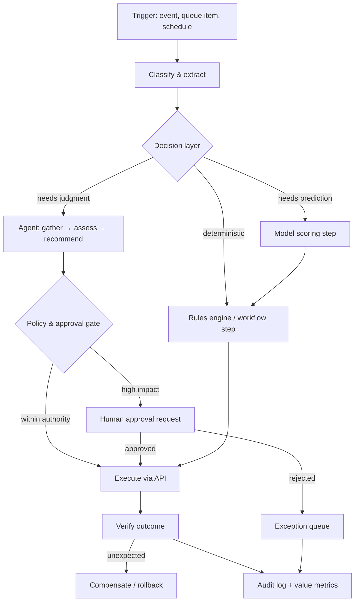

# Use Case — Agentic Process Automation

**Status:** Proposed · **Primary RA:** [Agentic](../reference-architectures/agentic/README.md) + [Intelligent automation](../reference-architectures/intelligent-automation/README.md) · **Lifecycle:** [Agent](../lifecycles/agent-lifecycle.md)

## Problem statement

High-volume operational processes (claims triage, order exceptions, invoice reconciliation, service requests) require human judgment at every step because inputs are unstructured and rules can't cover every case. People spend their time on data gathering, cross-system lookups, and routine decisions, while genuine exceptions wait in the same queue. Rigid RPA breaks whenever a UI or document format changes.

**Outcome wanted:** deterministic workflow for the routine path, AI judgment where rules can't reach, humans reserved for true exceptions and approvals — with every action auditable and reversible.

## Pain points

| Pain | Consequence |
|---|---|
| Manual cross-system data gathering | High handling time; low job satisfaction |
| Rules engines can't cover document/format variety | Work falls to humans by default |
| RPA brittle to UI/format changes | Silent breakage; maintenance treadmill |
| No process-level visibility | Unknown backlog drivers; uninformed automation choices |
| Exceptions indistinguishable from routine | Priority work waits behind noise |
| Automating a broken process | Faster waste; institutionalized inefficiency |
| Shadow automation by teams | Ungoverned credentials and unlogged actions |
| Fear of automation errors stopping rollout | Analysis paralysis instead of bounded, staged adoption |

## Users & stakeholders

| Role | Interest |
|---|---|
| Operations staff | Less toil; clear exception queue |
| Team lead | Throughput, quality, exception handling |
| Process owner | Cycle time and cost per transaction |
| Risk/compliance | Approvals, audit trail, correct authority |
| Engineering | Maintainable integrations; low breakage rate |

## Workflow

**Human decision points:** approval of high-impact actions, exception handling, and periodic review of automation thresholds.

## Tech stack (layers, not products)

| Layer | Choice | Notes |
|---|---|---|
| Orchestration | Durable workflow engine with retries, compensation, exception routing | The process is explicit, not model-driven |
| Decision layer | Rules → ML → agent, cheapest reliable mechanism first | Rules handle the 80% |
| Document/extraction | Document intelligence pipeline | See [document intelligence use case](document-intelligence-pipeline.md) |
| Integrations | APIs first; UI automation only where none exist | Detect UI breakage |
| Agent runtime | Bounded loop, typed tools, registry, sandbox | [Agent patterns](../design-patterns/agent-patterns.md) |
| Approval | External workflow, expiry defaults to deny | [HITL pattern](../design-patterns/human-in-the-loop-approval.md) |
| Audit | Immutable, correlated per instance/step | [Controls](../security/ai-security-controls.md) |
| Value tracking | Per-transaction outcome + cycle-time delta | [Value framework](../docs/business-case-and-value.md) |

## Trade-offs

| Decision | Option A | Option B | Guidance |
|---|---|---|---|
| Automation depth | Automate end-to-end | Assist humans step by step | Start assisted; expand as trust and evaluation evidence grow |
| Decision mechanism | Rules-only (safe, limited) | Agent (flexible, riskier) | Specify judgment tasks explicitly; use rules wherever possible |
| Autonomy | Straight-through processing | Approval for all writes | Tier by impact; approve irreversible actions |
| Integration | API | UI automation | API; UI automation is a liability with no API available |
| Exception handling | Auto-retry forever | Route to humans | Bounded retries, then a human queue with context |
| Rollout | Big-bang per process | Per-step autonomy levels | Per-step, with rollback at each level |
| Platform | Single vendor suite | Composable best-of-breed | Composable behind adapters; avoid platform lock-in ([vendor lifecycle](../lifecycles/vendor-third-party-lifecycle.md)) |

## Success metrics

| Metric | Target direction |
|---|---|
| Straight-through processing rate | ↑ |
| Handling time per transaction | ↓ |
| Exception rate (and its composition) | ↓ routine, stable genuine |
| Accuracy of automated decisions (audited sample) | ↑ |
| Rework / compensation rate | ↓ |
| Automation breakage incidents | ↓ |
| Cost per transaction | ↓ |

## Failure modes & mitigations

| Failure | Mitigation |
|---|---|
| Agent takes an unintended action | Side-effect classification + approval gate + sandbox |
| Silent automation breakage (UI/format change) | Breakage detection + alerting + fallback to manual queue |
| Runaway loop / cost | Step, time, and cost ceilings + kill switch |
| Credential misuse | Per-process least privilege, short-lived, vaulted |
| Automating a bad process | Measure and simplify before automating (Lean/Six Sigma) |
| Exception queue becomes a dumping ground | Queue triage metrics and staffing model |
| Authority creep | Authorization boundary declared, tested, reviewed |

## Related artifacts

[Agent lifecycle](../lifecycles/agent-lifecycle.md) · [Automation patterns](../design-patterns/agent-patterns.md) · [Reliability patterns](../design-patterns/reliability-resilience.md) · [Production issues](../production-issues/agents-and-tools.md)

## Future work

- Simulation environments for agent trajectories before production writes
- Automatic process-discovery from event logs to find the next automation candidate
- Self-healing integrations that detect and adapt to interface changes
- Autonomy regression testing after any model or prompt change
- Cooperative automation where humans and agents share a queue with priority learning
