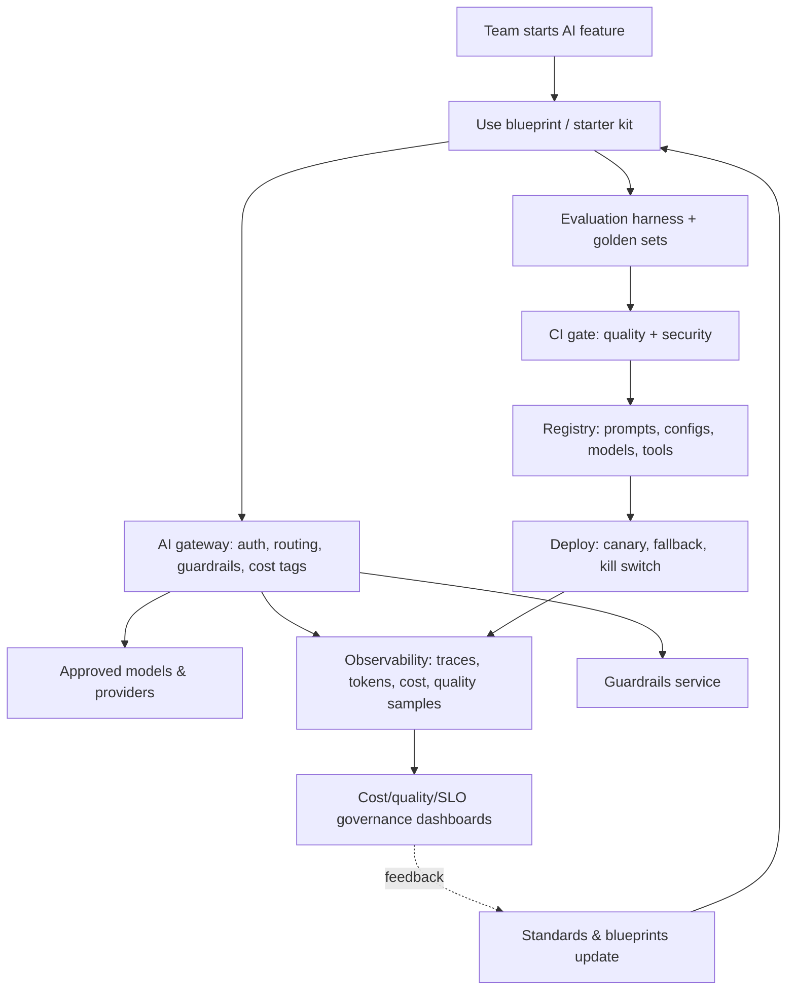

# Use Case — AI Platform Foundation (Enablement Platform)

**Status:** Proposed · **Primary RA:** [Inference](../reference-architectures/inference/README.md) · **Lifecycle:** [Technology](../lifecycles/technology-lifecycle.md), [FinOps](../lifecycles/finops-cost-lifecycle.md), [Enablement](../lifecycles/enablement-adoption-lifecycle.md)

## Problem statement

Every team building AI today provisions its own provider keys, writes its own guardrails, builds its own evaluation harness, and invents its own observability. The result is duplicated spend, inconsistent security posture, no organization-wide cost visibility, incompatible metrics, and slow delivery — while central review becomes a bottleneck because there is no golden path to adopt.

**Outcome wanted:** a shared platform layer — gateway, guardrails, evaluation, observability, registry, blueprints — that makes the compliant path the fast path, so teams self-serve without central review for routine designs.

## Pain points

| Pain | Consequence |
|---|---|
| Provider keys scattered in applications | Leak risk; no revocation; no attribution |
| Guardrails reinvented per team | Inconsistent safety; duplicated effort |
| No shared evaluation harness | Quality claims unverifiable; metrics incomparable |
| Cost per team invisible | Spend surprises; no unit economics |
| Every integration a bespoke design | Central review bottleneck; slow delivery |
| Fragmented observability | Cross-workload incidents hard to diagnose |
| Standards disconnected from practice | Exceptions become the norm |

## Users & stakeholders

| Role | Interest |
|---|---|
| Product teams / AI engineers | Self-service golden path; fast delivery |
| Central architecture | Standards applied without reviewing everything |
| Security | One policy surface; consistent controls |
| Finance | Attribution and forecastable spend |
| Platform/SRE | Operability, capacity, cost control |

## Workflow

**Human decision points:** approval for new providers/models/tool classes; standards changes; capacity and budget governance.

## Tech stack (layers, not products)

| Layer | Capability | Notes |
|---|---|---|
| Access | Gateway with workload identity, rate limits, routing, failover | Single egress path ([pattern](../design-patterns/llm-gateway.md)) |
| Safety | Guardrails as a service, versioned policy | Fail-closed ([controls](../security/ai-security-controls.md)) |
| Quality | Shared evaluation harness, golden/adversarial sets, judge calibration | [Evaluation lifecycle](../lifecycles/evaluation-lifecycle.md) |
| Delivery | Blueprints + CI templates wiring gateway, guardrails, evals | [Blueprints](../blueprints/README.md) |
| Registry | Prompts, model configs, tool contracts, evaluation results | Config-as-code |
| Observability | End-to-end traces, cost attribution, quality sampling | Stage-decomposed |
| Governance | Cost/quality/SLO dashboards, policy-as-code checks | [FinOps](../lifecycles/finops-cost-lifecycle.md) |
| Enablement | Docs, office hours, review clinics, community | [Enablement lifecycle](../lifecycles/enablement-adoption-lifecycle.md) |

## Trade-offs

| Decision | Option A | Option B | Guidance |
|---|---|---|---|
| Centralized gateway | One shared path | Per-team integration | Shared; the policy/attribution benefits outweigh the bottleneck risk |
| Guardrails | Platform service | Library in each app | Platform service with a library for local checks |
| Evaluation | Shared harness | Team-owned harnesses | Shared harness, team-owned datasets |
| Standards | Strict central list | Open choice | Approved list + evidence-based exception path |
| Platform scope | Thin (gateway + evals) | Full ML platform build-out | Start thin; expand from real friction, not speculation |
| Build vs buy | Buy managed components | Build in-house | Buy commodity layers; build the integration, policy, and governance layer |
| Enablement | Documentation only | Pairing + clinics + blueprints | Combination; docs alone don't change behavior |

## Success metrics

| Metric | Target direction |
|---|---|
| Time for a new AI feature to reach production | ↓ |
| Central review requests for routine designs | ↓ (delegation working) |
| Workloads using the gateway / guardrails / shared evals | ↑ |
| Cost attribution coverage | 100% of model calls |
| Security control gaps found in review | ↓ |
| Cross-team reuse (blueprints, patterns) | ↑ |
| Platform cost per workload served | Within envelope |

## Failure modes & mitigations

| Failure | Mitigation |
|---|---|
| Platform becomes a bottleneck | Thin core; delegate reviews; publish checklists |
| Teams bypass the platform | Make the approved path faster and better-supported than the alternative |
| Guardrail false positives drive workarounds | Tune with measured precision; provide an exceptions process with review |
| Cost controls block legitimate work | Budgets with escalation paths, not hard walls |
| Blueprints rot vs standards | Update blueprints in the same PR as the standard |
| Metrics incomparable across teams | Shared harness and metric definitions |
| Platform built for imagined needs | Build from observed friction ([product lifecycle](../lifecycles/product-lifecycle.md)) |

## Related artifacts

[Standards](../standards/README.md) · [Blueprints](../blueprints/README.md) · [Enablement lifecycle](../lifecycles/enablement-adoption-lifecycle.md) · [Production issues](../production-issues/README.md)

## Future work

- Internal catalog of reusable AI capabilities with quality ratings
- Automated conformance checks in CI from policy-as-code
- Self-service provider/model onboarding with automated evaluation
- Cross-workload evaluation benchmarking for model selection
- Platform SLAs published to consuming teams
